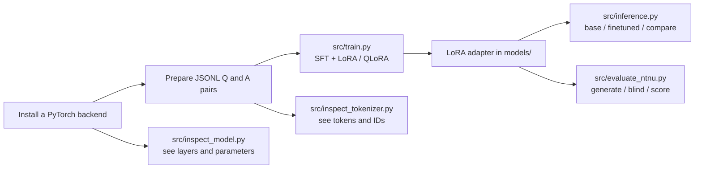
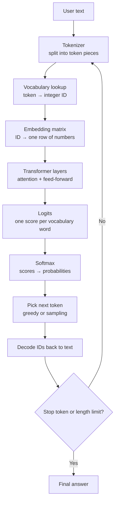
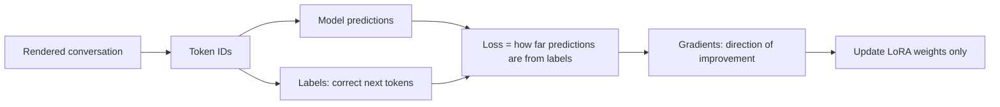
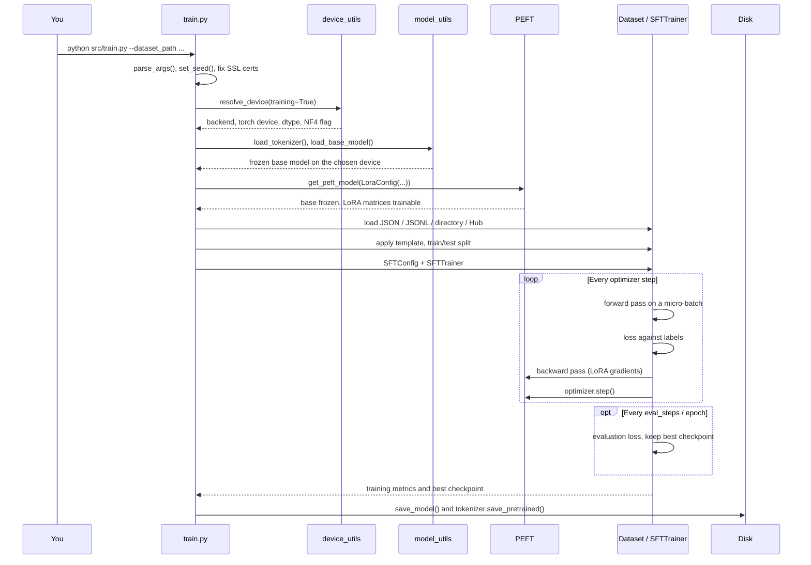
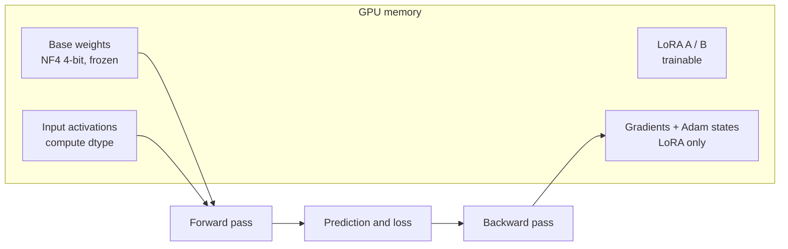
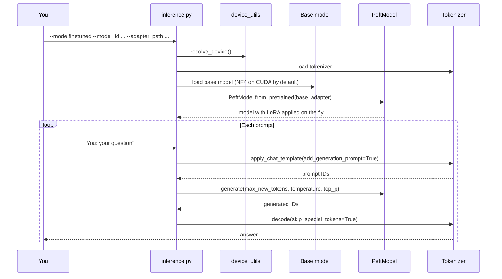
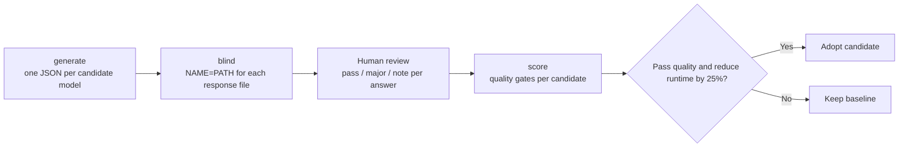
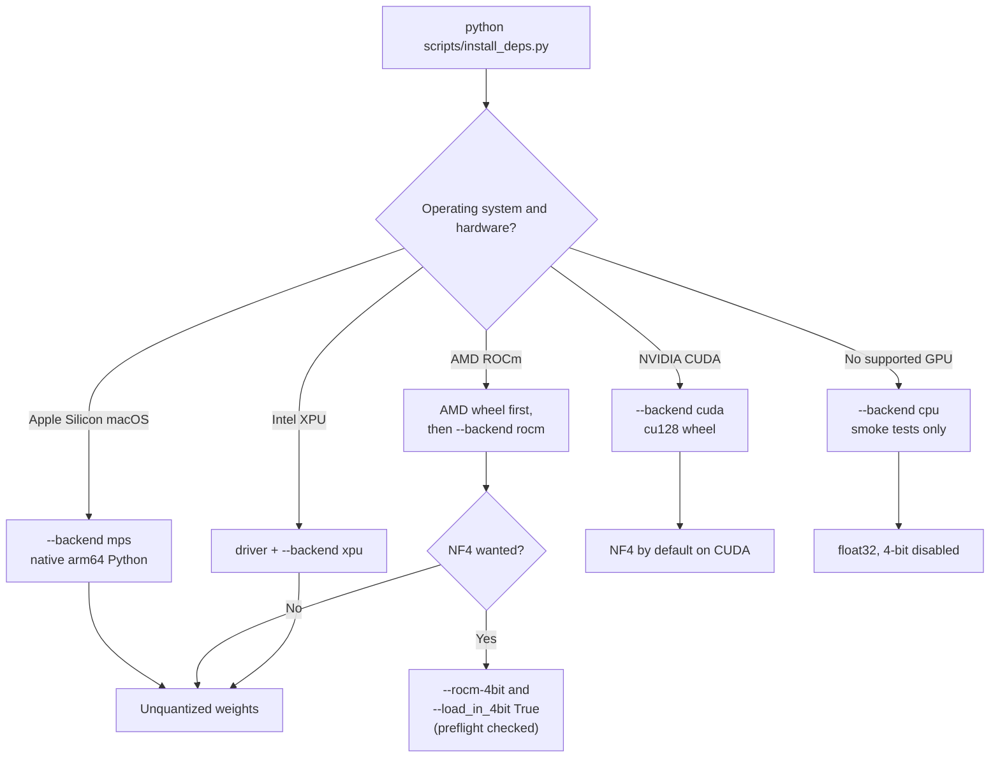
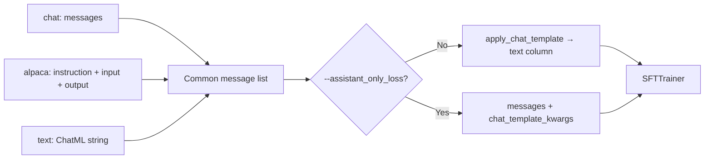

# Fine-Tuning Playground

A teaching-oriented codebase for supervised fine-tuning (SFT) of **Qwen3 / Qwen3.5**
decoder-only models (for example **Qwen3-4B** and **Qwen3.5-4B**) with **LoRA / QLoRA**.
It is built on Hugging Face `transformers`, `peft`, `trl`, and `bitsandbytes`.

The whole training pipeline lives in one top-to-bottom script, [`src/train.py`](src/train.py).
Every setting is a CLI flag. There is no config file to learn and no framework to
subclass: you can read the file from line 1 to the end and see exactly what happens.

**Language:** [English](README.md) · [繁體中文](README.zh-Hant.md)

---

## Table of Contents

- [Overview](#overview)
- [Start Here: How Fine-Tuning Actually Works](#start-here-how-fine-tuning-actually-works)
  - [The 30-second mental model](#the-30-second-mental-model)
  - [From a sentence to the next word](#from-a-sentence-to-the-next-word)
  - [What the chat template is doing](#what-the-chat-template-is-doing)
  - [What SFT teaches, and what the loss hides](#what-sft-teaches-and-what-the-loss-hides)
  - [The training pipeline, step by step](#the-training-pipeline-step-by-step)
  - [Why LoRA and QLoRA fit on a consumer GPU](#why-lora-and-qlora-fit-on-a-consumer-gpu)
  - [Epochs, batches, learning rate, and friends](#epochs-batches-learning-rate-and-friends)
  - [What happens at inference time](#what-happens-at-inference-time)
  - [How the NTNU evaluation works](#how-the-ntnu-evaluation-works)
  - [Choosing a compute backend](#choosing-a-compute-backend)
- [Features](#features)
- [Hardware Requirements](#hardware-requirements)
- [Installation](#installation)
  - [Option 1 — Miniconda (Recommended)](#option-1--miniconda-recommended)
  - [Option 2 — venv](#option-2--venv)
  - [Install and verify a backend](#install-and-verify-a-backend)
- [Quick Start](#quick-start)
  - [Cross-platform smoke test](#cross-platform-smoke-test)
  - [NVIDIA 4B preset](#nvidia-4b-preset)
- [Project Structure](#project-structure)
  - [File Descriptions](#file-descriptions)
- [Configuration](#configuration)
  - [Training (`src/train.py`)](#training-srctrainpy)
  - [Inference (`src/inference.py`)](#inference-srcinferencepy)
  - [Model inspection (`src/inspect_model.py`)](#model-inspection-srcinspect_modelpy)
  - [Tokenizer inspection (`src/inspect_tokenizer.py`)](#tokenizer-inspection-srcinspect_tokenizerpy)
  - [NTNU evaluation (`src/evaluate_ntnu.py`)](#ntnu-evaluation-srcevaluate_ntnupy)
- [Recommended Training Presets](#recommended-training-presets)
  - [Platform & OS](#platform--os)
  - [VRAM and Model Size (QLoRA)](#vram-and-model-size-qlora)
  - [Dataset Size Guidelines](#dataset-size-guidelines)
  - [Named Presets](#named-presets)
  - [Preset Scripts](#preset-scripts)
  - [Native Windows NTNU Benchmark](#native-windows-ntnu-benchmark)
  - [Manual Commands by Preset](#manual-commands-by-preset)
- [Data Formats](#data-formats)
  - [ChatML Format](#chatml-format)
  - [Alpaca Format](#alpaca-format)
  - [Text Format](#text-format)
- [Usage](#usage)
  - [Basic Training](#basic-training)
  - [Training with Alpaca Dataset](#training-with-alpaca-dataset)
  - [Training from Hugging Face Hub](#training-from-hugging-face-hub)
  - [Inference — Interactive (Default)](#inference--interactive-default)
  - [Inference — One-Shot (`--no_interactive`)](#inference--one-shot---no_interactive)
  - [Inference with Thinking Mode](#inference-with-thinking-mode)
  - [Inspecting a Model](#inspecting-a-model)
  - [Inspecting the Tokenizer](#inspecting-the-tokenizer)
- [Advanced Usage](#advanced-usage)
  - [Custom LoRA Target Modules](#custom-lora-target-modules)
  - [Push to Hugging Face Hub](#push-to-hugging-face-hub)
  - [Full-Precision LoRA vs QLoRA](#full-precision-lora-vs-qlora)
  - [Enable Thinking Mode During Training](#enable-thinking-mode-during-training)
  - [Measure Speed and Memory](#measure-speed-and-memory)
- [Output Artifacts](#output-artifacts)
- [Tips & Best Practices](#tips--best-practices)
- [Troubleshooting](#troubleshooting)
- [License](#license)

---

## Overview

**Qwen3** and **Qwen3.5** are dense language models from Alibaba's Qwen team. The 4B
variants support long context, grouped-query attention, and an optional chain-of-thought
**thinking mode** through `<think>` tags in the chat template.

This repository gives you one complete, readable path from "I have a JSONL file" to
"I have an adapter that changes how the model answers":



Core choices made by the code:

- **QLoRA** (4-bit NormalFloat with double quantization) is the default on NVIDIA CUDA.
  It lowers the base-model memory enough for consumer GPUs such as an RTX 3060 / 4060 / 4070.
- **`trl.SFTTrainer`** handles supervised fine-tuning, chat-template rendering,
  evaluation, checkpointing, and best-checkpoint selection.
- **All seven linear projection layers** (`q_proj`, `k_proj`, `v_proj`, `o_proj`,
  `gate_proj`, `up_proj`, `down_proj`) are LoRA targets by default.
- The base model is **frozen**. Training updates only the small LoRA matrices; the
  exported adapter is a few tens of megabytes rather than a full multi-gigabyte model.

---

## Start Here: How Fine-Tuning Actually Works

This section assumes no machine-learning background. Later sections are the reference
manual; this section is the explanation of *why* the commands look the way they do.

### The 30-second mental model

| Everyday analogy | Thing in this repository |
|---|---|
| A student who already read every book in the library | The pretrained Qwen model (`Qwen/Qwen3.5-4B`, etc.) |
| A workbook of example questions and ideal answers | Your JSONL file (`messages` / `instruction` / `text`) |
| Sticky notes written in the margins, leaving the books untouched | The LoRA adapter (`adapter_model.safetensors`) |
| Photo-copied, tiny-print books that still can be read | 4-bit NF4 base weights (QLoRA) |
| A teacher marking "wrong, move slightly this way" | Loss and gradients |
| Rehearsing the questions the teacher has not seen | The held-out eval split and the NTNU question set |

Fine-tuning does **not** teach the model facts from scratch the way pretraining did. It
nudges an already-capable model toward the style, format, and domain behaviour that your
examples demonstrate. That is why a few hundred to a few thousand good examples can be
useful, and why noisy examples reliably hurt.

### From a sentence to the next word

A language model never sees Chinese characters or English letters directly. It sees
integers, then vectors, then probabilities.



What to take away:

- **Token** — a piece of text. It may be a whole Chinese word, one character, or part of
  an English word. Run `src/inspect_tokenizer.py` to see the exact pieces for your sentence.
- **ID** — the index of that piece in a fixed vocabulary. The embedding table has one
  row per ID; `src/inspect_tokenizer.py --token_id 120573` prints that row.
- **Embedding** — the numeric "meaning coordinates" the model actually consumes.
- **Logits → probability** — the model outputs a score for *every* possible next token.
  `--temperature` and `--top_p` decide how adventurous the choice is. `temperature 0`
  makes generation greedy and deterministic (the evaluation script uses this).
- **Autoregressive loop** — the chosen token is appended to the input and the model runs
  again. `--max_new_tokens` caps how many times this happens.
- **Context length** — `--max_seq_length` (training) and the model's context window set
  how many tokens can be considered at once. Longer sequences use more memory; if you hit
  OOM, lower the length before changing anything else.

### What the chat template is doing

A model cannot infer who is speaking from a plain concatenation of strings. Qwen uses a
ChatML-style template with explicit control tokens:

```text
<|im_start|>system
You are a helpful assistant.<|im_end|>
<|im_start|>user
台灣師範大學的地址是什麼？<|im_end|>
<|im_start|>assistant
國立臺灣師範大學位於臺北市大安區和平東路一段 162 號。<|im_end|>
```

During training, `train.py` calls `tokenizer.apply_chat_template(..., tokenize=False,
add_generation_prompt=False)` and stores the resulting string in a `text` column. The
model therefore learns the delimiters, not just the words. During inference,
`inference.py` uses `add_generation_prompt=True`, which ends the prompt with
`<|im_start|>assistant\n` so the next token starts the answer.

This is also the reason the base model ID must match between training and inference: the
template and the vocabulary belong to that specific tokenizer.

### What SFT teaches, and what the loss hides

Training compares the model's probability distribution with the correct next token at
each position and adjusts the trainable weights to increase that probability. This is
cross-entropy (also called NLL) loss.



By default this project supervises the **whole rendered `text`**. If you pass
`--assistant_only_loss`, TRL instead receives the `messages` column and masks the
system/user parts, so the loss comes only from assistant turns and their end-of-turn
token. The script validates every row and refuses truncated assistant targets. This flag
requires `--dataset_format chat`.

### The training pipeline, step by step

Read [`src/train.py`](src/train.py) alongside this diagram; the message order matches the
`main()` function.



Details worth knowing:

- The dataset is loaded **after** the model and adapter are ready.
- `--benchmark_steps N>0` stops after `warmup + N` optimizer steps, prints timing and
  throughput, and deliberately writes **no adapter**.
- With a positive eval split, `load_best_model_at_end=True` reloads the lowest-eval-loss
  checkpoint before exporting, so the final directory contains the best model rather than
  necessarily the last one.
- `save_total_limit=2` keeps only the two most recent checkpoints on disk.

### Why LoRA and QLoRA fit on a consumer GPU

A 4B model in BF16 is roughly 8 GB of weights before you add activations, gradients, and
optimizer states. Full fine-tuning needs several times that. LoRA keeps the base weights
frozen and learns two small matrices beside each targeted linear layer:

```text
original:   y = W x                 W: big, frozen
LoRA:       y = W x + (alpha / r) * B A x
            A: r x in_features      B: out_features x r      (both trainable)
```



- `r` (`--lora_r`) is the rank, i.e. the width of the little bottleneck. Larger `r` can
  represent more complex changes but uses more memory.
- `alpha` (`--lora_alpha`) scales the LoRA update. The presets use `alpha = 2 * r`.
- `target_modules` selects *where* the adapters go. The default covers attention and
  feed-forward projections. Attention-only (`q_proj,k_proj,v_proj,o_proj`) is the first
  thing to try when memory is tight.
- QLoRA additionally stores the frozen base in 4-bit NF4 with double quantization and
  performs math in `bfloat16`/`float16`. Gradients and optimizer states exist only for
  LoRA parameters, which is the large saving.
- `--gradient_checkpointing` (on by default) recomputes intermediate activations during
  the backward pass, trading some speed for lower peak memory.

### Epochs, batches, learning rate, and friends

| Term | Plain-language meaning | Flag in this repo |
|---|---|---|
| Example | One Q&A record in your JSONL | `dataset_path` |
| Token | A text fragment after tokenization | `max_seq_length` |
| Batch | Examples processed together in one forward pass | `per_device_batch_size` |
| Accumulation | Accumulate several small batches before one weight update | `gradient_accum_steps` |
| Effective batch | `per_device_batch_size × gradient_accum_steps × number of GPUs` | derived |
| Epoch | One full pass over the training split | `num_epochs` / `--epochs` |
| Learning rate | Size of each weight update | `learning_rate` / `--lr` |
| Warmup | Small initial phase where the learning rate ramps up | `warmup_ratio` |
| Seed | Makes splitting and initialization repeatable | `seed` |
| Eval split | Examples hidden from training and used to pick the best checkpoint | `test_split` |

Worked example with the bundled NTNU data and `gpu-12gb-4b`:

- 1,252 records, 5% held out → about 1,189 training examples.
- `per_device_batch_size 2 × gradient_accum_steps 8` → effective batch 16.
- About 75 optimizer steps per epoch; three epochs → about **225 steps**, which is why
  you will see a `checkpoint-225/` in the shipped example output directories.
- `--save_steps 200` therefore writes intermediate checkpoints during the run.

> **Implementation note:** `--warmup_ratio` is passed to `SFTConfig` as the numeric
> `warmup_steps` argument in this version of `train.py` (default `0.03`). Treat it as a
> small fixed warmup value rather than relying on it to mean "3% of all steps".

### What happens at inference time

Inference never modifies weights. It loads the same base model, attaches the saved
adapter, and repeatedly runs the token loop shown earlier.



`--mode compare` loads the base once and the adapter on top of it, then prints both
answers for each prompt. This makes "did fine-tuning help?" visible without a second
process.

If `--adapter_path` is a directory without `adapter_config.json`, the script looks for
`checkpoint-*` subdirectories and picks the highest numbered one that contains an adapter.

### How the NTNU evaluation works

Training loss tells you how well the model fits your training examples; it does **not**
tell you whether answers are factually correct. [`src/evaluate_ntnu.py`](src/evaluate_ntnu.py)
implements a small offline, human-graded benchmark for that purpose.

`evaluation/ntnu_qa.jsonl` contains exactly **60** frozen questions:

| Category | Count | What it tests |
|---|---|---|
| `fact` | 40 | Factual answers; each case has an official NTNU source URL and explicit criteria |
| `uncertain` | 10 | Under-specified questions where the model should ask for details and refuse to invent them |
| `general` | 10 | Formatting and instruction-following constraints |

Keep these prompts out of training. Reusing them would turn a held-out test into a
memorization check.



- `generate` uses greedy decoding (`do_sample=False`), batching, and resumable output:
  a matching output file continues from the answers already present. It requires a LoRA
  adapter; there is no base-only mode.
- A run is bound to the model, adapter weight hash, cases hash, generation settings,
  backend, dtype, and quantization flag. Switching any of these requires a fresh output
  path.
- `blind` uses a fixed seed to shuffle answer order independently for every question and
  writes the mapping to a **separate key file** so the reviewer cannot identify models.
- `score` marks a candidate `passes_quality` only when it has at least `max(34, both
  baselines)` fact passes, at least 8 uncertain passes, at least `max(baselines) - 1`
  general passes, and zero major fabrications. Baselines themselves are not gated.

### Choosing a compute backend

All model commands accept `--device auto|gpu|cuda|rocm|mps|xpu|cpu`.



- `auto` tries CUDA, ROCm, MPS, XPU, then CPU. `gpu` uses the same search order but fails
  if no accelerator is present. An explicit backend must be available.
- MPS and XPU reject `--load_in_4bit True`; CPU prints a note and silently uses
  unquantized `float32`.
- ROCm NF4 is opt-in and runs a small forward/backward preflight before loading the
  large model. A failure gives an actionable fallback: `--load_in_4bit False`.

---

## Features

- **QLoRA / LoRA support** — 4-bit NF4 on NVIDIA CUDA and compatible AMD ROCm setups, or
  unquantized weights on any supported backend.
- **Multiple data formats** — ChatML (native), Alpaca (`instruction` / `input` / `output`),
  and flat text. All are converted to chat messages internally.
- **Hugging Face Hub integration** — load datasets directly from the Hub and push trained
  adapters back.
- **Thinking mode** — optionally enable Qwen3's `<think>` reasoning tags during training
  and inference.
- **CLI-first design** — every hyperparameter is a command-line flag; no YAML needed.
- **Multiple compute backends** — NVIDIA CUDA, AMD ROCm, Apple Metal (MPS), Intel XPU,
  and a float32 CPU fallback.
- **Single-file training script** — `src/train.py` runs the full SFT pipeline in order,
  which makes it suitable for teaching and line-by-line reading.
- **Model inspection** — `src/inspect_model.py` reports parameter counts, vocabulary size,
  embedding dimensions, and layer layout without needing a dataset.
- **Tokenizer inspection** — `src/inspect_tokenizer.py` shows token pieces, IDs, and the
  corresponding embedding rows.
- **Pre / post fine-tuning comparison** — test the base model first, then compare it
  side by side with the fine-tuned model.
- **Interactive inference** — the model stays loaded and prompts are read in a loop by
  default; `--no_interactive` runs a single prompt and exits.
- **Evaluation split** — automatic train/test split with best-model selection by eval loss.
- **Gradient checkpointing** — enabled by default to reduce peak memory.
- **Offline quality benchmark** — deterministic generation, blinded human review, and
  explicit quality gates for the bundled NTNU question set.

---

## Hardware Requirements

| Configuration | Minimum VRAM | Typical GPU |
|---|---|---|
| QLoRA 4B (4-bit, batch size 1–2) | ~6–8 GB | RTX 3060 / 4060 / 4070, T4 |
| QLoRA 9B (4-bit, batch size 1) | ~10–12 GB | RTX 4070 Ti / 5070 Ti (laptop), 3080 12 GB |
| QLoRA 9B (4-bit, batch size 2) | ~20–24 GB | RTX 4090 / 3090 24 GB, A5000 |
| LoRA 4B (unquantized, batch size 1) | ~12 GB | RTX 3080 / 4070 Ti / 4080, A10 |
| CPU (unquantized, float32) | — | Any CPU, very slow; smoke tests only |

These VRAM figures are NVIDIA examples. On Apple Silicon, weights, activations, and the
OS share unified memory. Start with Qwen3.5-0.8B when checking a new machine.

Training, inference, both inspection tools, and NTNU evaluation accept
`--device auto|gpu|cuda|rocm|mps|xpu|cpu`. Auto-detection tries CUDA, ROCm, MPS, XPU,
then CPU; `gpu` requires an available GPU and uses the same order. An explicit backend
must be available.

Training and inference default to NF4 on NVIDIA CUDA. ROCm defaults to unquantized
weights and accepts `--load_in_4bit True` only after its kernel preflight passes. MPS and
XPU use unquantized weights. CPU uses unquantized `float32`. Both inspection tools default
to unquantized weights on every backend.

---

## Installation

Use **Python 3.11 or 3.12** with a compatible PyTorch wheel. For ROCm, use the Python
version required by your AMD release. Create a fresh environment for each PyTorch backend.

### Option 1 — Miniconda (Recommended)

```bash
git clone https://github.com/cw1997/fine-tuning-playground.git
cd fine-tuning-playground

conda create -n finetune python=3.11 -y
conda activate finetune

# Install the platform default, or choose a backend below
python scripts/install_deps.py
```

### Option 2 — venv

```bash
git clone https://github.com/cw1997/fine-tuning-playground.git
cd fine-tuning-playground

python -m venv venv
source venv/bin/activate        # Linux / macOS
# venv\Scripts\activate         # Windows PowerShell

python scripts/install_deps.py
```

### Install and verify a backend

`install_deps.py` selects a PyTorch wheel, runs a small tensor computation, and prints
the active backend and PyTorch version. Its default is MPS on Apple Silicon macOS, CPU on
Intel macOS, and CUDA on Windows and Linux. The Bash wrapper forwards the Python flags;
the PowerShell wrapper uses `-Backend` and `-Rocm4Bit`.

| Backend | Install in the active environment | Verify model tooling |
|---|---|---|
| NVIDIA CUDA (Linux / Windows) | `python scripts/install_deps.py --backend cuda` | `python src/inspect_model.py --device cuda --no_load` |
| AMD ROCm (Linux / WSL2 / Windows) | Install the AMD PyTorch wheel, then `python scripts/install_deps.py --backend rocm` | `python src/inspect_model.py --device rocm --no_load` |
| Apple M series (macOS) | `bash scripts/install_deps.sh --backend mps` with native arm64 Python | `python src/inspect_model.py --device mps --no_load` |
| Intel XPU (Linux / Windows) | `python scripts/install_deps.py --backend xpu` after installing the GPU driver | `python src/inspect_model.py --device xpu --no_load` |
| CPU | `python scripts/install_deps.py --backend cpu` | `python src/inspect_model.py --device cpu --no_load` |

For ROCm, match the driver, GPU, and PyTorch wheel before running the installer. For
AMD NF4, run `python scripts/install_deps.py --backend rocm --rocm-4bit` or
`powershell -File scripts/install_deps.ps1 -Backend rocm -Rocm4Bit`, using a
bitsandbytes build that matches your GPU and ROCm release.

`python -m pip install -r requirements.txt` remains available for a direct NVIDIA CUDA
installation. For other backends, the installer uses `requirements-common.txt` after
selecting or verifying PyTorch.

References: [AMD Linux](https://rocm.docs.amd.com/projects/radeon-ryzen/en/latest/docs/install/installrad/native_linux/install-pytorch.html) ·
[AMD WSL2](https://rocm.docs.amd.com/projects/radeon-ryzen/en/latest/docs/compatibility/compatibilityrad/wsl/wsl_compatibility.html) ·
[AMD Windows](https://rocm.docs.amd.com/projects/radeon-ryzen/en/latest/docs/install/installryz/windows/install-pytorch.html) ·
[Intel XPU](https://docs.pytorch.org/docs/stable/notes/get_start_xpu.html) ·
[bitsandbytes ROCm](https://huggingface.co/docs/bitsandbytes/installation#amd-rocm)

Core packages:

| Package | Constraint in requirements | Purpose |
|---|---|---|
| `torch` | `>=2.4.0,<2.12` | Deep learning framework (cu128 wheel via `requirements.txt`) |
| `transformers` | `>=5.12.1` | Qwen model loading, tokenization, and training |
| `peft` | `>=0.13.0` | LoRA / QLoRA adapter configuration |
| `trl` | `>=1.6.0` | `SFTTrainer` with assistant labels and chunked loss |
| `accelerate` | `>=1.13.0` | Trainer placement and mixed precision |
| `bitsandbytes` | CUDA `>=0.46.1`, ROCm `>=0.50.0` | Optional 4-bit NF4 quantization |
| `datasets` | `>=3.0.0` | Dataset loading and processing |
| `packaging` | `>=21.0` | PyTorch version checks |

Run the hardware-independent regression tests with:

```bash
python -m unittest discover -s tests -v
```

---

## Quick Start

### Cross-platform smoke test

After installing a backend, run one training step on Qwen3.5-0.8B and reload the adapter.
Replace `gpu` with `mps`, `rocm`, `xpu`, `cuda`, or `cpu` to select the backend explicitly.
On a compatible AMD GPU, add `--load_in_4bit True` to both Python commands to exercise NF4.

```bash
python -c "from pathlib import Path; p=Path('models/backend-smoke'); p.mkdir(parents=True, exist_ok=True); (p/'train.jsonl').write_bytes(Path('data/ntnu_dataset.jsonl').read_bytes().splitlines(keepends=True)[0])"

python src/train.py --device gpu --dataset_path ./models/backend-smoke/train.jsonl \
  --num_epochs 1 --test_split 0 --max_seq_length 64 --per_device_batch_size 1 \
  --gradient_accum_steps 1 --output_dir ./models/backend-smoke/adapter

python src/inference.py --device gpu --mode finetuned \
  --adapter_path ./models/backend-smoke/adapter \
  --prompt "What does a tokenizer do?" --max_new_tokens 32 --no_interactive
```

### NVIDIA 4B preset

Set up a CUDA environment and train on the complete bundled dataset:

```bash
# 1. Clone and enter the repo
git clone https://github.com/cw1997/fine-tuning-playground.git
cd fine-tuning-playground

# 2. Create and activate an environment (or venv — see Installation)
conda create -n finetune python=3.11 -y
conda activate finetune

# 3. Install and verify CUDA
python scripts/install_deps.py --backend cuda

# 4. Train on the bundled NTNU dataset (1,252 ChatML examples)
bash scripts/train_preset.sh gpu-12gb-4b
# Equivalent manual command:
# python src/train.py --model_id Qwen/Qwen3.5-4B --dataset_path ./data/ntnu_dataset.jsonl \
#   --output_dir ./models/ntnu/gpu-12gb-4b

# 5. Base model before fine-tuning
python src/inference.py --mode base --model_id Qwen/Qwen3.5-4B \
  --prompt "台灣師範大學的地址是什麼" --no_interactive

# 6. Fine-tuned model after training
python src/inference.py --mode finetuned --model_id Qwen/Qwen3.5-4B \
  --adapter_path ./models/ntnu/gpu-12gb-4b \
  --prompt "台灣師範大學的地址是什麼" --no_interactive

# 7. Interactive chat (type quit / exit / q to stop)
python src/inference.py --mode finetuned --model_id Qwen/Qwen3.5-4B \
  --adapter_path ./models/ntnu/gpu-12gb-4b
```

---

## Project Structure

```text
fine-tuning-playground/
├── requirements.txt                    # NVIDIA cu128 installation entry point
├── requirements-common.txt             # Shared Python dependencies
├── src/
│   ├── train.py                        # Full SFT pipeline (single file, top-to-bottom)
│   ├── inference.py                    # base / finetuned / compare + interactive loop
│   ├── evaluate_ntnu.py                # Greedy generation, blinding, quality scoring
│   ├── device_utils.py                 # Backend selection, dtype, ROCm NF4 validation
│   ├── model_utils.py                  # Shared tokenizer and model loading helpers
│   ├── inspect_model.py                # Model internals report
│   └── inspect_tokenizer.py            # Token pieces, IDs, and embedding vectors
├── data/
│   ├── ntnu_dataset.jsonl              # Bundled NTNU ChatML dataset (1,252 records)
│   ├── full_dataset.jsonl              # Aggregated NTNU + Taiwan dataset (1,746 records)
│   ├── generate_ntnu_dataset.py        # Aggregates ntnu/ + taiwan/ into full_dataset.jsonl
│   ├── restructure_dataset.py          # Writes data/splits/ and data/generated/
│   ├── ntnu/                           # Curated NTNU JSONL files (general, extras)
│   ├── taiwan/                         # Curated Taiwan JSONL files (7 categories)
│   └── _archive/                       # Legacy record generator modules
├── evaluation/ntnu_qa.jsonl            # 60 held-out prompts, criteria, and sources
├── models/                             # Adapters and benchmark data (gitignored)
├── scripts/
│   ├── install_deps.py                 # Backend-aware installer and device probe
│   ├── install_deps.sh                 # Bash wrapper for the installer
│   ├── install_deps.ps1                # PowerShell wrapper for the installer
│   ├── train_preset.sh                 # Bash training presets
│   └── train_preset.ps1                # PowerShell presets + Windows NTNU benchmarks
├── tests/test_device_utils.py          # Backend selection and quantization tests
├── README.md                           # This file (English)
└── README.zh-Hant.md                   # Traditional Chinese documentation
```

### File Descriptions

**`src/train.py`** — the complete SFT pipeline in one file: SSL fix → parse CLI args →
select device → load tokenizer → load base model (optionally 4-bit) → apply LoRA → load and
format data → configure `SFTTrainer` → train → save the adapter. All hyperparameters are
CLI flags.

**`src/inference.py`** — standalone inference in `base`, `finetuned`, or `compare` mode.
With no `--prompt` it goes straight to the interactive loop (`You:`; type `quit`, `exit`,
or `q`, or press Ctrl+C to stop). With `--prompt` it answers once and then, unless
`--no_interactive` is given, continues into the same loop.

**`src/evaluate_ntnu.py`** — three subcommands. `generate` writes deterministic answers
for one model and adapter; `blind` shuffles answers from named runs and stores the key
separately; `score` applies the quality gates to a completed review.

**`src/device_utils.py`** — resolves backend, device, dtype, and NF4 policy. It also runs
the ROCm NF4 preflight. **`src/model_utils.py`** holds the shared tokenizer/model loading
code, the default model ID (`Qwen/Qwen3.5-0.8B`), and the SSL certificate repair.

**`src/inspect_model.py`** — prints a standardized report: model configuration
(vocabulary, hidden size, layers, heads, KV heads, head dimension, FFN size, context,
activation, RoPE theta, tied embeddings), tokenizer metadata, and — unless `--no_load`
is set — parameter counts, embedding shape and memory estimate, dtypes, and placement.

**`src/inspect_tokenizer.py`** — shows how a sentence splits into tokens, each token's ID,
and its embedding vector from the input embedding layer. It can also look up one token by
string (`--token`) or by ID (`--token_id`). Byte-level display is humanized (GPT-style
`Ġ` space prefixes become spaces). At least one of `--sentence`, `--token`, or
`--token_id` is required.

**`data/`** — `ntnu_dataset.jsonl` contains 1,252 ChatML records about National Taiwan
Normal University. `full_dataset.jsonl` contains 1,746 records after aggregating the
curated `ntnu/` and `taiwan/` subdirectories. `restructure_dataset.py` classifies records
from `ntnu_dataset.jsonl` into `data/splits/` and generates Taiwan university and district
questions into `data/generated/`; `generate_ntnu_dataset.py` then aggregates the curated
subdirectories into `full_dataset.jsonl`. `_archive/` keeps older generator modules for
reference.

**`scripts/train_preset.sh` / `scripts/train_preset.ps1`** — named presets for common GPU
tiers. The PowerShell script additionally defines four native Windows NTNU comparison
presets. Override the dataset with `DATASET_PATH=...` (Bash) or `$env:DATASET_PATH = ...`
(PowerShell).

**`tests/test_device_utils.py`** — simulates hardware to verify backend selection and
quantization rules; run it with `python -m unittest discover -s tests -v`.

---

## Configuration

### Training (`src/train.py`)

| Category | Parameter | Default | Description |
|---|---|---|---|
| **Model** | `--model_id` | `Qwen/Qwen3.5-0.8B` | Hugging Face model ID; use `Qwen/Qwen3.5-4B` or `Qwen/Qwen3-4B` for real GPU training |
| | `--load_in_4bit` | On for CUDA | `True` / `False`; NF4 QLoRA. Opt in on compatible ROCm; rejected on MPS/XPU; ignored on CPU |
| | `--torch_dtype` | `bfloat16` | `bfloat16`, `float16`, or `float32`; capability checks may choose a different effective dtype |
| **LoRA** | `--lora_r` | `16` | LoRA rank |
| | `--lora_alpha` | `32` | LoRA scaling factor, typically `2 × r` |
| | `--lora_dropout` | `0.05` | Dropout inside LoRA layers |
| | `--target_modules` | `q_proj,k_proj,v_proj,o_proj,gate_proj,up_proj,down_proj` | Comma-separated module names |
| **Data** | `--dataset_path` | _(required)_ | Local JSON/JSONL file, directory scanned recursively for `*.jsonl`, or a Hub dataset name. Any path that does not exist locally is passed to `load_dataset()` |
| | `--dataset_format` | `chat` | `chat`, `alpaca`, or `text` |
| | `--test_split` | `0.05` | Validation fraction in `[0, 1)`; `0` disables evaluation |
| | `--seed` | `42` | Splitting, initialization, and sampling seed |
| | `--max_seq_length` | `4096` | Maximum token length per example |
| | `--use_thinking` | `False` | Pass `enable_thinking` to the chat template |
| **Optimization** | `--learning_rate`, `--lr` | `2e-4` | Peak learning rate |
| | `--num_epochs`, `--epochs` | `3` | Training epochs |
| | `--per_device_batch_size`, `--batch_size` | `2` | Micro-batch per device |
| | `--gradient_accum_steps` | `8` | Micro-batches per optimizer step |
| | `--gradient_checkpointing` | `True` | Recompute activations to save memory |
| | `--group_by_length` | off | Group similar-length examples (`train_sampling_strategy="group_by_length"`) |
| | `--assistant_only_loss` | off | Supervise assistant turns and their end-of-turn token; requires `--dataset_format chat` |
| | `--loss_type` | TRL default | `nll` or `chunked_nll` (lower vocabulary-projection memory) |
| | `--warmup_ratio` | `0.03` | Numeric value passed as `SFTConfig(warmup_steps=...)` in this version |
| | `--logging_steps` | `10` | Log metrics every N steps |
| | `--save_steps` | `200` | Checkpoint every N steps when `save_strategy="steps"` |
| | `--output_dir` | `./models/qwen3-4b-finetuned` | Adapter output directory |
| **Evaluation** | `--eval_each_epoch` | off | Evaluate and save each epoch instead of every `save_steps` |
| | `--eval_batch_size` | `8` | Evaluation micro-batch per device |
| **Benchmark** | `--benchmark_steps` | `0` | Timed optimizer steps; positive values skip eval and adapter export |
| | `--benchmark_warmup_steps` | `3` | Steps excluded from timing |
| | `--run_metrics` | — | JSON path for timings, backend, dtype, NF4 state, lengths, revision, and versions |
| **Hardware** | `--device` | `auto` | `auto`, `gpu`, `cuda`, `rocm`, `mps`, `xpu`, `cpu` |
| **Hub** | `--push_to_hub` | `False` | Push the adapter and tokenizer after training; incompatible with benchmark mode |
| | `--hub_model_id` | `""` | Target Hub repository; required when pushing |

Validation rules in `parse_args()`: step counts must be nonnegative,
`0 <= test_split < 1`, `0 <= warmup_ratio <= 1`, batch sizes/accumulation/length must be
positive, `--assistant_only_loss` needs chat format, `--eval_each_epoch` needs a positive
eval split, and benchmarks cannot be combined with Hub pushes.

### Inference (`src/inference.py`)

| Category | Parameter | Default | Description |
|---|---|---|---|
| **Model** | `--model_id` | `Qwen/Qwen3.5-0.8B` | Base model; must match the model used for training |
| | `--mode` | `base` | `base`, `finetuned`, or `compare` |
| | `--adapter_path` | — | Required for `finetuned` and `compare`; auto-selects the latest `checkpoint-*` if needed |
| | `--load_in_4bit` | On for CUDA | `True` / `False`; NF4 rules match training |
| | `--torch_dtype` | `bfloat16` | Computation dtype |
| | `--device` | `auto` | `auto`, `gpu`, `cuda`, `rocm`, `mps`, `xpu`, `cpu` |
| **Generation** | `--prompt` | — | One prompt to answer before the interactive loop |
| | `--max_new_tokens` | `2048` | Maximum generated tokens |
| | `--temperature` | `0.7` | Sampling temperature; `0` selects greedy decoding |
| | `--top_p` | `0.9` | Nucleus sampling threshold |
| | `--use_thinking` | `False` | Enable thinking mode in the chat template |
| **Flow** | `--no_interactive` | off | Run the prompt once and exit. **A non-empty `--prompt` is required** |

With no `--prompt`, the script skips the one-shot test and opens the interactive loop.
`--no_interactive` without a prompt is a parser error; there are no built-in test prompts
in `inference.py`.

### Model inspection (`src/inspect_model.py`)

| Parameter | Default | Description |
|---|---|---|
| `--model_id` | `Qwen/Qwen3.5-0.8B` | Model to inspect |
| `--load_in_4bit` | `False` | Load quantized weights to inspect quantized parameter counts |
| `--torch_dtype` | `float32` | Computation dtype when weights are loaded |
| `--device` | `auto` | `auto`, `gpu`, `cuda`, `rocm`, `mps`, `xpu`, `cpu` |
| `--no_load` | off | Print only configuration and tokenizer information |

### Tokenizer inspection (`src/inspect_tokenizer.py`)

| Parameter | Default | Description |
|---|---|---|
| `--model_id` | `Qwen/Qwen3.5-0.8B` | Model whose tokenizer (and optional embeddings) to inspect |
| `--sentence` | — | Sentence to split into token pieces, IDs, and vectors |
| `--token` | — | Look up one token string: its index and vector |
| `--token_id` | — | Look up one token ID: its string and vector |
| `--vector_limit` | `8` | Vector elements to print; `0` prints the whole vector |
| `--load_in_4bit` | `False` | Load the model in 4-bit |
| `--torch_dtype` | `float32` | Computation dtype when weights are loaded |
| `--device` | `auto` | `auto`, `gpu`, `cuda`, `rocm`, `mps`, `xpu`, `cpu` |
| `--no_model` | off | Tokenization and IDs only; no vectors |

At least one of `--sentence`, `--token`, or `--token_id` is required, and
`--vector_limit` must be nonnegative.

### NTNU evaluation (`src/evaluate_ntnu.py`)

Top-level option: `--cases` (default `evaluation/ntnu_qa.jsonl`) must come **before** the
subcommand.

| Subcommand | Parameter | Default | Description |
|---|---|---|---|
| `generate` | `--model_id` | _(required)_ | Base model ID |
| | `--adapter_path` | _(required)_ | Adapter to evaluate |
| | `--device` | `gpu` | `auto`, `gpu`, `cuda`, `rocm`, `mps`, `xpu`, `cpu` |
| | `--load_in_4bit` | On for CUDA | Mutually exclusive with `--bf16_weights` |
| | `--bf16_weights` | off | Unquantized BF16 weights; mutually exclusive with `--load_in_4bit` |
| | `--batch_size` | `4` | Number of prompts generated together |
| | `--max_new_tokens` | `192` | Completion cap |
| | `--output` | _(required)_ | Resumable JSON with `run` metadata and `answers` |
| `blind` | `NAME=PATH ...` | _(required)_ | One named response file per candidate or baseline |
| | `--output` | _(required)_ | Shuffled review file |
| | `--key` | _(required)_ | Separate mapping from question ID to run names |
| `score` | `--review` | _(required)_ | Reviewed file from `blind` |
| | `--key` | _(required)_ | Key file from `blind` |
| | `--baselines` | _(required)_ | Exactly two baseline names present in the review |
| | `--output` | _(required)_ | Per-run totals and `passes_quality` flags |

`generate` forces `torch_dtype=bfloat16` internally. Existing output files are reused only
when the recorded run configuration matches; otherwise the script raises an error asking
for a fresh path.

> **Note:** `src/train.py` and `src/inference.py` default to `Qwen/Qwen3.5-0.8B` so CPU
> smoke tests stay small. For GPU work, pass `--model_id Qwen/Qwen3.5-4B` (or another 4B /
> 9B model) to **both** training and inference.

---

## Recommended Training Presets

The GPU presets use CUDA or compatible ROCm with bitsandbytes. They request `bfloat16`,
ChatML format, and an **effective batch size of 16**. For MPS and XPU, use the unquantized
commands in [Quick Start](#quick-start). All standard presets use a 5% eval split and keep
the best checkpoint by eval loss.

The bundled NTNU dataset has **1,252** examples, so the standard presets use 3 epochs and
`lr = 2e-4`. For larger custom data, apply the [dataset-size adjustments](#dataset-size-guidelines).

### Platform & OS

| Platform | Install | List presets | Run training | Notes |
|---|---|---|---|---|
| **Linux** | `bash scripts/install_deps.sh` | `bash scripts/train_preset.sh --list` | `bash scripts/train_preset.sh gpu-12gb-4b` | Native CUDA recommended |
| **Apple Silicon macOS** | `bash scripts/install_deps.sh --backend mps` | same as Linux | [Cross-platform smoke test](#cross-platform-smoke-test) | Use `--device mps` |
| **Windows (PowerShell)** | `powershell -File scripts/install_deps.ps1` | `powershell -File scripts/train_preset.ps1 -List` | `powershell -File scripts/train_preset.ps1 -Preset gpu-12gb-4b` | Set `$env:PYTORCH_CUDA_ALLOC_CONF="expandable_segments:True"` if OOM |
| **Windows (Git Bash)** | `bash scripts/install_deps.sh` | same as Linux | same as Linux | Same commands as Linux |

Override the dataset, output directory, or hyperparameters without editing scripts:

```bash
# Custom dataset (Linux / Git Bash)
DATASET_PATH=./data/my_dataset.jsonl bash scripts/train_preset.sh gpu-12gb-4b

# Larger dataset — fewer epochs (30K+ examples)
NUM_EPOCHS=2 LEARNING_RATE=1.5e-4 DATASET_PATH=./data/large.jsonl \
  bash scripts/train_preset.sh gpu-24gb-9b

# Custom output directory
OUTPUT_DIR=./models/my-run bash scripts/train_preset.sh gpu-12gb-4b
```

```powershell
# Custom dataset (Windows PowerShell)
$env:DATASET_PATH = ".\data\my_dataset.jsonl"
powershell -File scripts/train_preset.ps1 -Preset gpu-12gb-4b

# Larger dataset — fewer epochs
$env:NUM_EPOCHS = "2"
$env:LEARNING_RATE = "1.5e-4"
$env:DATASET_PATH = ".\data\large.jsonl"
powershell -File scripts/train_preset.ps1 -Preset gpu-24gb-9b
```

Environment overrides supported by both scripts: `DATASET_PATH`, `OUTPUT_DIR`,
`NUM_EPOCHS`, and `LEARNING_RATE`.

### VRAM and Model Size (QLoRA)

Starting points before [dataset-size](#dataset-size-guidelines) tuning. Reduce
`--max_seq_length` first if you hit OOM; then try
`--target_modules q_proj,k_proj,v_proj,o_proj`.

| VRAM | Model | Batch | Accum | Eff. Batch | Max Seq | LoRA r | Epochs | LR | Typical GPU |
|---|---|---|---|---|---|---|---|---|---|
| 6–8 GB | Qwen3.5-4B | 1 | 16 | 16 | 2048 | 16 | 3 | 2e-4 | RTX 3060 / 4060 / 4070 |
| 12 GB | Qwen3.5-4B | 2 | 8 | 16 | 2048 | 16 | 3 | 2e-4 | RTX 3060 12 GB / 4070 |
| 12 GB | Qwen3.5-9B | 1 | 16 | 16 | 1536 | 16 | 3 | 2e-4 | RTX 5070 Ti laptop |
| 12 GB | Qwen3.5-9B | 1 | 16 | 16 | 2048 | 16 | 3 | 2e-4 | Attention-only LoRA if OOM |
| 16 GB | Qwen3.5-9B | 1 | 16 | 16 | 2048 | 32 | 3 | 2e-4 | RTX 4080 16 GB / 4070 Ti Super |
| 24 GB | Qwen3.5-4B | 2 | 8 | 16 | 4096 | 32 | 3 | 2e-4 | RTX 3090 / 4090 |
| 24 GB | Qwen3.5-9B | 2 | 8 | 16 | 2048 | 32 | 3 | 2e-4 | RTX 4090 / A5000 |
| CPU | Qwen3.5-0.8B | 1 | 4 | 4 | 512 | 8 | 1 | 2e-4 | Smoke test only; `--device cpu` |

### Dataset Size Guidelines

Apply these on top of a [hardware preset](#vram-and-model-size-qlora). Keep the effective
batch size in the 16–32 range.

| Examples | Epochs | Learning Rate | LoRA r | test_split | Preset override | Notes |
|---|---|---|---|---|---|---|
| < 500 | 3–5 | 1e-4 | 16 | 0.10 | `LEARNING_RATE=1e-4 NUM_EPOCHS=5` | High overfit risk; monitor eval loss |
| 500 – 5,000 | 3 | 2e-4 | 16 | 0.05 | _(preset defaults)_ | Bundled NTNU (1,252 records) |
| 5,000 – 30,000 | 2–3 | 1.5e-4 – 2e-4 | 32 | 0.05 | `NUM_EPOCHS=2 LEARNING_RATE=1.5e-4` | Higher rank helps domain adaptation |
| 30,000+ | 1–2 | 1.5e-4 | 16–32 | 0.05 | `NUM_EPOCHS=2 LEARNING_RATE=1.5e-4` | Avoid 3+ epochs; watch for overfitting |

For 30K+ examples for example:

```bash
NUM_EPOCHS=2 LEARNING_RATE=1.5e-4 DATASET_PATH=./data/large.jsonl \
  bash scripts/train_preset.sh gpu-24gb-9b
```

### Named Presets

These ten presets exist in **both** scripts:

| Preset | Target Hardware | Model | Purpose |
|---|---|---|---|
| `smoke-4b` | CUDA or compatible ROCm | Qwen3.5-4B | 1-epoch pipeline check |
| `smoke-9b` | 12 GB+ GPU | Qwen3.5-9B | 1-epoch pipeline check |
| `cpu-smoke` | CPU only | Qwen3.5-0.8B | Verify installation without a GPU |
| `gpu-8gb-4b` | 6–8 GB | Qwen3.5-4B | Entry-level consumer GPU |
| `gpu-12gb-4b` | 12 GB | Qwen3.5-4B | Balanced 4B on 12 GB |
| `gpu-12gb-9b` | 12 GB mobile/desktop | Qwen3.5-9B | Recommended for RTX 5070 Ti 12 GB laptop |
| `gpu-12gb-9b-long` | 12 GB | Qwen3.5-9B | 2048-token answers, attention-only LoRA |
| `gpu-16gb-9b` | 16 GB | Qwen3.5-9B | Full 7-layer LoRA, r=32 |
| `gpu-24gb-4b` | 24 GB | Qwen3.5-4B | High-quality 4B, 4096-token context |
| `gpu-24gb-9b` | 24 GB | Qwen3.5-9B | Recommended desktop 9B training |

### Preset Scripts

Optional: reduce CUDA fragmentation on Windows / Git Bash before training:

```bash
export PYTORCH_CUDA_ALLOC_CONF=expandable_segments:True
```

**Linux / macOS / Git Bash:**

```bash
bash scripts/train_preset.sh --list
bash scripts/train_preset.sh smoke-9b
bash scripts/train_preset.sh gpu-12gb-9b
DATASET_PATH=./data/my_dataset.jsonl bash scripts/train_preset.sh gpu-24gb-9b
OUTPUT_DIR=./models/my-run DATASET_PATH=./data/my.jsonl bash scripts/train_preset.sh gpu-12gb-4b
```

**Windows PowerShell:**

```powershell
powershell -File scripts/train_preset.ps1 -List
powershell -File scripts/train_preset.ps1 -Preset smoke-9b
powershell -File scripts/train_preset.ps1 -Preset gpu-12gb-9b
$env:DATASET_PATH = ".\data\my_dataset.jsonl"
powershell -File scripts/train_preset.ps1 -Preset gpu-24gb-9b
```

### Native Windows NTNU Benchmark

These four presets exist **only in `scripts/train_preset.ps1`**, not in the Bash script.
Use a CUDA Python environment. The RTX 5070 Ti Laptop checks used Python 3.11,
PyTorch 2.11.0+cu128, Transformers 5.12.1, TRL 1.6.0, PEFT 0.19.1, and
bitsandbytes 0.49.2. Confirm your active Python reports CUDA before starting.

| Preset | Model | Weights | Micro-batch × accumulation | Epochs | Sequence |
|---|---|---|---|---|---|
| `ntnu-win-baseline` | Qwen3.5-4B | NF4 | 2 × 8 | 3 | 2048 |
| `ntnu-win-qwen35-4b` | Qwen3.5-4B | NF4 | 4 × 4 | 2 | 512 |
| `ntnu-win-qwen3-4b` | Qwen3-4B-Instruct-2507 | NF4 | 4 × 4 | 2 | 512 |
| `ntnu-win-qwen35-2b` | Qwen3.5-2B | BF16 (no quantization) | 8 × 2 | 2 | 512 |

All four use effective batch 16, the bundled 5% validation split, `--loss_type nll`,
and `--run_metrics`. Non-baseline candidates also use `--group_by_length` and
`--eval_each_epoch`.

Model revisions cached for these checks:

- `Qwen/Qwen3.5-4B` at `851bf6e806efd8d0a36b00ddf55e13ccb7b8cd0a`
- `Qwen/Qwen3-4B-Instruct-2507` at `cdbee75f17c01a7cc42f958dc650907174af0554`
- `Qwen/Qwen3.5-2B` at `15852e8c16360a2fea060d615a32b45270f8a8fc`

```powershell
conda activate ai
python -c "import torch; print(torch.__version__, torch.cuda.get_device_name())"
powershell -NoProfile -ExecutionPolicy Bypass -File scripts/train_preset.ps1 -List
powershell -NoProfile -ExecutionPolicy Bypass -File scripts/train_preset.ps1 -Preset ntnu-win-baseline -BenchmarkSteps 10
powershell -NoProfile -ExecutionPolicy Bypass -File scripts/train_preset.ps1 -Preset ntnu-win-qwen3-4b -BenchmarkSteps 10
```

Pass `-RunMetrics` a distinct JSON path for each repeat. If a candidate runs out of GPU
memory, retry with `-Checkpointing True`, then halve `-MicroBatch` as needed; the script
adjusts accumulation automatically to keep effective batch 16. For a one-step smoke test,
use `-BenchmarkSteps 1 -BenchmarkWarmupSteps 0`. `-AssistantOnly` enables assistant
labels, and `-LossType chunked_nll` requests the chunked loss. Omit `-BenchmarkSteps` for
full training; set `$env:NUM_EPOCHS = "3"` and a fresh `$env:OUTPUT_DIR` to compare three
epochs. `-PythonExecutable` selects an explicit interpreter. Benchmark runs append
`-short` to the default output directory name.

Generate answers with each candidate's actual model and weights. Add `--bf16_weights`
for the 2B BF16 candidate; for interactive use, pass the same model and adapter to
`src/inference.py --mode finetuned`, with `--load_in_4bit False` for BF16.

```powershell
$results = "models/ntnu/windows-comparison"
$model = "Qwen/Qwen3-4B-Instruct-2507"
$adapter = "$results/ntnu-win-qwen3-4b"
python src/evaluate_ntnu.py generate --model_id $model --adapter_path $adapter --output "$results/candidate.json"
python src/inference.py --mode finetuned --device gpu --model_id $model --adapter_path $adapter
```

Run generation for the existing and retrained 4B baselines, then pass the three response
files to `blind`. Review each answer against every listed criterion, mark `major` for
fabricated material facts such as invented eligibility, deadlines, amounts, addresses, or
instructions, and mark `pass` only when all criteria are met. Fill in both booleans and
describe failures in `note`, then pass the reviewed file and its separate key to `score`.

```powershell
python src/evaluate_ntnu.py blind "existing=$results/existing.json" "baseline=$results/baseline.json" "candidate=$results/candidate.json" --output "$results/review.json" --key "$results/key.json"
python src/evaluate_ntnu.py score --review "$results/review.json" --key "$results/key.json" --baselines existing baseline --output "$results/quality.json"
```

Adopt a candidate when it passes the quality rubric and cuts complete warm-cache runtime
by at least 25%. Compare `elapsed_seconds` in the metrics files and record first-time
model downloads separately. For comparable timings, run one training or inference
workload at a time. On Windows, check dedicated and shared GPU memory in Task Manager when
a step stalls or CUDA reports an unknown error.

### Manual Commands by Preset

Use these when you prefer a single copy-paste command without the helper script.

**Smoke test — Qwen3.5-4B (any GPU):**

```bash
python src/train.py \
  --model_id Qwen/Qwen3.5-4B \
  --dataset_path ./data/ntnu_dataset.jsonl \
  --device gpu --load_in_4bit True --torch_dtype bfloat16 \
  --max_seq_length 2048 --num_epochs 1 \
  --per_device_batch_size 1 --gradient_accum_steps 8 \
  --learning_rate 2e-4 --lora_r 16 --lora_alpha 32 \
  --test_split 0.05 --save_steps 200 --output_dir ./models/ntnu/smoke-4b
```

**12 GB — Qwen3.5-4B + NTNU:**

```bash
python src/train.py \
  --model_id Qwen/Qwen3.5-4B \
  --dataset_path ./data/ntnu_dataset.jsonl \
  --device gpu --load_in_4bit True --torch_dtype bfloat16 \
  --max_seq_length 2048 --num_epochs 3 \
  --per_device_batch_size 2 --gradient_accum_steps 8 \
  --learning_rate 2e-4 --lora_r 16 --lora_alpha 32 --lora_dropout 0.05 \
  --warmup_ratio 0.03 --test_split 0.05 --logging_steps 10 --save_steps 200 \
  --output_dir ./models/ntnu/gpu-12gb-4b
```

**12 GB laptop — Qwen3.5-9B + NTNU:**

```bash
python src/train.py \
  --model_id Qwen/Qwen3.5-9B \
  --dataset_path ./data/ntnu_dataset.jsonl \
  --device gpu --load_in_4bit True --torch_dtype bfloat16 \
  --max_seq_length 1536 --num_epochs 3 \
  --per_device_batch_size 1 --gradient_accum_steps 16 \
  --learning_rate 2e-4 --lora_r 16 --lora_alpha 32 --lora_dropout 0.05 \
  --warmup_ratio 0.03 --test_split 0.05 --logging_steps 10 --save_steps 250 \
  --output_dir ./models/ntnu/gpu-12gb-9b
```

**24 GB desktop — Qwen3.5-9B + NTNU:**

```bash
python src/train.py \
  --model_id Qwen/Qwen3.5-9B \
  --dataset_path ./data/ntnu_dataset.jsonl \
  --device gpu --load_in_4bit True --torch_dtype bfloat16 \
  --max_seq_length 2048 --num_epochs 3 \
  --per_device_batch_size 2 --gradient_accum_steps 8 \
  --learning_rate 2e-4 --lora_r 32 --lora_alpha 64 --lora_dropout 0.05 \
  --test_split 0.05 --save_steps 300 --output_dir ./models/ntnu/gpu-24gb-9b
```

**24 GB desktop — 30K+ custom examples:**

```bash
python src/train.py \
  --model_id Qwen/Qwen3.5-9B \
  --dataset_path ./data/large_dataset.jsonl \
  --device gpu --load_in_4bit True --torch_dtype bfloat16 \
  --max_seq_length 2048 --num_epochs 2 \
  --per_device_batch_size 2 --gradient_accum_steps 8 \
  --learning_rate 1.5e-4 --lora_r 32 --lora_alpha 64 --lora_dropout 0.05 \
  --test_split 0.05 --save_steps 300 --output_dir ./models/custom/gpu-24gb-9b
```

**Post-training comparison:**

```bash
python src/inference.py \
  --mode compare --model_id Qwen/Qwen3.5-4B \
  --adapter_path ./models/ntnu/gpu-12gb-4b \
  --load_in_4bit True \
  --prompt "請簡單介紹國立臺灣師範大學。" --no_interactive
```

---

## Data Formats

All three formats are normalized to chat messages before training:



### ChatML Format

The native Qwen format. Each JSONL line (or JSON list item) has a `messages` key:

```json
{
  "messages": [
    {"role": "system", "content": "You are a helpful assistant."},
    {"role": "user", "content": "What is the capital of France?"},
    {"role": "assistant", "content": "The capital of France is Paris."}
  ]
}
```

The system message is optional. Requires `--dataset_format chat` (the default). This is
the only format accepted by `--assistant_only_loss`.

### Alpaca Format

Three fields: `instruction`, `input`, and `output`. When `input` is non-empty it is
appended to the instruction with a blank line between them.

```json
{
  "instruction": "Translate the following to French.",
  "input": "Hello, how are you?",
  "output": "Bonjour, comment allez-vous ?"
}
```

Requires `--dataset_format alpaca`.

### Text Format

One `text` field containing a full ChatML conversation. The loader splits on
`<|im_end|>\n<|im_start|>` and alternates user / assistant roles starting with user:

```json
{
  "text": "<|im_start|>user\nWhat is machine learning?<|im_end|>\n<|im_start|>assistant\nMachine learning is a subset of AI...<|im_end|>"
}
```

Requires `--dataset_format text`.

---

## Usage

### Basic Training

Train on a local JSONL file where each line is a ChatML conversation:

```bash
python src/train.py \
  --model_id Qwen/Qwen3.5-4B \
  --dataset_path ./data/my_dataset.jsonl \
  --output_dir ./my-finetuned-model
```

`--dataset_path` also accepts a directory: all `*.jsonl` files under it are found
recursively, sorted, and merged. Be aware that a whole tree can merge overlapping copies
of the same records (for example `ntnu_dataset.jsonl`, `full_dataset.jsonl`, and their
category files), so prefer an explicit training file or a curated subdirectory:

```bash
python src/train.py \
  --model_id Qwen/Qwen3.5-4B \
  --dataset_path ./data/ntnu \
  --output_dir ./models/ntnu
```

Any path that does not exist locally is treated as a Hugging Face dataset name.

### Training with Alpaca Dataset

```bash
python src/train.py \
  --dataset_path ./data/alpaca_data.json \
  --dataset_format alpaca \
  --lr 2e-4 --epochs 5 \
  --output_dir ./alpaca-finetuned
```

### Training from Hugging Face Hub

```bash
python src/train.py \
  --dataset_path databricks/databricks-dolly-15k \
  --dataset_format alpaca \
  --max_seq_length 2048 \
  --output_dir ./dolly-finetuned
```

### Inference — Interactive (Default)

The model stays loaded and prompts are read in a loop. Enter a question at `You:`; use
`quit`, `exit`, `q`, or Ctrl+C to stop.

- **No `--prompt`** — goes straight to the input loop.
- **With `--prompt`** — answers once, then continues into the loop.

```bash
# Fine-tuned model — interactive chat
python src/inference.py --mode finetuned --model_id Qwen/Qwen3.5-4B \
  --adapter_path ./models/ntnu/gpu-12gb-4b

# Base model — one prompt, then continue interactively
python src/inference.py --mode base --model_id Qwen/Qwen3.5-4B \
  --prompt "台灣師範大學的地址是什麼"

# Compare mode — each input shows base vs fine-tuned answers
python src/inference.py --mode compare --model_id Qwen/Qwen3.5-4B \
  --adapter_path ./models/ntnu/gpu-12gb-4b
```

### Inference — One-Shot (`--no_interactive`)

Use this for scripts and comparisons. **`--prompt` is mandatory** with this flag;
`inference.py` has no built-in test prompts.

```bash
# Base model baseline
python src/inference.py --mode base --model_id Qwen/Qwen3.5-4B \
  --prompt "台灣師範大學的地址是什麼" --no_interactive

# Fine-tuned model
python src/inference.py --mode finetuned --model_id Qwen/Qwen3.5-4B \
  --adapter_path ./my-finetuned-model \
  --prompt "台灣師範大學的地址是什麼" --no_interactive

# Side-by-side comparison
python src/inference.py --mode compare --model_id Qwen/Qwen3.5-4B \
  --adapter_path ./models/my-finetuned-model \
  --prompt "請簡單介紹國立臺灣師範大學。" --no_interactive
```

### Inference with Thinking Mode

Pass `--use_thinking True` to enable Qwen's chain-of-thought `<think>` tags. Unless
`--no_interactive` is set, the script continues to the interactive loop afterwards.

```bash
python src/inference.py --mode finetuned --model_id Qwen/Qwen3.5-4B \
  --adapter_path ./my-finetuned-model \
  --use_thinking True \
  --prompt "台灣師範大學的地址是什麼"
```

### Inspecting a Model

`src/inspect_model.py` prints a standardized report without needing a dataset:

```bash
# Configuration + tokenizer + weights (default)
python src/inspect_model.py --model_id Qwen/Qwen3.5-4B

# Configuration + tokenizer only (fast; skips the weight download)
python src/inspect_model.py --model_id Qwen/Qwen3.5-4B --no_load

# Quantized parameter counts
python src/inspect_model.py --model_id Qwen/Qwen3.5-4B --load_in_4bit True
```

The report has three sections: model configuration, tokenizer metadata (including
special-token IDs and chat-template availability), and model weights (skipped with
`--no_load`).

### Inspecting the Tokenizer

`src/inspect_tokenizer.py` shows token pieces, IDs, and the embedding rows the model reads.
Byte-level tokens are displayed in readable form.

```bash
# Split a Traditional Chinese sentence
python src/inspect_tokenizer.py --model_id Qwen/Qwen3.5-0.8B \
  --sentence "請告訴我國立台灣師範大學的具體位置在哪裡？"

# Split an English sentence
python src/inspect_tokenizer.py --model_id Qwen/Qwen3.5-0.8B \
  --sentence "Where is the National Taiwan Normal University?"

# Look up a token string -> its ID and vector
python src/inspect_tokenizer.py --model_id Qwen/Qwen3.5-0.8B --token "台"
python src/inspect_tokenizer.py --model_id Qwen/Qwen3.5-0.8B --token "臺"

# Look up an ID -> its token string and vector
python src/inspect_tokenizer.py --model_id Qwen/Qwen3.5-0.8B --token_id 120573

# Print every vector element instead of the first eight
python src/inspect_tokenizer.py --model_id Qwen/Qwen3.5-0.8B \
  --sentence "Hello" --vector_limit 0

# Tokenization and IDs only (no model download)
python src/inspect_tokenizer.py --model_id Qwen/Qwen3.5-0.8B \
  --sentence "Hello world" --no_model
```

For each token, the output includes its text, ID, shape, dtype, norm, mean, standard
deviation, and values (limited by `--vector_limit`).

---

## Advanced Usage

### Custom LoRA Target Modules

Restrict LoRA to attention projections to save memory:

```bash
python src/train.py \
  --dataset_path ./data/train.jsonl \
  --model_id Qwen/Qwen3.5-4B \
  --target_modules q_proj,k_proj,v_proj,o_proj \
  --output_dir ./attention-only-lora
```

### Push to Hugging Face Hub

Log in first, then pass both flags:

```bash
huggingface-cli login

python src/train.py \
  --dataset_path ./data/train.jsonl \
  --output_dir ./my-adapter \
  --push_to_hub True \
  --hub_model_id your-username/qwen3-4b-finetuned
```

`--hub_model_id` is required when pushing, and benchmark runs cannot be pushed because
they do not export an adapter.

### Full-Precision LoRA vs QLoRA

QLoRA (4-bit) is the NVIDIA default. Use unquantized LoRA with:

```bash
python src/train.py \
  --dataset_path ./data/train.jsonl \
  --load_in_4bit False \
  --per_device_batch_size 1 \
  --output_dir ./fp-lora-finetuned
```

This requires roughly 12 GB VRAM for a 4B model. Reduce the micro-batch or
`--max_seq_length` if you run out of memory.

### Enable Thinking Mode During Training

If your dataset contains reasoning traces (`<think>...</think>`), enable the
thinking-aware chat template. Training still needs ChatML data; the flag controls how the
template renders the target.

```bash
python src/train.py \
  --dataset_path ./data/reasoning_dataset.jsonl \
  --use_thinking True \
  --output_dir ./thinking-finetuned
```

### Measure Speed and Memory

`--benchmark_steps` times a fixed window of optimizer steps after warmup and writes no
adapter. It pairs well with `--run_metrics` for repeatable comparisons:

```bash
python src/train.py \
  --model_id Qwen/Qwen3.5-4B \
  --dataset_path ./data/ntnu_dataset.jsonl \
  --device cuda --load_in_4bit True \
  --benchmark_steps 10 --benchmark_warmup_steps 3 \
  --run_metrics ./models/benchmarks/nf4-run.json \
  --output_dir ./models/benchmarks/nf4
```

The metrics JSON records all CLI arguments, the model revision and attention
implementation, dataset SHA-256 (for single files), backend, device name, dtype, NF4
state, installed package versions, token-length statistics, phase timings, trainer
metrics, the best checkpoint and validation loss, and the benchmark window result.

---

## Output Artifacts

After a normal training run, `output_dir` contains:

```text
my-finetuned-model/
├── adapter_config.json          # LoRA rank, alpha, target modules, base model
├── adapter_model.safetensors    # Trained LoRA weights (tens of MB)
├── tokenizer.json               # Tokenizer vocabulary
├── tokenizer_config.json        # Tokenizer settings
├── chat_template.jinja          # Saved chat template (when the tokenizer has one)
├── training_args.bin            # Serialized trainer arguments
└── checkpoint-*/                 # Intermediate checkpoints if save_steps was reached
```

A separate **merged full model is not written**. Inference always loads the base model
and attaches the adapter, which is why `--model_id` must match the one used for training.
Checkpoint directories contain the same adapter files plus optimizer/scheduler state and
trainer state; `--adapter_path` may point at one of them directly.

---

## Tips & Best Practices

1. **Start small.** Run `bash scripts/train_preset.sh smoke-9b` (or `cpu-smoke`) before a
   full run, or use `--max_seq_length 2048 --num_epochs 1` manually.
2. **Effective batch size** is `per_device_batch_size × gradient_accum_steps × num_gpus`.
   Aim for 16–32. On one GPU, `2 × 8 = 16`.
3. **Learning rate** — `2e-4` is a robust LoRA default. For fewer than 500 examples,
   `1e-4` reduces overfitting risk.
4. **Watch eval loss.** A rising eval loss means overfitting or a learning rate that is
   too high. The best checkpoint is restored automatically when evaluation is enabled.
5. **Sequence length** is capped by `SFTConfig.max_length`. There is no sequence packing
   in the current trainer configuration.
6. **Mixed precision** — the startup log prints the effective dtype. Unsupported BF16
   falls back to FP16 where possible; CPU uses FP32. MPS training needs PyTorch 2.5+ for
   FP16 and 2.6+ for BF16.
7. **Data quality beats quantity.** 500–1000 clean examples often beat 10,000 noisy ones.
8. **Match `model_id` at inference** to the model you fine-tuned.
9. **Choose the inference flow deliberately** — interactive loop for exploration,
   `--no_interactive` with an explicit `--prompt` for scripts.
10. **Keep the evaluation prompts held out** until you are ready to grade a candidate.
11. **For factual work, prefer `--assistant_only_loss`** with ChatML data so the model is
    not trained to reproduce the question text as an answer.

---

## Troubleshooting

| Problem | Likely cause | Solution |
|---|---|---|
| Training uses CPU despite an available GPU | The PyTorch wheel or driver cannot access the GPU | Reinstall with the backend's [instructions](#install-and-verify-a-backend) and pass an explicit `--device` |
| `--device gpu` or an explicit GPU is unavailable | Requested accelerator not visible to PyTorch | Verify the wheel and driver, or use `--device cpu` |
| `OutOfMemoryError` | Micro-batch, sequence length, or LoRA coverage too large | Lower `--max_seq_length` first, then `--per_device_batch_size`, then use attention-only `--target_modules` |
| `KeyError: 'qwen3'` | Transformers too old | Upgrade to `transformers>=5.12.1` |
| NF4 fails on CUDA or ROCm | Missing or mismatched bitsandbytes kernels | Match bitsandbytes to the GPU and CUDA/ROCm release; use `--load_in_4bit False` |
| MPS operator unsupported | PyTorch lacks an MPS kernel | Set `PYTORCH_ENABLE_MPS_FALLBACK=1` before launching Python |
| `--load_in_4bit True` on MPS or XPU | 4-bit loading is not supported there | Use `--load_in_4bit False` |
| Hub download / SSL errors | Broken `SSL_CERT_FILE` / `REQUESTS_CA_BUNDLE` on conda or Windows | `train.py` and `inference.py` repair these at startup; otherwise set them to the certifi bundle |
| Training loss is NaN | Learning rate too high or dtype issue | Lower `--learning_rate` or use `--torch_dtype bfloat16` |
| Model repeats one phrase | Overfitting or temperature too low | Reduce `--num_epochs` or raise `--temperature` |
| `apply_chat_template` error | Data does not match the declared format | Check [Data Formats](#data-formats) and the `--dataset_path` contents |
| Local file loaded from the Hub | `dataset_path` does not exist locally | Use `./data/train.jsonl` rather than a misspelled path |
| `A valid --prompt is required when using --no_interactive` | `--no_interactive` always needs a prompt | Pass `--prompt "..."` or remove `--no_interactive` |
| `--assistant_only_loss requires --dataset_format chat` | Flag combination is invalid | Use ChatML data or remove the flag |
| `Row N has no complete assistant target` | Assistant answer truncated by the length cap | Increase `--max_seq_length` or shorten that example |
| `--eval_each_epoch requires a positive --test_split` | No evaluation data configured | Set `--test_split 0.05` or remove `--eval_each_epoch` |
| `LoRA adapter not found` | Wrong `--adapter_path` | Point at the output directory or a `checkpoint-*` folder containing `adapter_config.json` |
| `The output belongs to a different evaluation run` | Reusing a result file with different settings | Use a fresh `--output` path or the original model/adapter/backend settings |
| `.jsonl` files missing when training from a directory | Directory scan only matches `*.jsonl`, not `*.json` | Convert the file or pass it directly as `--dataset_path` |

---

## License

This project is licensed under the [MIT License](LICENSE). Qwen3 / Qwen3.5 models are
released under their respective licenses on Hugging Face (typically Apache 2.0).

Traditional Chinese documentation: [README.zh-Hant.md](README.zh-Hant.md)
