# Fine-Tuning Playground

A teaching-oriented codebase for supervised fine-tuning (SFT) of **Qwen3 / Qwen3.5**
models with **LoRA / QLoRA**. It is built on Hugging Face `transformers`, `peft`, `trl`,
and `bitsandbytes`.

This README is a single path from "I have never installed Python" to "I trained an adapter,
ran inference, and understand what happened". Every command below is copy-pasteable and
matches the code in this repository. The whole training pipeline lives in one top-to-bottom
script, [`src/train.py`](src/train.py); every setting is a CLI flag, with no config file to
learn and no framework to subclass.

**Language:** [English](README.md) · [繁體中文](README.zh-Hant.md)

---

## Table of Contents

- [Overview](#overview)
- [Start Here: How Fine-Tuning Actually Works](#start-here-how-fine-tuning-actually-works)
  - [The 30-second mental model](#the-30-second-mental-model)
  - [From a sentence to the next word](#from-a-sentence-to-the-next-word)
  - [What the chat template is doing](#what-the-chat-template-is-doing)
  - [What SFT teaches, and what the loss hides](#what-sft-teaches-and-what-the-loss-hides)
  - [Why LoRA and QLoRA fit on a consumer GPU](#why-lora-and-qlora-fit-on-a-consumer-gpu)
  - [Epochs, batches, learning rate, and friends](#epochs-batches-learning-rate-and-friends)
  - [What happens at inference time](#what-happens-at-inference-time)
  - [How the NTNU evaluation works](#how-the-ntnu-evaluation-works)
  - [Choosing a compute backend](#choosing-a-compute-backend)
  - [Why Conda, PyTorch, and a GPU backend](#why-conda-pytorch-and-a-gpu-backend)
- [Zero-to-Run Walkthrough](#zero-to-run-walkthrough)
  - [Step 0 — Read This First: Hardware and Vocabulary](#step-0--read-this-first-hardware-and-vocabulary)
  - [Step 1 — Install Conda from Scratch](#step-1--install-conda-from-scratch)
  - [Step 2 — Understand CUDA, ROCm, MPS, XPU, and CPU](#step-2--understand-cuda-rocm-mps-xpu-and-cpu)
  - [Step 3 — Create the `ai` Conda Environment](#step-3--create-the-ai-conda-environment)
  - [Step 4 — Install Dependencies and Verify PyTorch](#step-4--install-dependencies-and-verify-pytorch)
  - [Step 5 — Choose a Model (and Why)](#step-5--choose-a-model-and-why)
  - [Step 6 — Build an SFT Dataset with ChatGPT](#step-6--build-an-sft-dataset-with-chatgpt)
  - [Step 7 — Train with `src/train.py`](#step-7--train-with-srctrainpy)
  - [Step 8 — Inference and Evaluation](#step-8--inference-and-evaluation)
- [Installation](#installation)
  - [Install Miniconda from Scratch](#install-miniconda-from-scratch)
  - [Create the `ai` Environment](#create-the-ai-environment)
  - [Install and Verify a Backend](#install-and-verify-a-backend)
- [Model Catalog: Qwen3.5 and Qwen3](#model-catalog-qwen35-and-qwen3)
- [Features](#features)
- [Hardware Requirements](#hardware-requirements)
- [Project Structure](#project-structure)
  - [File Descriptions](#file-descriptions)
- [Configuration](#configuration)
  - [Training (`src/train.py`)](#training-srctrainpy)
  - [Inference (`src/inference.py`)](#inference-srcinferencepy)
  - [Model inspection (`src/inspect_model.py`)](#model-inspection-srcinspect_modelpy)
  - [Tokenizer inspection (`src/inspect_tokenizer.py`)](#tokenizer-inspection-srcinspect_tokenizerpy)
  - [NTNU evaluation (`src/evaluate_ntnu.py`)](#ntnu-evaluation-srcevaluate_ntnupy)
- [Data Formats](#data-formats)
  - [ChatML Format](#chatml-format)
  - [Alpaca Format](#alpaca-format)
  - [Text Format](#text-format)
- [Usage](#usage)
  - [Basic Training](#basic-training)
  - [Training with Alpaca Dataset](#training-with-alpaca-dataset)
  - [Training from Hugging Face Hub](#training-from-hugging-face-hub)
  - [Inference — Interactive (Default)](#inference--interactive-default)
  - [Inference — One-Shot (`--no_interactive`)](#inference--one-shot---no_interactive)
  - [Inference with Thinking Mode](#inference-with-thinking-mode)
  - [Inspecting a Model](#inspecting-a-model)
  - [Inspecting the Tokenizer](#inspecting-the-tokenizer)
- [Advanced Usage](#advanced-usage)
  - [Custom LoRA Target Modules](#custom-lora-target-modules)
  - [Push to Hugging Face Hub](#push-to-hugging-face-hub)
  - [Full-Precision LoRA vs QLoRA](#full-precision-lora-vs-qlora)
  - [Enable Thinking Mode During Training](#enable-thinking-mode-during-training)
  - [Measure Speed and Memory](#measure-speed-and-memory)
- [Reproducibility: Windows NTNU Benchmark](#reproducibility-windows-ntnu-benchmark)
- [Output Artifacts](#output-artifacts)
- [Tips & Best Practices](#tips--best-practices)
- [Troubleshooting](#troubleshooting)
- [License](#license)

---

## Overview

Qwen3 and Qwen3.5 are model families from Alibaba's Qwen team. According to their official
model cards, Qwen3.5 models use a hybrid architecture that combines Gated Delta Networks
with **sparse Mixture-of-Experts** and a vision encoder; they are not simply dense
text-only models. Qwen3-4B-Instruct-2507 is a causal language model with GQA attention and
supports non-thinking mode only. See the [Model Catalog](#model-catalog-qwen35-and-qwen3)
for exact, sourced specs.

This repository gives you one complete, readable path from "I have a JSONL file" to
"I have an adapter that changes how the model answers":

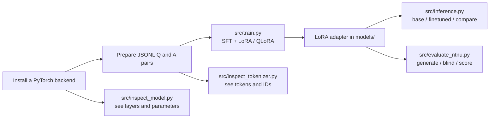

Core choices made by the code:

- **QLoRA** (4-bit NormalFloat with double quantization) is the default on NVIDIA CUDA.
  It lowers the base-model memory enough for consumer GPUs such as an RTX 3060 / 4060 / 4070.
- **`trl.SFTTrainer`** handles supervised fine-tuning, chat-template rendering,
  evaluation, checkpointing, and best-checkpoint selection.
- **All seven linear projection layers** (`q_proj`, `k_proj`, `v_proj`, `o_proj`,
  `gate_proj`, `up_proj`, `down_proj`) are LoRA targets by default.
- The base model is **frozen**. Training updates only the small LoRA matrices; the
  exported adapter is a few tens of megabytes rather than a full multi-gigabyte model.

---

## Start Here: How Fine-Tuning Actually Works

This section assumes no machine-learning background. Later sections are the reference
manual; this section explains *why* the commands look the way they do.

### The 30-second mental model

| Everyday analogy | Thing in this repository |
|---|---|
| A student who already read every book in the library | The pretrained Qwen model (`Qwen/Qwen3.5-4B`, etc.) |
| A workbook of example questions and ideal answers | Your JSONL file (`messages` / `instruction` / `text`) |
| Sticky notes written in the margins, leaving the books untouched | The LoRA adapter (`adapter_model.safetensors`) |
| Photo-copied, tiny-print books that still can be read | 4-bit NF4 base weights (QLoRA) |
| A teacher marking "wrong, move slightly this way" | Loss and gradients |
| Rehearsing the questions the teacher has not seen | The held-out eval split and the NTNU question set |

Fine-tuning does **not** teach the model facts from scratch the way pretraining did. It
nudges an already-capable model toward the style, format, and domain behaviour that your
examples demonstrate. That is why a few hundred to a few thousand good examples can be
useful, and why noisy examples reliably hurt.

### From a sentence to the next word

A language model never sees Chinese characters or English letters directly. It sees
integers, then vectors, then probabilities.

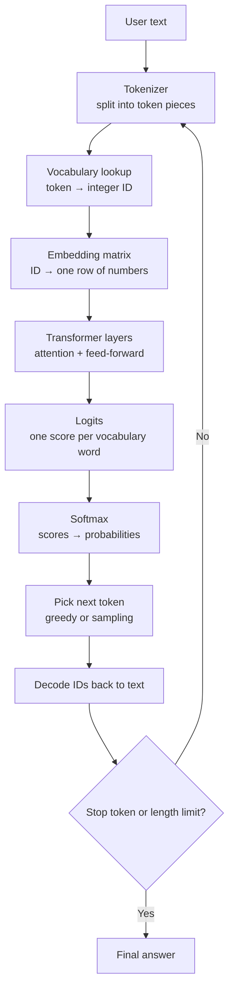

What to take away:

- **Token** — a piece of text. It may be a whole Chinese word, one character, or part of
  an English word. Run `src/inspect_tokenizer.py` to see the exact pieces for your sentence.
- **ID** — the index of that piece in a fixed vocabulary. The embedding table has one
  row per ID; `src/inspect_tokenizer.py --token_id 120573` prints that row.
- **Embedding** — the numeric "meaning coordinates" the model actually consumes.
- **Logits → probability** — the model outputs a score for *every* possible next token.
  `--temperature` and `--top_p` decide how adventurous the choice is. `temperature 0`
  makes generation greedy and deterministic (the evaluation script uses this).
- **Autoregressive loop** — the chosen token is appended to the input and the model runs
  again. `--max_new_tokens` caps how many times this happens.
- **Context length** — `--max_seq_length` (training) and the model's context window set
  how many tokens can be considered at once. Longer sequences use more memory; if you hit
  OOM, lower the length before changing anything else.

### What the chat template is doing

A model cannot infer who is speaking from a plain concatenation of strings. Qwen uses a
ChatML-style template with explicit control tokens:

```text
<|im_start|>system
You are a helpful assistant.<|im_end|>
<|im_start|>user
台灣師範大學的地址是什麼？<|im_end|>
<|im_start|>assistant
國立臺灣師範大學位於臺北市大安區和平東路一段 162 號。<|im_end|>
```

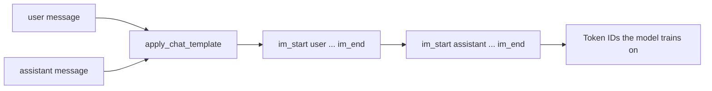

During training, `train.py` calls `tokenizer.apply_chat_template(..., tokenize=False,
add_generation_prompt=False)` and stores the resulting string in a `text` column. The
model therefore learns the delimiters, not just the words. During inference,
`inference.py` uses `add_generation_prompt=True`, which ends the prompt with
`<|im_start|>assistant\n` so the next token starts the answer.

This is also the reason the base model ID must match between training and inference: the
template and the vocabulary belong to that specific tokenizer.

### What SFT teaches, and what the loss hides

Training compares the model's probability distribution with the correct next token at
each position and adjusts the trainable weights to increase that probability. This is
cross-entropy (also called NLL) loss.

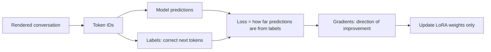

By default this project supervises the **whole rendered `text`**. If you pass
`--assistant_only_loss`, TRL instead receives the `messages` column and masks the
system/user parts, so the loss comes only from assistant turns and their end-of-turn
token. The script validates every row and refuses truncated assistant targets. This flag
requires `--dataset_format chat`.

### Why LoRA and QLoRA fit on a consumer GPU

A 4B model in BF16 is roughly 8 GB of weights before you add activations, gradients, and
optimizer states. Full fine-tuning needs several times that. LoRA keeps the base weights
frozen and learns two small matrices beside each targeted linear layer:

```text
original:   y = W x                 W: big, frozen
LoRA:       y = W x + (alpha / r) * B A x
            A: r x in_features      B: out_features x r      (both trainable)
```

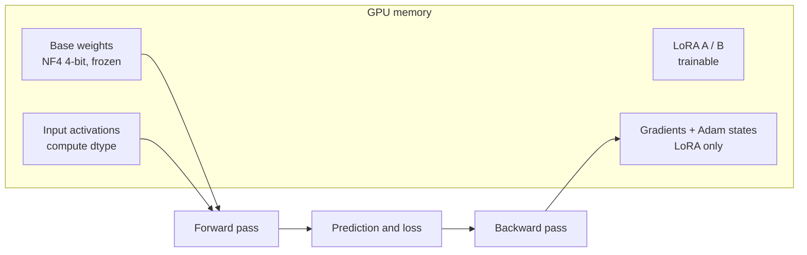

- `r` (`--lora_r`) is the rank, i.e. the width of the little bottleneck. Larger `r` can
  represent more complex changes but uses more memory.
- `alpha` (`--lora_alpha`) scales the LoRA update. The commands in this README use
  `alpha = 2 * r`.
- `target_modules` selects *where* the adapters go. The default covers attention and
  feed-forward projections. Attention-only (`q_proj,k_proj,v_proj,o_proj`) is the first
  thing to try when memory is tight.
- QLoRA additionally stores the frozen base in 4-bit NF4 with double quantization and
  performs math in `bfloat16`/`float16`. Gradients and optimizer states exist only for
  LoRA parameters, which is the large saving.
- `--gradient_checkpointing` (on by default) recomputes intermediate activations during
  the backward pass, trading some speed for lower peak memory.

### Epochs, batches, learning rate, and friends

| Term | Plain-language meaning | Flag in this repo |
|---|---|---|
| Example | One Q&A record in your JSONL | `dataset_path` |
| Token | A text fragment after tokenization | `max_seq_length` |
| Batch | Examples processed together in one forward pass | `per_device_batch_size` |
| Accumulation | Accumulate several small batches before one weight update | `gradient_accum_steps` |
| Effective batch | `per_device_batch_size × gradient_accum_steps × number of GPUs` | derived |
| Epoch | One full pass over the training split | `num_epochs` / `--epochs` |
| Learning rate | Size of each weight update | `learning_rate` / `--lr` |
| Warmup | Small initial phase where the learning rate ramps up | `warmup_ratio` |
| Seed | Makes splitting and initialization repeatable | `seed` |
| Eval split | Examples hidden from training and used to pick the best checkpoint | `test_split` |

```mermaid
sequenceDiagram
    participant Data as Dataset
    participant T as SFTTrainer
    participant Opt as Optimizer
    Data->>T: 1,252 records, 5% held out
    Note over Data: ~1,189 training examples
    loop Each micro-batch
        Data->>T: 2 examples (per_device_batch_size 2)
        T->>T: forward + loss
    end
    Note over T: 8 micro-batches accumulated
    T->>Opt: one optimizer.step() (effective batch 16)
    Opt-->>T: weights updated
    Note over T: ~75 steps per epoch × 3 epochs ≈ 225 steps
```

Worked example with the bundled NTNU data and the 12 GB / 4B settings below:

- 1,252 records, 5% held out → about 1,189 training examples.
- `per_device_batch_size 2 × gradient_accum_steps 8` → effective batch 16.
- About 75 optimizer steps per epoch; three epochs → about **225 steps**, which is why
  you will see `checkpoint-225/` in shipped example output directories.
- `--save_steps 200` therefore writes intermediate checkpoints during the run.

> **Implementation note:** `--warmup_ratio` is passed to `SFTConfig` as the numeric
> `warmup_steps` argument in this version of `train.py` (default `0.03`). Treat it as a
> small fixed warmup value rather than relying on it to mean "3% of all steps".

### What happens at inference time

Inference never modifies weights. It loads the same base model, attaches the saved
adapter, and repeatedly runs the token loop shown earlier.

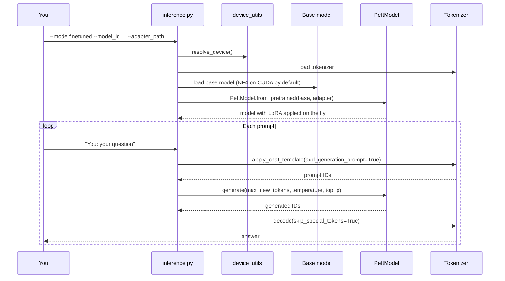

`--mode compare` loads the base once and the adapter on top of it, then prints both
answers for each prompt. This makes "did fine-tuning help?" visible without a second
process.

If `--adapter_path` is a directory without `adapter_config.json`, the script looks for
`checkpoint-*` subdirectories and picks the highest numbered one that contains an adapter.

### How the NTNU evaluation works

Training loss tells you how well the model fits your training examples; it does **not**
tell you whether answers are factually correct. [`src/evaluate_ntnu.py`](src/evaluate_ntnu.py)
implements a small offline, human-graded benchmark for that purpose.

`evaluation/ntnu_qa.jsonl` contains exactly **60** frozen questions:

| Category | Count | What it tests |
|---|---|---|
| `fact` | 40 | Factual answers; each case has an official NTNU source URL and explicit criteria |
| `uncertain` | 10 | Under-specified questions where the model should ask for details and refuse to invent them |
| `general` | 10 | Formatting and instruction-following constraints |

Keep these prompts out of training. Reusing them would turn a held-out test into a
memorization check.

The flow is `generate` → `blind` → human review → `score`; Step 8 shows it as a diagram.

- `generate` uses greedy decoding (`do_sample=False`), batching, and resumable output:
  a matching output file continues from the answers already present. It requires a LoRA
  adapter; there is no base-only mode.
- A run is bound to the model, adapter weight hash, cases hash, generation settings,
  backend, dtype, and quantization flag. Switching any of these requires a fresh output
  path.
- `blind` uses a fixed seed to shuffle answer order independently for every question and
  writes the mapping to a **separate key file** so the reviewer cannot identify models.
- `score` marks a candidate `passes_quality` only when it has at least `max(34, both
  baselines)` fact passes, at least 8 uncertain passes, at least `max(baselines) - 1`
  general passes, and zero major fabrications. Baselines themselves are not gated.

### Choosing a compute backend

All model commands accept `--device auto|gpu|cuda|rocm|mps|xpu|cpu`.

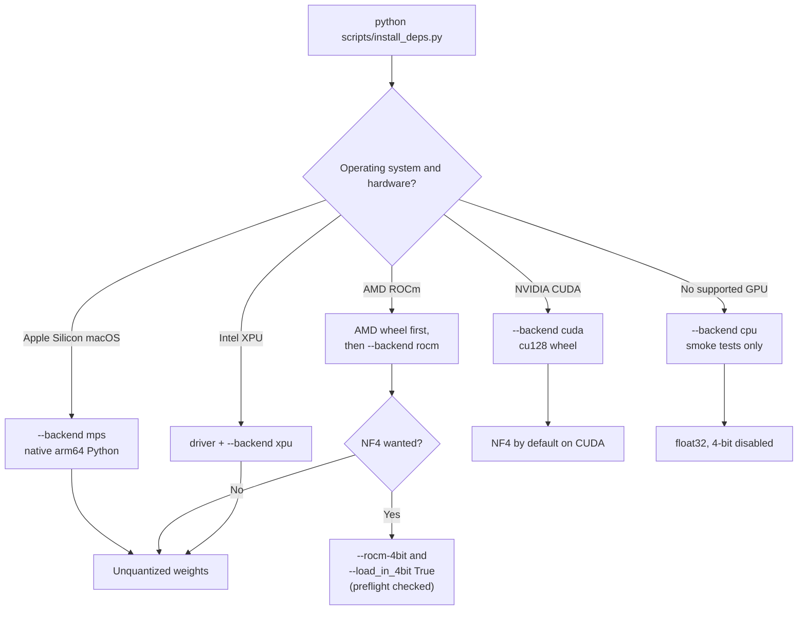

- `auto` tries CUDA, ROCm, MPS, XPU, then CPU. `gpu` uses the same search order but fails
  if no accelerator is present. An explicit backend must be available.
- MPS and XPU reject `--load_in_4bit True`; CPU prints a note and silently uses
  unquantized `float32`.
- ROCm NF4 is opt-in and runs a small forward/backward preflight before loading the
  large model. A failure gives an actionable fallback: `--load_in_4bit False`.
- The installer has **no ROCm wheel index**: for AMD GPUs you must install the correct
  PyTorch wheel from AMD first, then run `--backend rocm` to install the remaining
  dependencies and verify the device.

### Why Conda, PyTorch, and a GPU backend

Three layers are easy to confuse:

| Layer | What it is | Why this project needs it |
|---|---|---|
| Conda environment | An isolated folder containing one Python interpreter and its packages | Prevents a system Python or another project from breaking this one; lets CUDA and ROCm machines keep separate wheels |
| PyTorch wheel | The compiled `torch` package built for a specific accelerator (cu128, ROCm/HIP, XPU, MPS, or CPU) | Without the matching wheel, `torch.cuda.is_available()` is false even when a GPU is physically present |
| CUDA / ROCm / Metal | The vendor runtime that lets PyTorch launch GPU kernels | It is the bridge between Python code and the GPU; a driver alone is not enough |

This is why the walkthrough creates an environment named `ai` **before** installing
anything, and passes an explicit `--backend` to the installer.

---

## Zero-to-Run Walkthrough

Follow these steps in order. Each step explains the idea first, then gives commands you
can paste.

### Step 0 — Read This First: Hardware and Vocabulary

You do not need a GPU to read this project, but you need one for a useful training run.
The minimum practical setup is:

- **8 GB VRAM** for QLoRA with a 4B model at short sequence length.
- **12 GB VRAM** for the comfortable 4B command used in Step 7.
- **Apple Silicon** with unified memory can use MPS; start with `Qwen/Qwen3.5-0.8B`.
- **CPU only** is supported for smoke tests. It will be slow and is not for real training.

Key vocabulary used throughout Step 1 onward:

- **SFT** — supervised fine-tuning: show the model question/answer pairs and let it copy
  the style and behaviour.
- **LoRA** — train small add-on matrices instead of the whole model.
- **QLoRA** — keep the base model in 4-bit NF4 while training those small matrices.
- **Adapter** — the small file produced by training; it is useless without the same base
  model ID.
- **Backend** — the runtime used for tensor math: CUDA, ROCm, MPS, XPU, or CPU.
- **Environment** — the isolated Python installation where those packages live.

### Step 1 — Install Conda from Scratch

Conda creates isolated Python environments. Do **not** install these packages into your
system Python: PyTorch wheels, CUDA builds, and Transformers versions from other projects
can conflict. Miniconda is enough; Anaconda is not required.

**Windows**

1. Download `Miniconda3-latest-Windows-x86_64.exe` from
   https://docs.conda.io/en/latest/miniconda.html.
2. Run the installer. Either check "Add Miniconda3 to PATH" or use "Anaconda Prompt"
   from the Start menu.
3. Open a new terminal and verify:

```powershell
conda --version
```

**Linux / macOS**

```bash
# Linux x86_64
wget https://repo.anaconda.com/miniconda/Miniconda3-latest-Linux-x86_64.sh
bash Miniconda3-latest-Linux-x86_64.sh -b -p "$HOME/miniconda3"
"$HOME/miniconda3/bin/conda" init bash
exec bash

# macOS Apple Silicon (arm64)
curl -L -o ~/miniconda3.sh \
  https://repo.anaconda.com/miniconda/Miniconda3-latest-MacOSX-arm64.sh
bash ~/miniconda3.sh -b -p "$HOME/miniconda3"
"$HOME/miniconda3/bin/conda" init zsh
exec zsh
```

`conda init` adds Conda to your shell startup file so `conda activate` works in new
terminals. Verify with:

```bash
conda --version
```

### Step 2 — Understand CUDA, ROCm, MPS, XPU, and CPU

These are **backends**, not alternatives to Python:

| Backend | What it is | Why you would choose it | Important constraint |
|---|---|---|---|
| **CUDA** | NVIDIA's parallel computing platform and runtime | Most complete PyTorch support; NF4/bitsandbytes works out of the box | Needs an NVIDIA driver and the matching cu128 PyTorch wheel |
| **ROCm** | AMD's open-source GPU computing stack (HIP is its CUDA-like API) | Use AMD GPUs | The wheel must match the ROCm version, GPU model, and OS. This installer does **not** fetch it for you |
| **MPS** | Apple Metal Performance Shaders | Apple Silicon Macs | Requires native arm64 Python; 4-bit loading is not supported |
| **XPU** | Intel GPU support in PyTorch | Intel Arc / Data Center GPUs | Needs the Intel driver and XPU wheel; 4-bit loading is not supported |
| **CPU** | Plain processor execution | Smoke tests and debugging | Very slow for 4B+ models; 4-bit is disabled and `float32` is used |

Check what your machine actually has:

```bash
# NVIDIA only
nvidia-smi

# Inside the conda environment, after installing PyTorch
python -c "import torch; print(torch.__version__, torch.version.cuda, torch.version.hip)"
```

A driver is not the same as a PyTorch wheel. `nvidia-smi` can show a working GPU while
`torch.cuda.is_available()` is `False` if PyTorch was installed from the wrong index.
One environment holds one PyTorch wheel, so keep CUDA and ROCm environments separate.

### Step 3 — Create the `ai` Conda Environment

```bash
conda create -n ai python=3.11 -y
conda activate ai
python --version
```

Python 3.11 is a safe choice for current PyTorch, Transformers, TRL, and PEFT releases.
Every new terminal starts in the `base` environment, so run `conda activate ai` again
each time. If you previously used an environment named `finetune`, either rename it with
`conda rename -n finetune ai` (if your conda supports it) or simply create `ai` and
activate that instead.

### Step 4 — Install Dependencies and Verify PyTorch

`scripts/install_deps.py` does four things:

1. Selects a PyTorch wheel index from `--backend` (CUDA → cu128, XPU → xpu, CPU → cpu;
   MPS and macOS CPU use PyPI; ROCm installs no wheel and expects AMD's wheel already
   present).
2. Runs a real tensor operation on the chosen device and reads back the exact installed
   torch version.
3. Installs `requirements.txt` for CUDA or `requirements-common.txt` for every other
   backend, then re-pins `torch==<verified version>` so pip cannot silently replace the
   vendor wheel.
4. Adds `bitsandbytes>=0.50.0` only for `--rocm-4bit`.

`-c requirements-common.txt` during the wheel install is a **constraint** (it limits
`torch>=2.4.0,<2.12`), not an instruction to install every package twice.

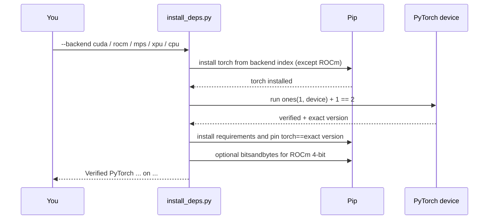

Paste the command for your platform:

```bash
# NVIDIA CUDA (Linux / Windows Git Bash)
python scripts/install_deps.py --backend cuda

# AMD ROCm: install the AMD PyTorch wheel FIRST, then:
python scripts/install_deps.py --backend rocm
python scripts/install_deps.py --backend rocm --rocm-4bit   # optional NF4 support

# Apple Silicon (native arm64 Python)
bash scripts/install_deps.sh --backend mps

# Intel XPU
python scripts/install_deps.py --backend xpu

# CPU only
python scripts/install_deps.py --backend cpu

# Windows PowerShell
powershell -File scripts/install_deps.ps1 -Backend cuda
powershell -File scripts/install_deps.ps1 -Backend rocm -Rocm4Bit
```

> **ROCm warning:** `install_deps.py` intentionally skips the wheel download for ROCm
> because AMD wheels are GPU/OS/ROCm-specific. If you run `--backend rocm` before
> installing the correct wheel, verification fails. Follow AMD's official ROCm PyTorch
> installation guide for your exact configuration first.

Verify the installation:

```bash
python -c "import torch; print(torch.__version__, torch.cuda.is_available())"
python src/inspect_model.py --model_id Qwen/Qwen3.5-0.8B --device cpu --no_load
python -m unittest discover -s tests -v
```

The last command runs nine backend-selection tests and should end with `OK`.

### Step 5 — Choose a Model (and Why)

The **model ID** is a Hugging Face repository name. It must be identical during training
and inference because the tokenizer, chat template, and vocabulary belong to that model.
The default in the code is `Qwen/Qwen3.5-0.8B` so smoke tests stay small; real GPU work
usually uses `Qwen/Qwen3.5-4B`.

| If you have | Start with | Why |
|---|---|---|
| CPU only | `Qwen/Qwen3.5-0.8B`, `--device cpu`, `--load_in_4bit False` | Small enough to finish a smoke run |
| 8 GB NVIDIA VRAM | `Qwen/Qwen3.5-4B`, NF4, short sequence | 4-bit base weights fit |
| 12–16 GB NVIDIA VRAM | `Qwen/Qwen3.5-4B`, NF4, batch 2 | Best quality / memory balance |
| 12 GB+ and want more capacity | `Qwen/Qwen3.5-9B`, NF4, batch 1 | Needs careful sequence length |
| Apple Silicon | `Qwen/Qwen3.5-0.8B` or `2B`, MPS, unquantized | MPS rejects 4-bit loading |

Full specs and official links are in the [Model Catalog](#model-catalog-qwen35-and-qwen3).

### Step 6 — Build an SFT Dataset with ChatGPT

SFT needs **paired examples**: a realistic user question and the ideal assistant answer.
The native format here is ChatML, one JSON object per line:

```json
{"messages":[{"role":"user","content":"問題"},{"role":"assistant","content":"回答"}]}
```

You can generate a first draft with ChatGPT or another LLM, but you must verify it.
Language models can produce fluent, plausible fabrications; if you train on a fabricated
address or deadline, the adapter learns it as fact.

#### Prompt 1: Generate Chinese Q&A Pairs

Paste this into ChatGPT, replacing the topic in the last line:

```text
你是一位資料標註員，正在為「監督式微調（SFT）」製作訓練資料。
請針對下面指定主題，產生 20 筆繁體中文問答對。

硬性規則：
1. 問題要像真實使用者會問的話；答案要簡潔、完整、可查證。
2. 絕對不要捏造地址、電話、期限、金額、人名、法規或制度。不確定就跳過該筆，不要猜。
3. 只輸出純 JSONL：每一行一個 JSON 物件，不要輸出任何說明文字，不要加 markdown 程式碼區塊。
4. 每行格式固定為：
{"messages":[{"role":"user","content":"問題"},{"role":"assistant","content":"回答"}]}
5. messages 陣列必須恰好 2 個元素，role 依序為 user、assistant，content 皆為非空白字串。
6. 20 筆的主題要彼此不重複。

主題：〈在這裡填入主題，例如：國立臺灣師範大學的入學申請流程〉
```

#### Prompt 2: Validate and Debug JSONL

Paste this after the model returns a draft:

```text
你是 JSONL 驗證器。我會貼上一段 JSONL，請逐行檢查，
只輸出一個 JSON 陣列，元素格式：{"line":<行號>,"ok":true/false,"reason":"..."}
不要修改我的內容，只回報問題。

檢查規則：
1. 每行必須是合法 JSON 物件。
2. 必須有 messages 欄位，且為陣列、長度恰好 2。
3. messages[0].role == "user"，messages[1].role == "assistant"。
4. 兩個 content 都是非空白字串。
5. 若某行有額外欄位（例如 source），標記 ok=true 但於 reason 註明「額外欄位會被訓練器忽略」。

以下是待檢查的 JSONL：
〈貼上 JSONL〉
```


#### Save and Verify the JSONL

1. Paste the cleaned output into `data/my_dataset.jsonl`. If ChatGPT wrapped it in a
   JSON code fence, remove the first and last lines.
2. Validate locally, not only in the chat:

```bash
python - <<'PY'
import json
import sys
from pathlib import Path

path = Path('data/my_dataset.jsonl')
bad = []
for line_no, line in enumerate(path.read_text(encoding='utf-8').splitlines(), 1):
    if not line.strip():
        continue
    try:
        record = json.loads(line)
    except json.JSONDecodeError as exc:
        bad.append((line_no, f'JSON error: {exc}'))
        continue
    messages = record.get('messages')
    if not isinstance(messages, list) or len(messages) != 2:
        bad.append((line_no, 'messages must be a list of length 2'))
        continue
    if [m.get('role') for m in messages] != ['user', 'assistant']:
        bad.append((line_no, 'roles must be user then assistant'))
        continue
    if any(not isinstance(m.get('content'), str) or not m['content'].strip() for m in messages):
        bad.append((line_no, 'content must be a non-empty string'))

if bad:
    for item in bad[:20]:
        print(item)
    sys.exit(1)
print(f'OK: {path}')
PY
```

3. Run the same validator on the bundled file to see a known-good example:
   `data/ntnu_dataset.jsonl` has 1,252 valid records.

#### Hallucination and Fact-Checking

**Format correctness is not factual correctness.** The prompt reduces invented details
but cannot eliminate them. Before training:

- Manually check every address, phone number, deadline, amount, name, rule, and law
  against an official website.
- Keep source URLs in a separate file such as `data/my_dataset.sources.json`; the trainer
  ignores extra keys, but the file gives you an audit trail.
- Prefer narrow, verifiable topics. "Admission FAQ for one university" is safer than
  "everything about Taiwan".
- Keep `evaluation/ntnu_qa.jsonl` out of training. Those 60 questions are held out for
  evaluation.

For factual work, add `--assistant_only_loss` with ChatML data so the model is not
trained to reproduce the question text as if it were an answer.

Dataset size guidance:

| Examples | Suggested approach | Flags to change |
|---|---|---|
| < 500 | Short smoke run, check for overfitting | `--num_epochs 1`, `--learning_rate 1e-4` |
| 500–5,000 | Normal LoRA run | defaults are reasonable |
| 5,000–30,000 | Longer run, fewer epochs | `--num_epochs 2`, `--learning_rate 1.5e-4` |
| 30,000+ | More capacity and checkpointing | `--lora_r 32`, `--lora_alpha 64`, `--save_steps 300` |

### Step 7 — Train with `src/train.py`

The script path is `src/train.py`; there is no `train.py` at the repository root.
`--load_in_4bit` accepts exactly `True` or `False`. `--device` accepts
`auto|gpu|cuda|rocm|mps|xpu|cpu`.

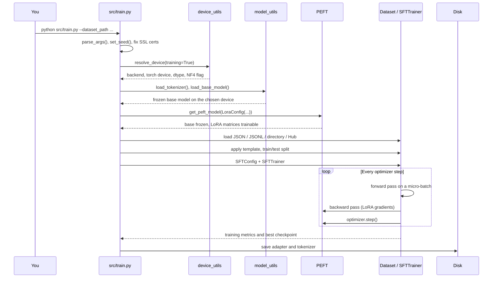

#### Copy-Paste Commands by VRAM

**12 GB NVIDIA, 4B model** — the recommended first real run:

```bash
python src/train.py \
  --model_id Qwen/Qwen3.5-4B \
  --dataset_path ./data/ntnu_dataset.jsonl \
  --dataset_format chat \
  --device gpu --load_in_4bit True --torch_dtype bfloat16 \
  --max_seq_length 2048 --num_epochs 3 \
  --per_device_batch_size 2 --gradient_accum_steps 8 \
  --learning_rate 2e-4 --lora_r 16 --lora_alpha 32 --lora_dropout 0.05 \
  --warmup_ratio 0.03 --test_split 0.05 --logging_steps 10 --save_steps 200 \
  --output_dir ./models/ntnu/gpu-12gb-4b
```

**4B single-epoch smoke test** — verifies the pipeline before a long run:

```bash
python src/train.py \
  --model_id Qwen/Qwen3.5-4B \
  --dataset_path ./data/ntnu_dataset.jsonl \
  --dataset_format chat \
  --device gpu --load_in_4bit True --torch_dtype bfloat16 \
  --max_seq_length 2048 --num_epochs 1 \
  --per_device_batch_size 1 --gradient_accum_steps 8 \
  --learning_rate 2e-4 --lora_r 16 --lora_alpha 32 --lora_dropout 0.05 \
  --test_split 0.05 --logging_steps 10 --save_steps 200 \
  --output_dir ./models/ntnu/smoke-4b
```

**CPU smoke test** — works without a GPU:

```bash
python src/train.py \
  --model_id Qwen/Qwen3.5-0.8B \
  --dataset_path ./data/ntnu_dataset.jsonl \
  --dataset_format chat \
  --device cpu --load_in_4bit False --torch_dtype float32 \
  --max_seq_length 512 --num_epochs 1 \
  --per_device_batch_size 1 --gradient_accum_steps 4 \
  --learning_rate 2e-4 --lora_r 8 --lora_alpha 16 --lora_dropout 0.05 \
  --test_split 0.05 --logging_steps 5 --save_steps 50 \
  --output_dir ./models/ntnu/cpu-smoke
```

Other VRAM situations use the same flags as the 12 GB / 4B command with these changes:

| Situation | `--model_id` | `--max_seq_length` | batch | accum | `lora_r/alpha` | `--save_steps` | `--output_dir` |
|---|---|---|---|---|---|---|---|
| 8 GB NVIDIA | `Qwen/Qwen3.5-4B` | 2048 | 1 | 16 | 16/32 | 200 | `./models/ntnu/gpu-8gb-4b` |
| 12 GB NVIDIA, 9B | `Qwen/Qwen3.5-9B` | 1536 | 1 | 16 | 16/32 | 250 | `./models/ntnu/gpu-12gb-9b` |
| 12 GB NVIDIA, 9B longer | `Qwen/Qwen3.5-9B` | 2048 | 1 | 16 | 16/32, plus `--target_modules q_proj,k_proj,v_proj,o_proj` | 250 | `./models/ntnu/gpu-12gb-9b-long` |
| 16 GB NVIDIA, 9B | `Qwen/Qwen3.5-9B` | 2048 | 1 | 16 | 32/64 | 300 | `./models/ntnu/gpu-16gb-9b` |
| 24 GB NVIDIA, 4B | `Qwen/Qwen3.5-4B` | 4096 | 2 | 8 | 32/64 | 300 | `./models/ntnu/gpu-24gb-4b` |
| 24 GB NVIDIA, 9B | `Qwen/Qwen3.5-9B` | 2048 | 2 | 8 | 32/64 | 300 | `./models/ntnu/gpu-24gb-9b` |
| 9B smoke test | `Qwen/Qwen3.5-9B` | 1536 | 1 | 8 | 16/32, `--num_epochs 1` | 200 | `./models/ntnu/smoke-9b` |

#### Hyperparameters Explained

- `--max_seq_length` is the first thing to reduce on OOM. Longer text means more attention
  memory and more truncated examples.
- `--per_device_batch_size × --gradient_accum_steps × GPU count` is the effective batch.
  Aim for 16–32. Two GPUs are not required; one GPU with `2 × 8 = 16` is fine.
- `--learning_rate 2e-4` is a robust LoRA default. Smaller datasets prefer `1e-4`.
- `--num_epochs 3` is a starting point. Watch validation loss; rising eval loss means
  overfitting or too high a learning rate.
- `--test_split 0.05` hides five percent of the data and restores the best checkpoint at
  the end. Set it to `0` only for a pure throughput benchmark.
- `--assistant_only_loss` requires `--dataset_format chat` and supervises only assistant
  turns.
- `--gradient_checkpointing` is on by default and trades speed for lower peak memory.
- `--run_metrics path.json` records timings, model revision, package versions, dataset
  hash, and token statistics.

On Windows, if CUDA allocation is fragmented:

```powershell
$env:PYTORCH_CUDA_ALLOC_CONF = "expandable_segments:True"
```

If you still hit OOM, reduce `--max_seq_length` first, then restrict
`--target_modules q_proj,k_proj,v_proj,o_proj`, then lower the micro-batch while raising
`--gradient_accum_steps` to keep the effective batch unchanged.

#### Migration: Removed Shortcuts → Direct Commands

The named shortcut scripts were removed. Use the direct commands above. This table maps
every old shortcut to its replacement; only the first three full commands are printed in
this README, and the rest follow the "Other VRAM situations" table.

| Removed shortcut | Replacement | Main difference |
|---|---|---|
| `smoke-4b` | 4B single-epoch smoke command | Same flags, one epoch |
| `smoke-9b` | 9B row in the VRAM table, `--num_epochs 1` | 1536 tokens, batch 1 |
| `cpu-smoke` | CPU smoke command | 0.8B, float32, no 4-bit |
| `gpu-8gb-4b` | 8 GB row | batch 1, accumulation 16 |
| `gpu-12gb-4b` | 12 GB / 4B command | Full three-epoch run |
| `gpu-12gb-9b` | 12 GB / 9B row | 1536 tokens |
| `gpu-12gb-9b-long` | 12 GB / 9B longer row | attention-only LoRA |
| `gpu-16gb-9b` | 16 GB / 9B row | rank 32 |
| `gpu-24gb-4b` | 24 GB / 4B row | 4096 tokens, rank 32 |
| `gpu-24gb-9b` | 24 GB / 9B row | batch 2, rank 32 |
| `ntnu-win-baseline` | See [Reproducibility](#reproducibility-windows-ntnu-benchmark) | 4B NF4, batch 2, 3 epochs, 2048 tokens |
| `ntnu-win-qwen35-4b` | See [Reproducibility](#reproducibility-windows-ntnu-benchmark) | 4B NF4, batch 4, 2 epochs, 512 tokens |
| `ntnu-win-qwen3-4b` | See [Reproducibility](#reproducibility-windows-ntnu-benchmark) | Qwen3-4B-Instruct-2507, batch 4 |
| `ntnu-win-qwen35-2b` | See [Reproducibility](#reproducibility-windows-ntnu-benchmark) | 2B unquantized, batch 8 |

If you used an environment named `finetune`, run `conda activate ai` from now on.

### Step 8 — Inference and Evaluation

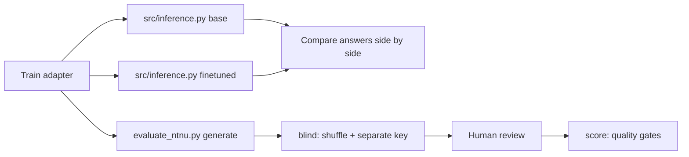

One-shot inference requires a non-empty `--prompt` when `--no_interactive` is used;
there is no built-in test prompt.

```bash
# Base model before training
python src/inference.py --mode base --model_id Qwen/Qwen3.5-4B \
  --prompt "台灣師範大學的地址是什麼" --no_interactive

# Fine-tuned adapter
python src/inference.py --mode finetuned --model_id Qwen/Qwen3.5-4B \
  --adapter_path ./models/ntnu/gpu-12gb-4b \
  --prompt "台灣師範大學的地址是什麼" --no_interactive

# Side-by-side comparison
python src/inference.py --mode compare --model_id Qwen/Qwen3.5-4B \
  --adapter_path ./models/ntnu/gpu-12gb-4b \
  --load_in_4bit True \
  --prompt "請簡單介紹國立臺灣師範大學。" --no_interactive
```

Without `--no_interactive`, the script opens an interactive loop after answering the
optional `--prompt`. Type `quit`, `exit`, `q`, or press Ctrl+C to leave.

For Qwen3.5 thinking mode, add `--use_thinking True`. Qwen3.5 does not support the Qwen3
`/think` and `/nothink` soft switches; the CLI flag feeds
`chat_template_kwargs={"enable_thinking": true}` into the tokenizer.

Run the offline NTNU evaluation:

```bash
python src/evaluate_ntnu.py generate \
  --model_id Qwen/Qwen3.5-4B \
  --adapter_path ./models/ntnu/gpu-12gb-4b \
  --output ./models/ntnu/candidate.json

python src/evaluate_ntnu.py blind \
  baseline=./models/ntnu/baseline.json candidate=./models/ntnu/candidate.json \
  --output ./models/ntnu/review.json \
  --key ./models/ntnu/key.json

python src/evaluate_ntnu.py score \
  --review ./models/ntnu/review.json \
  --key ./models/ntnu/key.json \
  --baselines baseline1 baseline2 \
  --output ./models/ntnu/score.json
```

The `--baselines` names must match names used in the `blind` step. `generate` requires an
adapter and forces BF16 weights; use `--bf16_weights` or `--load_in_4bit` explicitly if
you need to control the weight format.

---

## Installation

This is a compact reference for the steps already walked through above.

### Install Miniconda from Scratch

See [Step 1](#step-1--install-conda-from-scratch) for platform-specific installers.
Miniconda is enough; verify with `conda --version`.

### Create the `ai` Environment

```bash
conda create -n ai python=3.11 -y
conda activate ai
python --version
```

### Install and Verify a Backend

`install_deps.py` uses the currently active Python, so activate `ai` first. The Bash
wrapper forwards every flag verbatim; the PowerShell wrapper uses `-Backend` and
`-Rocm4Bit`.

| Backend | Command | Wheel index used by installer |
|---|---|---|
| NVIDIA CUDA | `python scripts/install_deps.py --backend cuda` | `https://download.pytorch.org/whl/cu128` |
| AMD ROCm | install AMD wheel first, then `python scripts/install_deps.py --backend rocm` | none; expects a preinstalled wheel |
| Apple Silicon | `bash scripts/install_deps.sh --backend mps` | PyPI, native arm64 only |
| Intel XPU | `python scripts/install_deps.py --backend xpu` | `https://download.pytorch.org/whl/xpu` |
| CPU | `python scripts/install_deps.py --backend cpu` | `https://download.pytorch.org/whl/cpu`, or PyPI on macOS |
| Windows PowerShell | `powershell -File scripts/install_deps.ps1 -Backend cuda` | same as `cuda` |

The installer verifies a real tensor operation, then installs
`requirements.txt` on CUDA or `requirements-common.txt` elsewhere and re-pins the exact
torch version it just verified. ROCm NF4 needs `--rocm-4bit` and adds
`bitsandbytes>=0.50.0`.

Core packages from `requirements-common.txt`:

| Package | Minimum | Purpose |
|---|---|---|
| `torch` | `>=2.4.0,<2.12` | Tensor math and GPU kernels; backend-specific wheel |
| `transformers` | `>=5.12.1` | Qwen model, tokenizer, chat template |
| `peft` | `>=0.13.0` | LoRA / QLoRA adapters |
| `trl` | `>=1.6.0` | `SFTTrainer` |
| `accelerate` | `>=1.13.0` | Device placement and distributed helpers |
| `datasets` | `>=3.0.0` | Loading JSON / JSONL / Hub datasets |
| `packaging` | `>=21.0` | PyTorch version capability checks |
| `certifi` | `>=2023.7.22` | CA bundle used by the SSL repair in `model_utils.py` |

`requirements.txt` additionally sets the cu128 index and installs
`bitsandbytes>=0.46.1` for NVIDIA NF4.

Official backend references:

- NVIDIA CUDA: https://developer.nvidia.com/cuda-downloads
- PyTorch wheels: https://pytorch.org/get-started/locally/
- AMD ROCm: https://rocm.docs.amd.com/
- Apple Metal / MPS: https://developer.apple.com/metal/pytorch/
- Intel XPU: https://pytorch.org/docs/stable/xpu.html

---

## Model Catalog: Qwen3.5 and Qwen3

Official specs below come from the linked Hugging Face model cards (checked 2026-11-26).
The HF metadata column records what the Hugging Face page reports separately from the
model card text; the two counting conventions are **not interchangeable**. Project
revisions come from `models/ntnu/windows-comparison/observations.json` and are a local
test record, not official specs.

| Model ID | Official parameters | HF metadata | Context length | Architecture | Default thinking mode | Project revision |
|---|---|---|---|---|---|---|
| `Qwen/Qwen3.5-4B` | 4B | 5B | 262,144; extensible to 1,010,000 | Causal LM with vision encoder; Gated DeltaNet + sparse MoE | thinking (`<think>…</think>`) | `851bf6e806efd8d0a36b00ddf55e13ccb7b8cd0a` |
| `Qwen/Qwen3.5-2B` | 2B | — | 262,144 | Hybrid sparse MoE with vision encoder | non-thinking; can enable thinking | `15852e8c16360a2fea060d615a32b45270f8a8fc` |
| `Qwen/Qwen3.5-0.8B` | 0.8B | 0.9B | 262,144 | Hybrid sparse MoE with vision encoder | non-thinking; official card warns about thinking loops | — (code default) |
| `Qwen/Qwen3.5-9B` | 9B | 10B | 262,144; extensible to 1,010,000 | Hybrid sparse MoE with vision encoder | thinking | — |
| `Qwen/Qwen3-4B-Instruct-2507` | 4.0B (3.6B non-embedding) | — | 262,144 | Causal LM; 36 layers; GQA 32 Q / 8 KV heads | non-thinking only | `cdbee75f17c01a7cc42f958dc650907174af0554` |

Official model cards:

- [Qwen3.5-4B](https://huggingface.co/Qwen/Qwen3.5-4B)
- [Qwen3.5-2B](https://huggingface.co/Qwen/Qwen3.5-2B)
- [Qwen3.5-0.8B](https://huggingface.co/Qwen/Qwen3.5-0.8B)
- [Qwen3.5-9B](https://huggingface.co/Qwen/Qwen3.5-9B)
- [Qwen3-4B-Instruct-2507](https://huggingface.co/Qwen/Qwen3-4B-Instruct-2507)

Notes:

1. All five are licensed `apache-2.0`. No release date is asserted: the cards cite
   February 2026, which is not an explicit release date.
2. Qwen3.5 models do **not** officially support the Qwen3 `/think` and `/nothink` soft
   switches. Control thinking with `chat_template_kwargs={"enable_thinking": ...}`,
   exposed here as `--use_thinking True|False`.
3. Qwen3-4B-Instruct-2507 supports non-thinking only; passing `--use_thinking False` is
   harmless but unnecessary.
4. `Qwen/Qwen3.5-0.8B` is the default because it is small enough for CPU smoke tests. It
   is not the recommended model for real results.
5. The base model ID passed to inference must match the one used for training. No merged
   full model is exported.

---

## Features

- **QLoRA / LoRA support** — 4-bit NF4 on NVIDIA CUDA and compatible AMD ROCm setups, or
  unquantized weights on any supported backend.
- **Multiple data formats** — ChatML (native), Alpaca (`instruction` / `input` / `output`),
  and flat text. All are converted to chat messages internally.
- **Hugging Face Hub integration** — load datasets directly from the Hub and push trained
  adapters back.
- **Thinking mode** — enable Qwen3.5 `<think>` reasoning through the chat template during
  training and inference.
- **CLI-first design** — every hyperparameter is a command-line flag; no YAML needed.
- **Multiple compute backends** — NVIDIA CUDA, AMD ROCm, Apple Metal (MPS), Intel XPU,
  and a float32 CPU fallback.
- **Single-file training script** — `src/train.py` runs the full SFT pipeline in order,
  which makes it suitable for teaching and line-by-line reading.
- **Model inspection** — `src/inspect_model.py` reports parameter counts, vocabulary size,
  embedding dimensions, and layer layout without needing a dataset.
- **Tokenizer inspection** — `src/inspect_tokenizer.py` shows token pieces, IDs, and the
  corresponding embedding rows.
- **Pre / post fine-tuning comparison** — test the base model first, then compare it
  side by side with the fine-tuned model.
- **Interactive inference** — the model stays loaded and prompts are read in a loop by
  default; `--no_interactive` runs one prompt and exits.
- **Evaluation split** — automatic train/test split with best-model selection by eval loss.
- **Gradient checkpointing** — enabled by default to reduce peak memory.
- **Offline quality benchmark** — deterministic generation, blinded human review, and
  explicit quality gates for the bundled NTNU question set.

---

## Hardware Requirements

| Configuration | Minimum VRAM | Typical GPU |
|---|---|---|
| QLoRA 4B (4-bit, batch size 1–2) | ~6–8 GB | RTX 3060 / 4060 / 4070, T4 |
| QLoRA 9B (4-bit, batch size 1) | ~10–12 GB | RTX 4070 Ti / 5070 Ti (laptop), 3080 12 GB |
| QLoRA 9B (4-bit, batch size 2) | ~20–24 GB | RTX 4090 / 3090 24 GB, A5000 |
| LoRA 4B (unquantized, batch size 1) | ~12 GB | RTX 3080 / 4070 Ti / 4080, A10 |
| CPU (unquantized, float32) | — | Any CPU, very slow; smoke tests only |

These VRAM figures are NVIDIA examples. On Apple Silicon, weights, activations, and the
OS share unified memory. Start with `Qwen3.5-0.8B` when checking a new machine. If you
run out of memory, reduce `--max_seq_length` before changing anything else.

Training, inference, both inspection tools, and NTNU evaluation accept
`--device auto|gpu|cuda|rocm|mps|xpu|cpu`. Auto-detection tries CUDA, ROCm, MPS, XPU,
then CPU; `gpu` requires an available GPU and uses the same order. An explicit backend
must be available.

Training and inference default to NF4 on NVIDIA CUDA. ROCm defaults to unquantized
weights and accepts `--load_in_4bit True` only after its kernel preflight passes. MPS and
XPU use unquantized weights. CPU uses unquantized `float32`. Both inspection tools default
to unquantized weights on every backend.

---

## Project Structure

```text
fine-tuning-playground/
├── requirements.txt                    # NVIDIA cu128 installation entry point
├── requirements-common.txt             # Shared Python dependencies
├── src/
│   ├── train.py                        # Full SFT pipeline (single file, top-to-bottom)
│   ├── inference.py                    # base / finetuned / compare + interactive loop
│   ├── evaluate_ntnu.py                # Greedy generation, blinding, quality scoring
│   ├── device_utils.py                 # Backend selection, dtype, ROCm NF4 validation
│   ├── model_utils.py                  # Shared tokenizer and model loading helpers
│   ├── inspect_model.py                # Model internals report
│   └── inspect_tokenizer.py            # Token pieces, IDs, and embedding vectors
├── data/
│   ├── ntnu_dataset.jsonl              # Bundled NTNU ChatML dataset (1,252 records)
│   ├── full_dataset.jsonl              # Aggregated extended dataset (1,746 records)
│   ├── ntnu/                           # Curated NTNU JSONL files
│   └── taiwan/                         # Curated Taiwan JSONL files
├── evaluation/ntnu_qa.jsonl            # 60 held-out prompts, criteria, and sources
├── models/                             # Adapters and benchmark data (gitignored)
├── scripts/
│   ├── install_deps.py                 # Backend-aware installer and device probe
│   ├── install_deps.sh                 # Bash wrapper for the installer
│   └── install_deps.ps1                # PowerShell wrapper for the installer
├── tests/test_device_utils.py          # Backend selection and quantization tests
├── README.md                           # This file (English)
└── README.zh-Hant.md                   # Traditional Chinese documentation
```

### File Descriptions

**`src/train.py`** — the complete SFT pipeline in one file: SSL fix → parse CLI args →
select device → load tokenizer → load base model (optionally 4-bit) → apply LoRA → load and
format data → configure `SFTTrainer` → train → save the adapter. All hyperparameters are
CLI flags.

**`src/inference.py`** — standalone inference in `base`, `finetuned`, or `compare` mode.
With no `--prompt` it goes straight to the interactive loop (`You:`; type `quit`, `exit`,
or `q`, or press Ctrl+C to stop). With `--prompt` it answers once and then, unless
`--no_interactive` is given, continues into the same loop.

**`src/evaluate_ntnu.py`** — three subcommands. `generate` writes deterministic answers
for one model and adapter; `blind` shuffles answers from named runs and stores the key
separately; `score` applies the quality gates to a completed review.

**`src/device_utils.py`** — resolves backend, device, dtype, and NF4 policy. It also runs
the ROCm NF4 preflight. **`src/model_utils.py`** holds the shared tokenizer/model loading
code, the default model ID (`Qwen/Qwen3.5-0.8B`), and the SSL certificate repair.

**`src/inspect_model.py`** — prints a standardized report: model configuration
(vocabulary, hidden size, layers, heads, KV heads, head dimension, FFN size, context,
activation, RoPE theta, tied embeddings), tokenizer metadata, and — unless `--no_load`
is set — parameter counts, embedding shape and memory estimate, dtypes, and placement.

**`src/inspect_tokenizer.py`** — shows how a sentence splits into tokens, each token's ID,
and its embedding vector from the input embedding layer. At least one of `--sentence`,
`--token`, or `--token_id` is required.

**`scripts/install_deps.py` / `.sh` / `.ps1`** — installs the backend-specific PyTorch
wheel, verifies it with a real tensor operation, then installs the remaining Python
dependencies.

**`tests/test_device_utils.py`** — simulates hardware to verify backend selection and
quantization rules; run it with `python -m unittest discover -s tests -v`.

---

## Configuration

### Training (`src/train.py`)

| Category | Parameter | Default | Description |
|---|---|---|---|
| **Model** | `--model_id` | `Qwen/Qwen3.5-0.8B` | Hugging Face model ID; use `Qwen/Qwen3.5-4B` or another 4B / 9B model for real GPU training |
| | `--load_in_4bit` | On for CUDA | `True` / `False`; NF4 QLoRA. Opt in on compatible ROCm; rejected on MPS/XPU; ignored on CPU |
| | `--torch_dtype` | `bfloat16` | `bfloat16`, `float16`, or `float32`; capability checks may choose a different effective dtype |
| **LoRA** | `--lora_r` | `16` | LoRA rank |
| | `--lora_alpha` | `32` | LoRA scaling factor, typically `2 × r` |
| | `--lora_dropout` | `0.05` | Dropout inside LoRA layers |
| | `--target_modules` | `q_proj,k_proj,v_proj,o_proj,gate_proj,up_proj,down_proj` | Comma-separated module names |
| **Data** | `--dataset_path` | _(required)_ | Local JSON/JSONL file, directory scanned recursively for `*.jsonl`, or a Hub dataset name. A path that does not exist locally is passed to `load_dataset()` |
| | `--dataset_format` | `chat` | `chat`, `alpaca`, or `text` |
| | `--test_split` | `0.05` | Validation fraction in `[0, 1)`; `0` disables evaluation |
| | `--seed` | `42` | Splitting, initialization, and sampling seed |
| | `--max_seq_length` | `4096` | Maximum token length per example |
| | `--use_thinking` | `False` | Pass `enable_thinking` to the chat template; see the Qwen3.5 notes above |
| **Optimization** | `--learning_rate`, `--lr` | `2e-4` | Peak learning rate |
| | `--num_epochs`, `--epochs` | `3` | Training epochs |
| | `--per_device_batch_size`, `--batch_size` | `2` | Micro-batch per device |
| | `--gradient_accum_steps` | `8` | Micro-batches per optimizer step |
| | `--gradient_checkpointing` | `True` | Recompute activations to save memory |
| | `--group_by_length` | off | Group similar-length examples |
| | `--assistant_only_loss` | off | Supervise assistant turns and their end-of-turn token; requires `--dataset_format chat` |
| | `--loss_type` | TRL default | `nll` or `chunked_nll` (lower vocabulary-projection memory) |
| | `--warmup_ratio` | `0.03` | Numeric value passed as `SFTConfig(warmup_steps=...)` in this version |
| | `--logging_steps` | `10` | Log metrics every N steps |
| | `--save_steps` | `200` | Checkpoint every N steps when `save_strategy="steps"` |
| | `--output_dir` | `./models/qwen3-4b-finetuned` | Adapter output directory |
| **Evaluation** | `--eval_each_epoch` | off | Evaluate and save each epoch instead of every `save_steps` |
| | `--eval_batch_size` | `8` | Evaluation micro-batch per device |
| **Benchmark** | `--benchmark_steps` | `0` | Timed optimizer steps; positive values skip eval and adapter export |
| | `--benchmark_warmup_steps` | `3` | Steps excluded from timing |
| | `--run_metrics` | — | JSON path for timings, backend, dtype, NF4 state, lengths, revision, and versions |
| **Hardware** | `--device` | `auto` | `auto`, `gpu`, `cuda`, `rocm`, `mps`, `xpu`, `cpu` |
| **Hub** | `--push_to_hub` | `False` | Push the adapter and tokenizer after training; incompatible with benchmark mode |
| | `--hub_model_id` | `""` | Target Hub repository; required when pushing |

Validation rules in `parse_args()`: step counts must be nonnegative,
`0 <= test_split < 1`, `0 <= warmup_ratio <= 1`, batch sizes/accumulation/length must be
positive, `--assistant_only_loss` needs chat format, `--eval_each_epoch` needs a positive
eval split, and benchmarks cannot be combined with Hub pushes.

### Inference (`src/inference.py`)

| Category | Parameter | Default | Description |
|---|---|---|---|
| **Model** | `--model_id` | `Qwen/Qwen3.5-0.8B` | Base model; must match the model used for training |
| | `--mode` | `base` | `base`, `finetuned`, or `compare` |
| | `--adapter_path` | — | Required for `finetuned` and `compare`; auto-selects the latest `checkpoint-*` if needed |
| | `--load_in_4bit` | On for CUDA | `True` / `False`; NF4 rules match training |
| | `--torch_dtype` | `bfloat16` | Computation dtype |
| | `--device` | `auto` | `auto`, `gpu`, `cuda`, `rocm`, `mps`, `xpu`, `cpu` |
| **Generation** | `--prompt` | — | One prompt to answer before the interactive loop |
| | `--max_new_tokens` | `2048` | Maximum generated tokens |
| | `--temperature` | `0.7` | Sampling temperature; `0` selects greedy decoding |
| | `--top_p` | `0.9` | Nucleus sampling threshold |
| | `--use_thinking` | `False` | Enable thinking mode in the chat template |
| **Flow** | `--no_interactive` | off | Run the prompt once and exit. **A non-empty `--prompt` is required** |

### Model inspection (`src/inspect_model.py`)

| Parameter | Default | Description |
|---|---|---|
| `--model_id` | `Qwen/Qwen3.5-0.8B` | Model to inspect |
| `--load_in_4bit` | `False` | Load quantized weights to inspect quantized parameter counts |
| `--torch_dtype` | `float32` | Computation dtype when weights are loaded |
| `--device` | `auto` | `auto`, `gpu`, `cuda`, `rocm`, `mps`, `xpu`, `cpu` |
| `--no_load` | off | Print only configuration and tokenizer information |

### Tokenizer inspection (`src/inspect_tokenizer.py`)

| Parameter | Default | Description |
|---|---|---|
| `--model_id` | `Qwen/Qwen3.5-0.8B` | Model whose tokenizer (and optional embeddings) to inspect |
| `--sentence` | — | Sentence to split into token pieces, IDs, and vectors |
| `--token` | — | Look up one token string: its index and vector |
| `--token_id` | — | Look up one token ID: its string and vector |
| `--vector_limit` | `8` | Vector elements to print; `0` prints the whole vector |
| `--load_in_4bit` | `False` | Load the model in 4-bit |
| `--torch_dtype` | `float32` | Computation dtype when weights are loaded |
| `--device` | `auto` | `auto`, `gpu`, `cuda`, `rocm`, `mps`, `xpu`, `cpu` |
| `--no_model` | off | Tokenization and IDs only; no vectors |

At least one of `--sentence`, `--token`, or `--token_id` is required, and
`--vector_limit` must be nonnegative.

### NTNU evaluation (`src/evaluate_ntnu.py`)

Top-level option: `--cases` (default `evaluation/ntnu_qa.jsonl`) must come **before** the
subcommand.

| Subcommand | Parameter | Default | Description |
|---|---|---|---|
| `generate` | `--model_id` | _(required)_ | Base model ID |
| | `--adapter_path` | _(required)_ | Adapter to evaluate |
| | `--device` | `gpu` | `auto`, `gpu`, `cuda`, `rocm`, `mps`, `xpu`, `cpu` |
| | `--load_in_4bit` | On for CUDA | Mutually exclusive with `--bf16_weights` |
| | `--bf16_weights` | off | Unquantized BF16 weights; mutually exclusive with `--load_in_4bit` |
| | `--batch_size` | `4` | Number of prompts generated together |
| | `--max_new_tokens` | `192` | Completion cap |
| | `--output` | _(required)_ | Resumable JSON with `run` metadata and `answers` |
| `blind` | `NAME=PATH ...` | _(required)_ | One named response file per candidate or baseline |
| | `--output` | _(required)_ | Shuffled review file |
| | `--key` | _(required)_ | Separate mapping from question ID to run names |
| `score` | `--review` | _(required)_ | Reviewed file from `blind` |
| | `--key` | _(required)_ | Key file from `blind` |
| | `--baselines` | _(required)_ | Exactly two baseline names present in the review |
| | `--output` | _(required)_ | Per-run totals and `passes_quality` flags |

`generate` forces `torch_dtype=bfloat16` internally. Existing output files are reused only
when the recorded run configuration matches; otherwise the script raises an error asking
for a fresh path.

> **Note:** `src/train.py` and `src/inference.py` default to `Qwen/Qwen3.5-0.8B` so CPU
> smoke tests stay small. For GPU work, pass `--model_id Qwen/Qwen3.5-4B` (or another 4B /
> 9B model) to **both** training and inference.

---

## Data Formats

All three formats are normalized to chat messages before training. To produce any of
them with ChatGPT, start from [Step 6](#step-6--build-an-sft-dataset-with-chatgpt).

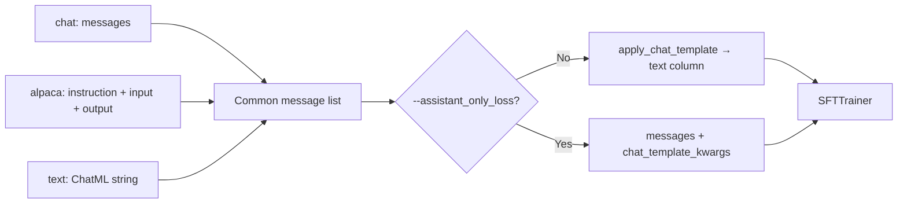

### ChatML Format

The native Qwen format. Each JSONL line (or JSON list item) has a `messages` key:

```json
{
  "messages": [
    {"role": "system", "content": "You are a helpful assistant."},
    {"role": "user", "content": "What is the capital of France?"},
    {"role": "assistant", "content": "The capital of France is Paris."}
  ]
}
```

The system message is optional. Requires `--dataset_format chat` (the default). This is
the only format accepted by `--assistant_only_loss`.

### Alpaca Format

Three fields: `instruction`, `input`, and `output`. When `input` is non-empty it is
appended to the instruction with a blank line between them.

```json
{
  "instruction": "Translate the following to French.",
  "input": "Hello, how are you?",
  "output": "Bonjour, comment allez-vous ?"
}
```

Requires `--dataset_format alpaca`. Ask ChatGPT for these three keys instead of
`messages` if you prefer this schema.

### Text Format

One `text` field containing a full ChatML conversation. The loader splits on
`<|im_end|>\n<|im_start|>` and alternates user / assistant roles starting with user:

```json
{
  "text": "<|im_start|>user\nWhat is machine learning?<|im_end|>\n<|im_start|>assistant\nMachine learning is a subset of AI...<|im_end|>"
}
```

Requires `--dataset_format text`.

---

## Usage

### Basic Training

Train on a local JSONL file where each line is a ChatML conversation:

```bash
python src/train.py \
  --model_id Qwen/Qwen3.5-4B \
  --dataset_path ./data/my_dataset.jsonl \
  --output_dir ./my-finetuned-model
```

`--dataset_path` also accepts a directory: all `*.jsonl` files under it are found
recursively, sorted, and merged. Be aware that a whole tree can merge overlapping copies
of the same records, so prefer an explicit training file or a curated subdirectory:

```bash
python src/train.py \
  --model_id Qwen/Qwen3.5-4B \
  --dataset_path ./data/ntnu \
  --output_dir ./models/ntnu
```

Any path that does not exist locally is treated as a Hugging Face dataset name.

### Training with Alpaca Dataset

```bash
python src/train.py \
  --dataset_path ./data/alpaca_data.json \
  --dataset_format alpaca \
  --lr 2e-4 --epochs 5 \
  --output_dir ./alpaca-finetuned
```

### Training from Hugging Face Hub

```bash
python src/train.py \
  --dataset_path databricks/databricks-dolly-15k \
  --dataset_format alpaca \
  --max_seq_length 2048 \
  --output_dir ./dolly-finetuned
```

### Inference — Interactive (Default)

The model stays loaded and prompts are read in a loop. Enter a question at `You:`; use
`quit`, `exit`, `q`, or Ctrl+C to stop.

```bash
# Fine-tuned model — interactive chat
python src/inference.py --mode finetuned --model_id Qwen/Qwen3.5-4B \
  --adapter_path ./models/ntnu/gpu-12gb-4b

# Base model — one prompt, then continue interactively
python src/inference.py --mode base --model_id Qwen/Qwen3.5-4B \
  --prompt "台灣師範大學的地址是什麼"

# Compare mode — each input shows base vs fine-tuned answers
python src/inference.py --mode compare --model_id Qwen/Qwen3.5-4B \
  --adapter_path ./models/ntnu/gpu-12gb-4b
```

### Inference — One-Shot (`--no_interactive`)

Use this for scripts and comparisons. **`--prompt` is mandatory** with this flag;
`inference.py` has no built-in test prompts.

```bash
python src/inference.py --mode base --model_id Qwen/Qwen3.5-4B \
  --prompt "台灣師範大學的地址是什麼" --no_interactive

python src/inference.py --mode finetuned --model_id Qwen/Qwen3.5-4B \
  --adapter_path ./my-finetuned-model \
  --prompt "台灣師範大學的地址是什麼" --no_interactive
```

### Inference with Thinking Mode

Pass `--use_thinking True` to enable Qwen3.5's `<think>` tags. Unless
`--no_interactive` is set, the script continues to the interactive loop afterwards.

```bash
python src/inference.py --mode finetuned --model_id Qwen/Qwen3.5-4B \
  --adapter_path ./my-finetuned-model \
  --use_thinking True \
  --prompt "台灣師範大學的地址是什麼"
```

### Inspecting a Model

```bash
# Configuration + tokenizer + weights (default)
python src/inspect_model.py --model_id Qwen/Qwen3.5-4B

# Configuration + tokenizer only (fast; skips the weight download)
python src/inspect_model.py --model_id Qwen/Qwen3.5-4B --no_load

# Quantized parameter counts
python src/inspect_model.py --model_id Qwen/Qwen3.5-4B --load_in_4bit True
```

### Inspecting the Tokenizer

```bash
# Split a Traditional Chinese sentence
python src/inspect_tokenizer.py --model_id Qwen/Qwen3.5-0.8B \
  --sentence "請告訴我國立台灣師範大學的具體位置在哪裡？"

# Look up a token string and an ID
python src/inspect_tokenizer.py --model_id Qwen/Qwen3.5-0.8B --token "台"
python src/inspect_tokenizer.py --model_id Qwen/Qwen3.5-0.8B --token_id 120573

# Tokenization only, no model download
python src/inspect_tokenizer.py --model_id Qwen/Qwen3.5-0.8B \
  --sentence "Hello world" --no_model
```

---

## Advanced Usage

### Custom LoRA Target Modules

Restrict LoRA to attention projections to save memory:

```bash
python src/train.py \
  --dataset_path ./data/train.jsonl \
  --model_id Qwen/Qwen3.5-4B \
  --target_modules q_proj,k_proj,v_proj,o_proj \
  --output_dir ./attention-only-lora
```

### Push to Hugging Face Hub

Log in first, then pass both flags:

```bash
huggingface-cli login

python src/train.py \
  --dataset_path ./data/train.jsonl \
  --output_dir ./my-adapter \
  --push_to_hub True \
  --hub_model_id your-username/qwen3-4b-finetuned
```

`--hub_model_id` is required when pushing, and benchmark runs cannot be pushed because
they do not export an adapter.

### Full-Precision LoRA vs QLoRA

QLoRA (4-bit) is the NVIDIA default. Use unquantized LoRA with:

```bash
python src/train.py \
  --dataset_path ./data/train.jsonl \
  --load_in_4bit False \
  --per_device_batch_size 1 \
  --output_dir ./fp-lora-finetuned
```

This requires roughly 12 GB VRAM for a 4B model. Reduce the micro-batch or
`--max_seq_length` if you run out of memory.

### Enable Thinking Mode During Training

If your dataset contains reasoning traces (`<think>...</think>`), enable the
thinking-aware chat template. Training still needs ChatML data; the flag controls how the
template renders the target.

```bash
python src/train.py \
  --dataset_path ./data/reasoning_dataset.jsonl \
  --use_thinking True \
  --output_dir ./thinking-finetuned
```

### Measure Speed and Memory

`--benchmark_steps` times a fixed window of optimizer steps after warmup and writes no
adapter. It pairs well with `--run_metrics` for repeatable comparisons:

```bash
python src/train.py \
  --model_id Qwen/Qwen3.5-4B \
  --dataset_path ./data/ntnu_dataset.jsonl \
  --device cuda --load_in_4bit True \
  --benchmark_steps 10 --benchmark_warmup_steps 3 \
  --run_metrics ./models/benchmarks/nf4-run.json \
  --output_dir ./models/benchmarks/nf4
```

The metrics JSON records all CLI arguments, the model revision and attention
implementation, dataset SHA-256 (for single files), backend, device name, dtype, NF4
state, installed package versions, token-length statistics, phase timings, trainer
metrics, the best checkpoint and validation loss, and the benchmark window result.

---

## Reproducibility: Windows NTNU Benchmark

The four Windows comparison runs are now expressed as plain `src/train.py` commands.
The flags `--gradient_checkpointing`, `--loss_type`, `--run_metrics`, `--group_by_length`,
`--eval_each_epoch`, `--eval_batch_size`, `--assistant_only_loss`, `--benchmark_steps`,
and `--benchmark_warmup_steps` all exist in `train.py`. The versions below use an
effective batch of 16 and an explicit metrics path.

Recorded revisions and metrics live in
`models/ntnu/windows-comparison/observations.json`. Package versions recorded there are
a historical environment, **not** installation requirements; use the versions in
`requirements-common.txt`.

```bash
# Baseline: Qwen3.5-4B, NF4, batch 2 x accum 8, 3 epochs, 2048 tokens
python src/train.py \
  --model_id Qwen/Qwen3.5-4B --load_in_4bit True \
  --dataset_path ./data/ntnu_dataset.jsonl --device gpu \
  --num_epochs 3 --learning_rate 2e-4 --max_seq_length 2048 \
  --per_device_batch_size 2 --gradient_accum_steps 8 \
  --gradient_checkpointing True \
  --output_dir ./models/ntnu/windows-comparison/ntnu-win-baseline \
  --loss_type nll \
  --run_metrics ./models/ntnu/windows-comparison/ntnu-win-baseline/metrics.json

# Qwen3.5-4B short: batch 4 x accum 4, 2 epochs, 512 tokens
python src/train.py \
  --model_id Qwen/Qwen3.5-4B --load_in_4bit True \
  --dataset_path ./data/ntnu_dataset.jsonl --device gpu \
  --num_epochs 2 --learning_rate 2e-4 --max_seq_length 512 \
  --per_device_batch_size 4 --gradient_accum_steps 4 \
  --gradient_checkpointing True \
  --output_dir ./models/ntnu/windows-comparison/ntnu-win-qwen35-4b \
  --loss_type nll --group_by_length --eval_each_epoch --eval_batch_size 4 \
  --run_metrics ./models/ntnu/windows-comparison/ntnu-win-qwen35-4b/metrics.json

# Qwen3-4B-Instruct-2507 short: non-thinking model, same short settings
python src/train.py \
  --model_id Qwen/Qwen3-4B-Instruct-2507 --load_in_4bit True \
  --dataset_path ./data/ntnu_dataset.jsonl --device gpu \
  --num_epochs 2 --learning_rate 2e-4 --max_seq_length 512 \
  --per_device_batch_size 4 --gradient_accum_steps 4 \
  --gradient_checkpointing True \
  --output_dir ./models/ntnu/windows-comparison/ntnu-win-qwen3-4b \
  --loss_type nll --group_by_length --eval_each_epoch --eval_batch_size 4 \
  --run_metrics ./models/ntnu/windows-comparison/ntnu-win-qwen3-4b/metrics.json

# Qwen3.5-2B short: unquantized BF16, batch 8 x accum 2
python src/train.py \
  --model_id Qwen/Qwen3.5-2B --load_in_4bit False \
  --dataset_path ./data/ntnu_dataset.jsonl --device gpu \
  --num_epochs 2 --learning_rate 2e-4 --max_seq_length 512 \
  --per_device_batch_size 8 --gradient_accum_steps 2 \
  --gradient_checkpointing True \
  --output_dir ./models/ntnu/windows-comparison/ntnu-win-qwen35-2b \
  --loss_type nll --group_by_length --eval_each_epoch --eval_batch_size 8 \
  --run_metrics ./models/ntnu/windows-comparison/ntnu-win-qwen35-2b/metrics.json
```

Add `--assistant_only_loss` only with `--dataset_format chat` (the default). For a
timing-only run, add `--benchmark_steps 10 --benchmark_warmup_steps 3`; no adapter will be
exported in that mode.

---

## Output Artifacts

After a normal training run, `output_dir` contains:

```text
my-finetuned-model/
├── adapter_config.json          # LoRA rank, alpha, target modules, base model
├── adapter_model.safetensors    # Trained LoRA weights (tens of MB)
├── tokenizer.json               # Tokenizer vocabulary
├── tokenizer_config.json        # Tokenizer settings
├── chat_template.jinja          # Saved chat template (when the tokenizer has one)
├── training_args.bin            # Serialized trainer arguments
└── checkpoint-*/                 # Intermediate checkpoints if save_steps was reached
```

A separate **merged full model is not written**. Inference always loads the base model
and attaches the adapter, which is why `--model_id` must match the one used for training.
Checkpoint directories contain the same adapter files plus optimizer/scheduler state and
trainer state; `--adapter_path` may point at one of them directly.

---

## Tips & Best Practices

1. **Start small.** Run the 4B smoke command or CPU smoke command before a full run.
2. **Effective batch size** is `per_device_batch_size × gradient_accum_steps × num_gpus`.
   Aim for 16–32. On one GPU, `2 × 8 = 16`.
3. **Learning rate** — `2e-4` is a robust LoRA default. For fewer than 500 examples,
   `1e-4` reduces overfitting risk.
4. **Watch eval loss.** A rising eval loss means overfitting or a learning rate that is
   too high. The best checkpoint is restored automatically when evaluation is enabled.
5. **Sequence length** is capped by `SFTConfig.max_length`. There is no sequence packing
   in the current trainer configuration.
6. **Mixed precision** — the startup log prints the effective dtype. Unsupported BF16
   falls back to FP16 where possible; CPU uses FP32. MPS training needs PyTorch 2.5+ for
   FP16 and 2.6+ for BF16.
7. **Data quality beats quantity.** 500–1000 clean examples often beat 10,000 noisy ones.
8. **Match `model_id` at inference** to the model you fine-tuned.
9. **Choose the inference flow deliberately** — interactive loop for exploration,
   `--no_interactive` with an explicit `--prompt` for scripts.
10. **Keep the evaluation prompts held out** until you are ready to grade a candidate.
11. **For factual work, prefer `--assistant_only_loss`** with ChatML data so the model is
    not trained to reproduce the question text as an answer.
12. **Verify generated training data twice** — structure with the JSONL validator, facts
    with official sources.

---

## Troubleshooting

| Problem | Likely cause | Solution |
|---|---|---|
| `conda: command not found` | Conda not initialized in this shell | Run `conda init bash` / `zsh`, reopen the terminal, or use Anaconda Prompt on Windows |
| `python -m pip: No module named pip` | Wrong Python interpreter | Run `conda activate ai` and check `python --version` |
| Training uses CPU despite an available GPU | The PyTorch wheel or driver cannot access the GPU | Reinstall with the backend's [instructions](#install-and-verify-a-backend) and pass an explicit `--device` |
| `torch.cuda.is_available()` is `False` after ROCm setup | AMD wheel not installed or ROCm version mismatch | Install the correct AMD wheel first; `--backend rocm` only installs remaining dependencies |
| `--device gpu` or an explicit GPU is unavailable | Requested accelerator not visible to PyTorch | Verify the wheel and driver, or use `--device cpu` |
| `OutOfMemoryError` | Micro-batch, sequence length, or LoRA coverage too large | Lower `--max_seq_length` first, then `--per_device_batch_size`, then use attention-only `--target_modules` |
| `KeyError: 'qwen3'` | Transformers too old | Upgrade to `transformers>=5.12.1` |
| NF4 fails on CUDA or ROCm | Missing or mismatched bitsandbytes kernels | Match bitsandbytes to the GPU and CUDA/ROCm release; use `--load_in_4bit False` |
| MPS operator unsupported | PyTorch lacks an MPS kernel | Set `PYTORCH_ENABLE_MPS_FALLBACK=1` before launching Python |
| `--load_in_4bit True` on MPS or XPU | 4-bit loading is not supported there | Use `--load_in_4bit False` |
| Hub download / SSL errors | Broken `SSL_CERT_FILE` / `REQUESTS_CA_BUNDLE` | `train.py` and `inference.py` repair these at startup; `certifi` is declared in `requirements-common.txt` |
| Training loss is NaN | Learning rate too high or dtype issue | Lower `--learning_rate` or use `--torch_dtype bfloat16` |
| Model repeats one phrase | Overfitting or temperature too low | Reduce `--num_epochs` or raise `--temperature` |
| JSONL validator reports bad lines | ChatGPT added prose, fences, or wrong roles | Remove markdown fences and regenerate with Prompt 2 |
| Local file loaded from the Hub | `dataset_path` does not exist locally | Use `./data/train.jsonl` rather than a misspelled path |
| `A valid --prompt is required when using --no_interactive` | `--no_interactive` always needs a prompt | Pass `--prompt "..."` or remove `--no_interactive` |
| `--assistant_only_loss requires --dataset_format chat` | Flag combination is invalid | Use ChatML data or remove the flag |
| `Row N has no complete assistant target` | Assistant answer truncated by the length cap | Increase `--max_seq_length` or shorten that example |
| `--eval_each_epoch requires a positive --test_split` | No evaluation data configured | Set `--test_split 0.05` or remove `--eval_each_epoch` |
| `LoRA adapter not found` | Wrong `--adapter_path` | Point at the output directory or a `checkpoint-*` folder containing `adapter_config.json` |
| `The output belongs to a different evaluation run` | Reusing a result file with different settings | Use a fresh `--output` path or the original model/adapter/backend settings |
| `.jsonl` files missing when training from a directory | Directory scan only matches `*.jsonl`, not `*.json` | Convert the file or pass it directly as `--dataset_path` |

---

## License

This project is licensed under the [MIT License](LICENSE). Qwen3 / Qwen3.5 models are
released under their respective licenses on Hugging Face (the models listed above use
Apache 2.0).

Traditional Chinese documentation: [README.zh-Hant.md](README.zh-Hant.md)
