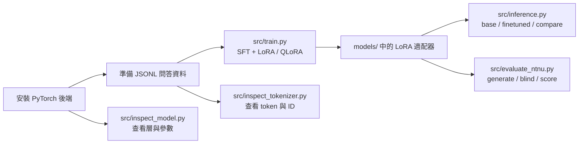
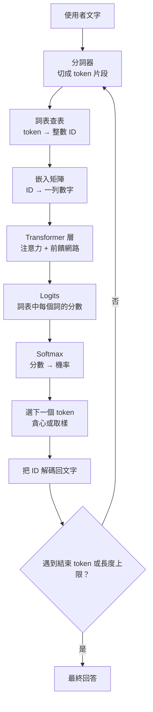
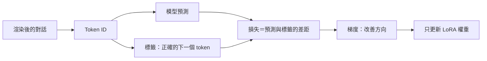
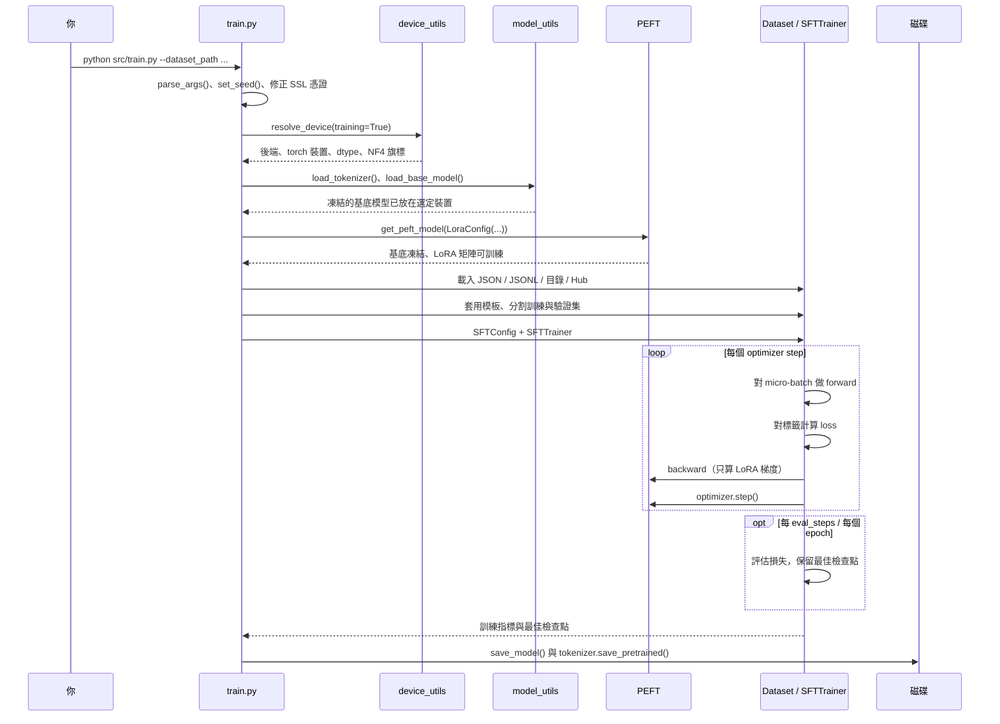
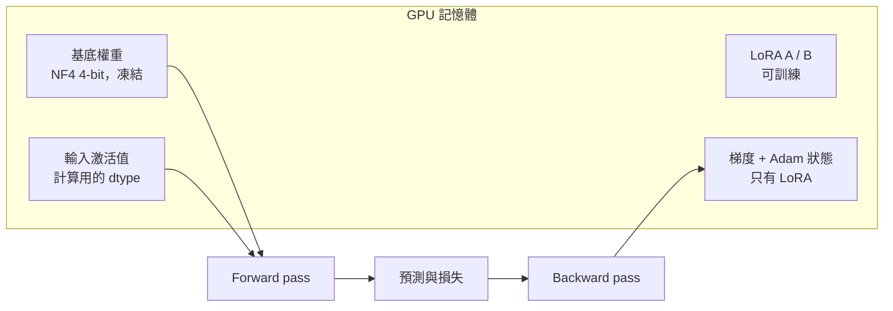
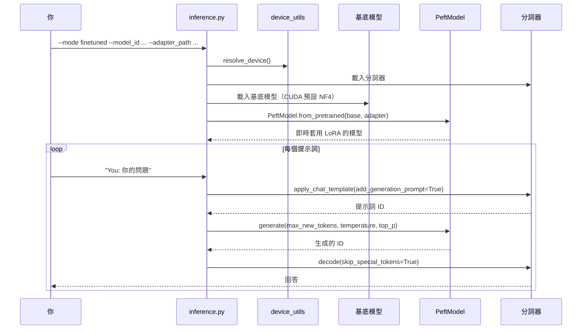
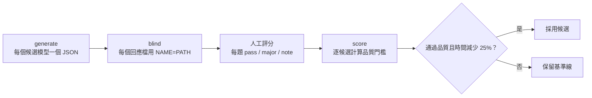
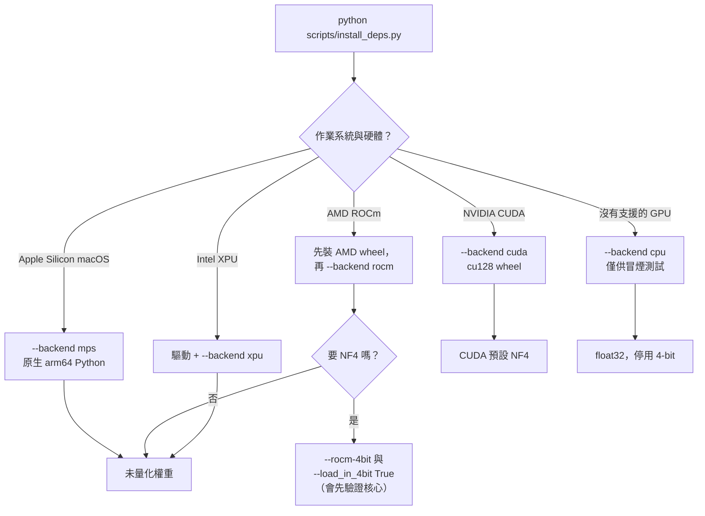
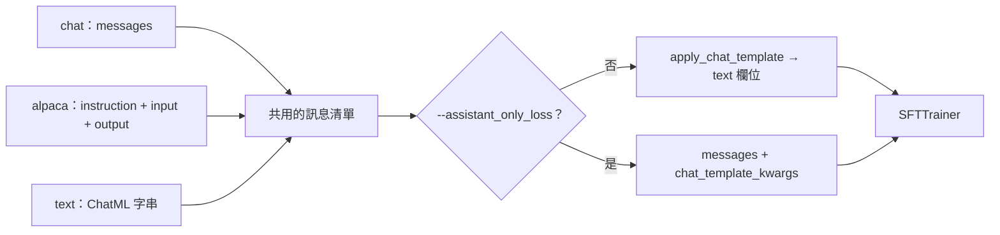

# Fine-Tuning Playground — 微調遊樂場

一套面向教學的程式碼，專為 **Qwen3 / Qwen3.5** 僅解碼器（decoder-only）模型（例如 **Qwen3-4B**、**Qwen3.5-4B**）的監督式微調（Supervised Fine-Tuning, SFT）而設計，採用 **LoRA / QLoRA** 技術。底層使用 Hugging Face 的 `transformers`、`peft`、`trl` 與 `bitsandbytes`。

完整訓練流程集中在單一腳本 [`src/train.py`](src/train.py) 中，由上而下順序執行，所有設定都是命令列參數。沒有設定檔要學，也不需要繼承任何框架類別：你可以從第一行讀到最後一行，確切看到每一步發生什麼事。

**語言：** [English](README.md) · [繁體中文](README.zh-Hant.md)

---

## 目錄

- [專案概述](#專案概述)
- [先從這裡開始：微調究竟如何運作](#先從這裡開始微調究竟如何運作)
  - [30 秒心智模型](#30-秒心智模型)
  - [從一個句子到下一個字](#從一個句子到下一個字)
  - [對話模板在做什麼](#對話模板在做什麼)
  - [SFT 教會模型什麼，損失又遮住了什麼](#sft-教會模型什麼損失又遮住了什麼)
  - [訓練流程逐步拆解](#訓練流程逐步拆解)
  - [為什麼 LoRA 與 QLoRA 能塞進消費級 GPU](#為什麼-lora-與-qlora-能塞進消費級-gpu)
  - [Epoch、Batch、學習率與其他名詞](#epochbatch學習率與其他名詞)
  - [推論時會發生什麼](#推論時會發生什麼)
  - [臺師大評測如何運作](#臺師大評測如何運作)
  - [選擇運算後端](#選擇運算後端)
- [功能特色](#功能特色)
- [硬體需求](#硬體需求)
- [安裝方式](#安裝方式)
  - [方式一 — Miniconda（建議）](#方式一--miniconda建議)
  - [方式二 — venv](#方式二--venv)
  - [安裝並驗證後端](#安裝並驗證後端)
- [快速開始](#快速開始)
  - [跨平台冒煙測試](#跨平台冒煙測試)
  - [NVIDIA 4B 預設](#nvidia-4b-預設)
- [專案結構](#專案結構)
  - [各檔案說明](#各檔案說明)
- [設定參數](#設定參數)
  - [訓練（`src/train.py`）](#訓練-srctrainpy)
  - [推論（`src/inference.py`）](#推論-srcinferencepy)
  - [模型檢查（`src/inspect_model.py`）](#模型檢查-srcinspect_modelpy)
  - [分詞器檢查（`src/inspect_tokenizer.py`）](#分詞器檢查-srcinspect_tokenizerpy)
  - [臺師大評測（`src/evaluate_ntnu.py`）](#臺師大評測-srcevaluate_ntnupy)
- [建議訓練預設組合](#建議訓練預設組合)
  - [平台與作業系統](#平台與作業系統)
  - [VRAM 與模型規模（QLoRA）](#vram-與模型規模qlora)
  - [資料集規模指引](#資料集規模指引)
  - [具名預設組合](#具名預設組合)
  - [預設腳本](#預設腳本)
  - [原生 Windows 臺師大基準測試](#原生-windows-臺師大基準測試)
  - [各預設的手動命令](#各預設的手動命令)
- [資料格式](#資料格式)
  - [ChatML 格式](#chatml-格式)
  - [Alpaca 格式](#alpaca-格式)
  - [純文字格式](#純文字格式)
- [使用方式](#使用方式)
  - [基本訓練](#基本訓練)
  - [使用 Alpaca 資料集訓練](#使用-alpaca-資料集訓練)
  - [從 Hugging Face Hub 載入資料集](#從-hugging-face-hub-載入資料集)
  - [推論 — 互動式（預設）](#推論-互動式預設)
  - [推論 — 單次執行（`--no_interactive`）](#推論-單次執行no_interactive)
  - [啟用思考模式推論](#啟用思考模式推論)
  - [檢查模型](#檢查模型)
  - [檢查分詞器](#檢查分詞器)
- [進階用法](#進階用法)
  - [自訂 LoRA 目標模組](#自訂-lora-目標模組)
  - [推送至 Hugging Face Hub](#推送至-hugging-face-hub)
  - [完整精度 LoRA vs QLoRA](#完整精度-lora-vs-qlora)
  - [訓練時啟用思考模式](#訓練時啟用思考模式)
  - [測量速度與記憶體](#測量速度與記憶體)
- [輸出產物](#輸出產物)
- [建議與最佳實踐](#建議與最佳實踐)
- [疑難排解](#疑難排解)
- [授權條款](#授權條款)

---

## 專案概述

**Qwen3** 與 **Qwen3.5** 是阿里巴巴 Qwen 團隊推出的稠密語言模型。4B 等級型號支援長脈絡、分組查詢注意力（grouped-query attention），並可透過對話模板中的 `<think>` 標籤選擇性啟用連鎖思考（chain-of-thought）**思考模式**。

本專案提供一條從「我有一份 JSONL 檔」到「我有一個會改變模型回答方式的適配器」的完整且易讀的路徑：



程式碼採用的核心選擇：

- **QLoRA**（4-bit NormalFloat 加上雙重量化）是 NVIDIA CUDA 上的預設，可把基底模型所需的記憶體降到消費級 GPU（如 RTX 3060 / 4060 / 4070）能負擔的程度。
- **`trl.SFTTrainer`** 負責監督式微調、對話模板渲染、評估、檢查點與最佳檢查點挑選。
- **全部七個線性投影層**（`q_proj`、`k_proj`、`v_proj`、`o_proj`、`gate_proj`、`up_proj`、`down_proj`）預設都是 LoRA 目標。
- 基底模型是**凍結**的。訓練只更新小型 LoRA 矩陣；匯出的適配器只有幾十 MB，而不是好幾 GB 的完整模型。

---

## 先從這裡開始：微調究竟如何運作

本節假設讀者沒有機器學習背景。後面章節是參考手冊，本節則在解釋「為什麼指令長這樣」。

### 30 秒心智模型

| 日常比喻 | 本專案中的對應物件 |
|---|---|
| 一個已經讀完圖書館所有書的學生 | 預訓練模型（`Qwen/Qwen3.5-4B` 等） |
| 一本寫滿範例問題與理想答案的練習簿 | 你的 JSONL 檔（`messages` / `instruction` / `text`） |
| 寫在書頁邊緣的便利貼，原書不動 | LoRA 適配器（`adapter_model.safetensors`） |
| 把書縮印成極小字體但仍可閱讀 | 4-bit NF4 基底權重（QLoRA） |
| 老師批改「不對，往這個方向稍微修正」 | 損失（loss）與梯度（gradient） |
| 練習老師沒看過的題目 | 保留的驗證分割與臺師大題目集 |

微調**不是**像預訓練那樣從頭教模型事實，而是輕輕推一把已經很有能力的模型，讓它朝向你的範例所展示的風格、格式與領域行為。這也是為什麼幾百到幾千筆好資料就可能有效，而雜訊多的資料一定會有害。

### 從一個句子到下一個字

語言模型看到的不是中文字或英文字母，而是整數，接著是向量，最後是機率。



重點如下：

- **Token（詞元）** — 一段文字。可能是完整中文詞、單一字元，或英文單字的一部分。執行 `src/inspect_tokenizer.py` 可看見句子確切的切法。
- **ID** — 該片段在固定詞表中的索引。嵌入表每個 ID 都有一列；`src/inspect_tokenizer.py --token_id 120573` 會印出那一列。
- **Embedding（嵌入向量）** — 模型真正消費的「意義座標」。
- **Logits → 機率** — 模型對「下一個 token 是每一個詞」各給一個分數。`--temperature` 與 `--top_p` 決定挑選時有多冒險；`temperature 0` 會貪心解碼，結果固定（評測腳本正是這麼做）。
- **自回歸迴圈（autoregressive loop）** — 選到的 token 會接回輸入，模型再跑一次。`--max_new_tokens` 限制這個動作最多幾次。
- **脈絡長度** — 訓練時的 `--max_seq_length` 與模型本身的脈絡視窗，決定一次能考慮多少 token。序列越長越耗記憶體；遇到 OOM 時先調小它。

### 對話模板在做什麼

模型無法只靠串接字串判斷誰在說話。Qwen 使用 ChatML 風格模板與明確的控制 token：

```text
<|im_start|>system
You are a helpful assistant.<|im_end|>
<|im_start|>user
台灣師範大學的地址是什麼？<|im_end|>
<|im_start|>assistant
國立臺灣師範大學位於臺北市大安區和平東路一段 162 號。<|im_end|>
```

訓練時，`train.py` 呼叫 `tokenizer.apply_chat_template(..., tokenize=False,
add_generation_prompt=False)`，並把結果字串存到 `text` 欄位。因此模型學到的是分隔符號，不只是文字。推論時，`inference.py` 使用 `add_generation_prompt=True`，讓提示詞以 `<|im_start|>assistant\n` 結尾，使下一個 token 從回答開始。

這也是為什麼訓練與推論的基底模型 ID 必須一致：模板與詞表都屬於那個特定的分詞器。

### SFT 教會模型什麼，損失又遮住了什麼

訓練會比較模型在每個位置對「正確下一個 token」的機率分布與正確答案，並調整可訓練權重，讓正確答案的機率上升。這就是交叉熵（cross-entropy，也稱 NLL）損失。



本專案預設監督**整段渲染後的 `text`**。若傳入 `--assistant_only_loss`，TRL 會改為接收 `messages` 欄位並遮蔽系統／使用者部分，使損失只來自助理回應與其回合結束 token。腳本會驗證每一筆資料，拒絕助理回答被截斷的紀錄。此旗標需要 `--dataset_format chat`。

### 訓練流程逐步拆解

請對照 [`src/train.py`](src/train.py) 閱讀下圖；訊息順序與 `main()` 函式一致。



值得注意的細節：

- 資料集是在模型與適配器準備好**之後**才載入。
- `--benchmark_steps N>0` 會在 `warmup + N` 個 optimizer step 後停止，印出時間與吞吐量，並刻意**不輸出適配器**。
- 當 `--test_split > 0` 時，`load_best_model_at_end=True` 會在匯出前載回驗證損失最低的檢查點，因此最終目錄保存的是最佳模型，不一定是最後一個。
- `save_total_limit=2` 在磁碟上只保留最近兩個檢查點。

### 為什麼 LoRA 與 QLoRA 能塞進消費級 GPU

4B 模型光是 BF16 權重就約 8 GB，還沒算激活值、梯度與 optimizer 狀態。完整微調需要好幾倍於此的記憶體。LoRA 凍結基底權重，只在每個目標線性層旁邊學習兩個小矩陣：

```text
原始：   y = W x                 W：很大、凍結
LoRA：   y = W x + (alpha / r) * B A x
         A：r x in_features      B：out_features x r      （兩者可訓練）
```



- `r`（`--lora_r`）是秩（rank），也就是小瓶頸的寬度。較大的 `r` 能表示較複雜的變化，但較耗記憶體。
- `alpha`（`--lora_alpha`）縮放 LoRA 更新量。預設組合使用 `alpha = 2 * r`。
- `target_modules` 選擇「在哪裡」裝適配器。預設涵蓋注意力與前饋投影。記憶體吃緊時，優先試試只留注意力層（`q_proj,k_proj,v_proj,o_proj`）。
- QLoRA 另外把凍結基底存成 4-bit NF4 並使用雙重量化，數學運算則在 `bfloat16` / `float16` 中進行。梯度與 optimizer 狀態只存在於 LoRA 參數，這就是主要的節省來源。
- `--gradient_checkpointing`（預設開啟）在 backward 時重新計算中間激活值，以一點速度換取較低的峰值記憶體。

### Epoch、Batch、學習率與其他名詞

| 名詞 | 白話說明 | 本專案參數 |
|---|---|---|
| Example（範例） | JSONL 中的一筆問答紀錄 | `dataset_path` |
| Token（詞元） | 分詞後的一段文字 | `max_seq_length` |
| Batch（批次） | 一次 forward 一起處理的範例數 | `per_device_batch_size` |
| Accumulation（累積） | 先累積幾個小批次，再一次更新權重 | `gradient_accum_steps` |
| Effective batch（有效批次） | `per_device_batch_size × gradient_accum_steps × GPU 數量` | 推導而得 |
| Epoch（訓練輪次） | 完整看過訓練集一次 | `num_epochs` / `--epochs` |
| Learning rate（學習率） | 每次更新權重的步幅 | `learning_rate` / `--lr` |
| Warmup（暖機） | 一開始讓學習率緩慢爬升的短暫階段 | `warmup_ratio` |
| Seed（隨機種子） | 讓分割與初始化可以重現 | `seed` |
| Eval split（驗證分割） | 不參與訓練、用來挑最佳檢查點的資料 | `test_split` |

以內附臺師大資料搭配 `gpu-12gb-4b` 試算：

- 1,252 筆，保留 5% → 約 1,189 筆訓練資料。
- `per_device_batch_size 2 × gradient_accum_steps 8` → 有效批次 16。
- 每輪約 75 個 optimizer step；三輪約 **225 步**，所以範例輸出目錄中會看到 `checkpoint-225/`。
- `--save_steps 200` 因此會在訓練中途寫出檢查點。

> **實作提醒：** 在此版本的 `train.py` 中，`--warmup_ratio` 是以數值形式傳給 `SFTConfig(warmup_steps=...)`（預設 `0.03`）。請把它當成一個固定的小暖機值，不要假設它代表「全部步數的 3%」。

### 推論時會發生什麼

推論不會修改權重。它載入同一個基底模型，接上儲存的適配器，然後重複前面的 token 迴圈。



`--mode compare` 只載入一次基底模型，再在其上套用適配器，對每個提示詞同時印出兩種回答，讓你不必啟動第二個行程就能看出微調是否有幫助。

若 `--adapter_path` 指向的目錄沒有 `adapter_config.json`，腳本會尋找 `checkpoint-*` 子目錄，並選出編號最大且含有適配器的那一個。

### 臺師大評測如何運作

訓練損失只告訴你模型多擬合訓練資料，**不能**告訴你回答是否事實正確。[`src/evaluate_ntnu.py`](src/evaluate_ntnu.py) 為此實作了一套小型、離線、由人評分的基準測試。

`evaluation/ntnu_qa.jsonl` 恰好包含 **60** 題固定的題目：

| 類別 | 數量 | 測試什麼 |
|---|---|---|
| `fact` | 40 | 事實型回答；每題都附臺師大官方來源網址與明確評分條件 |
| `uncertain` | 10 | 條件不足的題目，模型應追問而不該捏造細節 |
| `general` | 10 | 格式與指令遵循限制 |

請不要把這些題目放進訓練資料；否則保留題會變成背誦測驗。



- `generate` 使用貪心解碼（`do_sample=False`）與批次處理，輸出可續跑：設定相符的既有檔案會接續已完成的答案。它需要 LoRA 適配器，沒有「只測基底模型」的模式。
- 每一次 run 都與模型、適配器權重雜湊、題目檔雜湊、生成設定、後端、dtype 與量化旗標綁定。任一項改變都要換新的輸出路徑。
- `blind` 使用固定種子，為每一題獨立打亂回答順序，並把對照表寫到**另一個 key 檔**，讓評分者無法辨識模型。
- `score` 只有在候選的 fact 通過數 ≥ `max(34, 兩個基準線)`、uncertain ≥ 8、general ≥ `max(基準線) - 1`，且 major 捏造數為 0 時，才標記 `passes_quality`。基準線本身不適用這個門檻。

### 選擇運算後端

所有模型指令都接受 `--device auto|gpu|cuda|rocm|mps|xpu|cpu`。



- `auto` 依序嘗試 CUDA、ROCm、MPS、XPU，最後 CPU；`gpu` 用相同順序但要求必須有加速器。明確指定的後端必須可用。
- MPS 與 XPU 會拒絕 `--load_in_4bit True`；CPU 會印出提示並改用未量化的 `float32`。
- ROCm NF4 必須主動啟用，並在載入大模型前執行小型 forward/backward 驗證。失敗時會給出明確的退化方式：`--load_in_4bit False`。

---

## 功能特色

- **QLoRA / LoRA 雙模式支援** — NVIDIA CUDA 與相容的 AMD ROCm 可用 4-bit NF4，其他支援的後端可使用未量化權重。
- **多種資料格式** — ChatML（原生）、Alpaca（`instruction` / `input` / `output`）與純文字；內部都會轉成聊天訊息。
- **Hugging Face Hub 整合** — 直接從 Hub 載入資料集，並把訓練好的適配器推回 Hub。
- **思考模式** — 可在訓練與推論時啟用 Qwen3 的 `<think>` 推理標籤。
- **命令列優先設計** — 所有超參數都是命令列旗標，不需要 YAML。
- **多種運算後端** — NVIDIA CUDA、AMD ROCm、Apple Metal（MPS）、Intel XPU，以及 float32 CPU 備援。
- **單檔訓練腳本** — `src/train.py` 依序執行完整 SFT 流程，適合教學與逐行閱讀。
- **模型檢查** — `src/inspect_model.py` 輸出參數量、詞表大小、嵌入維度與層級結構，無需準備資料集。
- **分詞器檢查** — `src/inspect_tokenizer.py` 顯示 token 片段、ID 與對應的嵌入向量。
- **微調前後對比** — 先測試基底模型，再與微調後模型並排比較。
- **互動式推論** — 預設模型常駐並在使用者輸入迴圈中等待；`--no_interactive` 則執行單次提示後結束。
- **評估資料分割** — 自動分割訓練／測試集，並依驗證損失挑選最佳模型。
- **梯度檢查點** — 預設啟用，可降低峰值記憶體。
- **離線品質基準** — 確定性生成、盲評，以及針對內附臺師大題目集的明確品質門檻。

---

## 硬體需求

| 設定 | 最低 VRAM | 常見 GPU |
|---|---|---|
| QLoRA 4B（4-bit，batch 1–2） | 約 6–8 GB | RTX 3060 / 4060 / 4070、T4 |
| QLoRA 9B（4-bit，batch 1） | 約 10–12 GB | RTX 4070 Ti / 5070 Ti（筆電）、3080 12 GB |
| QLoRA 9B（4-bit，batch 2） | 約 20–24 GB | RTX 4090 / 3090 24 GB、A5000 |
| LoRA 4B（未量化，batch 1） | 約 12 GB | RTX 3080 / 4070 Ti / 4080、A10 |
| CPU（未量化，float32） | — | 任何 CPU，但非常慢；僅供冒煙測試 |

上方的 VRAM 數字以 NVIDIA 為例。Apple Silicon 的模型權重、激活值與作業系統共用統一記憶體。測試新機器時可先從 Qwen3.5-0.8B 開始。

訓練、推論、兩個檢查工具與臺師大評測都接受 `--device auto|gpu|cuda|rocm|mps|xpu|cpu`。自動偵測依 CUDA、ROCm、MPS、XPU、CPU 的順序；`gpu` 使用相同順序但要求加速器可用。明確指定的後端必須存在。

訓練與推論在 NVIDIA CUDA 上預設使用 NF4。ROCm 預設未量化，且只有在核心驗證通過後才接受 `--load_in_4bit True`。MPS 與 XPU 使用未量化權重。CPU 使用未量化的 `float32`。兩個檢查工具在所有後端預設都未量化。

---

## 安裝方式

建議使用 **Python 3.11 或 3.12** 搭配相容的 PyTorch wheel。ROCm 請使用 AMD 版本要求的 Python 版本。每種 PyTorch 後端建議使用獨立環境。

### 方式一 — Miniconda（建議）

```bash
git clone https://github.com/cw1997/fine-tuning-playground.git
cd fine-tuning-playground

conda create -n finetune python=3.11 -y
conda activate finetune

# 安裝平台預設後端，或依下表選擇後端
python scripts/install_deps.py
```

### 方式二 — venv

```bash
git clone https://github.com/cw1997/fine-tuning-playground.git
cd fine-tuning-playground

python -m venv venv
source venv/bin/activate        # Linux / macOS
# venv\Scripts\activate         # Windows PowerShell

python scripts/install_deps.py
```

### 安裝並驗證後端

`install_deps.py` 會選擇 PyTorch wheel、執行小型張量運算，並印出目前後端與 PyTorch 版本。預設值為 Apple Silicon macOS 上的 MPS、Intel macOS 上的 CPU，以及 Windows / Linux 上的 CUDA。Bash 包裝腳本會轉送 Python 參數；PowerShell 包裝腳本使用 `-Backend` 與 `-Rocm4Bit`。

| 後端 | 在啟用環境中安裝 | 驗證模型工具 |
|---|---|---|
| NVIDIA CUDA（Linux / Windows） | `python scripts/install_deps.py --backend cuda` | `python src/inspect_model.py --device cuda --no_load` |
| AMD ROCm（Linux / WSL2 / Windows） | 先裝 AMD PyTorch wheel，再執行 `python scripts/install_deps.py --backend rocm` | `python src/inspect_model.py --device rocm --no_load` |
| Apple M 系列（macOS） | 使用原生 arm64 Python 執行 `bash scripts/install_deps.sh --backend mps` | `python src/inspect_model.py --device mps --no_load` |
| Intel XPU（Linux / Windows） | 裝好 GPU 驅動後執行 `python scripts/install_deps.py --backend xpu` | `python src/inspect_model.py --device xpu --no_load` |
| CPU | `python scripts/install_deps.py --backend cpu` | `python src/inspect_model.py --device cpu --no_load` |

ROCm 請先確認驅動、GPU 與 PyTorch wheel 相符。AMD NF4 請執行 `python scripts/install_deps.py --backend rocm --rocm-4bit`，或 `powershell -File scripts/install_deps.ps1 -Backend rocm -Rocm4Bit`，並使用與 GPU／ROCm 版本相符的 bitsandbytes。

`python -m pip install -r requirements.txt` 仍可用於直接安裝 NVIDIA CUDA 版本。其他後端則由安裝腳本在選擇或驗證 PyTorch 後改用 `requirements-common.txt`。

參考資料：[AMD Linux](https://rocm.docs.amd.com/projects/radeon-ryzen/en/latest/docs/install/installrad/native_linux/install-pytorch.html) · [AMD WSL2](https://rocm.docs.amd.com/projects/radeon-ryzen/en/latest/docs/compatibility/compatibilityrad/wsl/wsl_compatibility.html) · [AMD Windows](https://rocm.docs.amd.com/projects/radeon-ryzen/en/latest/docs/install/installryz/windows/install-pytorch.html) · [Intel XPU](https://docs.pytorch.org/docs/stable/notes/get_start_xpu.html) · [bitsandbytes ROCm](https://huggingface.co/docs/bitsandbytes/installation#amd-rocm)

核心套件：

| 套件 | requirements 中的約束 | 用途 |
|---|---|---|
| `torch` | `>=2.4.0,<2.12` | 深度學習框架（`requirements.txt` 使用 cu128 wheel） |
| `transformers` | `>=5.12.1` | Qwen 模型載入、分詞與訓練 |
| `peft` | `>=0.13.0` | LoRA / QLoRA 適配器設定 |
| `trl` | `>=1.6.0` | `SFTTrainer`：助理標籤與 chunked loss |
| `accelerate` | `>=1.13.0` | Trainer 裝置配置與混合精度 |
| `bitsandbytes` | CUDA `>=0.46.1`、ROCm `>=0.50.0` | 選擇性 4-bit NF4 量化 |
| `datasets` | `>=3.0.0` | 資料集載入與處理 |
| `packaging` | `>=21.0` | PyTorch 版本檢查 |

可執行與硬體無關的回歸測試：

```bash
python -m unittest discover -s tests -v
```

---

## 快速開始

### 跨平台冒煙測試

安裝好後端後，用 Qwen3.5-0.8B 跑一步訓練並重新載入適配器。把 `gpu` 換成 `mps`、`rocm`、`xpu`、`cuda` 或 `cpu` 可明確指定後端。在相容的 AMD GPU 上，於兩個 Python 指令加上 `--load_in_4bit True` 可驗證 NF4。

```bash
python -c "from pathlib import Path; p=Path('models/backend-smoke'); p.mkdir(parents=True, exist_ok=True); (p/'train.jsonl').write_bytes(Path('data/ntnu_dataset.jsonl').read_bytes().splitlines(keepends=True)[0])"

python src/train.py --device gpu --dataset_path ./models/backend-smoke/train.jsonl \
  --num_epochs 1 --test_split 0 --max_seq_length 64 --per_device_batch_size 1 \
  --gradient_accum_steps 1 --output_dir ./models/backend-smoke/adapter

python src/inference.py --device gpu --mode finetuned \
  --adapter_path ./models/backend-smoke/adapter \
  --prompt "What does a tokenizer do?" --max_new_tokens 32 --no_interactive
```

### NVIDIA 4B 預設

準備好 CUDA 環境，並用內附完整資料集訓練：

```bash
# 1. 複製並進入專案
git clone https://github.com/cw1997/fine-tuning-playground.git
cd fine-tuning-playground

# 2. 建立並啟用環境（或 venv — 見安裝方式）
conda create -n finetune python=3.11 -y
conda activate finetune

# 3. 安裝並驗證 CUDA
python scripts/install_deps.py --backend cuda

# 4. 使用內附臺師大資料集（1,252 筆 ChatML 紀錄）訓練
bash scripts/train_preset.sh gpu-12gb-4b
# 等效手動指令：
# python src/train.py --model_id Qwen/Qwen3.5-4B --dataset_path ./data/ntnu_dataset.jsonl \
#   --output_dir ./models/ntnu/gpu-12gb-4b

# 5. 微調前的基底模型
python src/inference.py --mode base --model_id Qwen/Qwen3.5-4B \
  --prompt "台灣師範大學的地址是什麼" --no_interactive

# 6. 微調後的模型
python src/inference.py --mode finetuned --model_id Qwen/Qwen3.5-4B \
  --adapter_path ./models/ntnu/gpu-12gb-4b \
  --prompt "台灣師範大學的地址是什麼" --no_interactive

# 7. 互動式對話（輸入 quit / exit / q 結束）
python src/inference.py --mode finetuned --model_id Qwen/Qwen3.5-4B \
  --adapter_path ./models/ntnu/gpu-12gb-4b
```

---

## 專案結構

```text
fine-tuning-playground/
├── requirements.txt                    # NVIDIA cu128 安裝入口
├── requirements-common.txt             # 共用 Python 依賴
├── src/
│   ├── train.py                        # 完整 SFT 流程（單檔、由上而下）
│   ├── inference.py                    # base / finetuned / compare + 輸入迴圈
│   ├── evaluate_ntnu.py                # 確定性生成、盲評、品質評分
│   ├── device_utils.py                 # 後端選擇、dtype、ROCm NF4 驗證
│   ├── model_utils.py                  # 共用的分詞器與模型載入工具
│   ├── inspect_model.py                # 模型內部結構報告
│   └── inspect_tokenizer.py            # token 片段、ID 與嵌入向量
├── data/
│   ├── ntnu_dataset.jsonl              # 內附臺師大 ChatML 資料集（1,252 筆）
│   ├── full_dataset.jsonl              # 臺師大 + 臺灣資料彙整（1,746 筆）
│   ├── generate_ntnu_dataset.py        # 將 ntnu/ + taiwan/ 彙整成 full_dataset.jsonl
│   ├── restructure_dataset.py          # 輸出到 data/splits/ 與 data/generated/
│   ├── ntnu/                           # 整理過的臺師大 JSONL（general、extras）
│   ├── taiwan/                         # 整理過的臺灣 JSONL（7 類）
│   └── _archive/                       # 舊版紀錄產生器模組
├── evaluation/ntnu_qa.jsonl            # 60 題保留題目、評分條件與來源
├── models/                             # 適配器與基準測試資料（已 gitignore）
├── scripts/
│   ├── install_deps.py                 # 依後端安裝依賴並檢查裝置
│   ├── install_deps.sh                 # 安裝器的 Bash 包裝
│   ├── install_deps.ps1                # 安裝器的 PowerShell 包裝
│   ├── train_preset.sh                 # Bash 訓練預設
│   └── train_preset.ps1                # PowerShell 預設 + Windows 臺師大基準
├── tests/test_device_utils.py          # 後端選擇與量化測試
├── README.md                           # 本文件的英文版
└── README.zh-Hant.md                   # 繁體中文文件
```

### 各檔案說明

**`src/train.py`** — 單檔完整 SFT 流程：修正 SSL → 解析參數 → 選擇裝置 → 載入分詞器 → 載入基底模型（可選 4-bit）→ 套用 LoRA → 載入並格式化資料 → 設定 `SFTTrainer` → 訓練 → 儲存適配器。所有超參數都是 CLI 旗標。

**`src/inference.py`** — 獨立推論腳本，支援 `base`、`finetuned`、`compare` 三種模式。沒有 `--prompt` 時直接進入輸入迴圈（`You:`；輸入 `quit`、`exit`、`q` 或按 Ctrl+C 結束）。有 `--prompt` 時先回答一次，除非加上 `--no_interactive`，否則會繼續進入同一個迴圈。

**`src/evaluate_ntnu.py`** — 三個子命令。`generate` 為單一模型與適配器產生確定性回答；`blind` 打亂不同命名的 run 的回答並另外儲存對照 key；`score` 對完成的評分套用品質門檻。

**`src/device_utils.py`** — 解析後端、裝置、dtype 與 NF4 策略，並執行 ROCm NF4 預檢。**`src/model_utils.py`** 放共用的分詞器／模型載入程式、預設模型 ID（`Qwen/Qwen3.5-0.8B`）與 SSL 憑證修正。

**`src/inspect_model.py`** — 輸出標準化報告：模型設定（詞表、隱藏維度、層數、注意力頭、KV 頭、頭維度、FFN 大小、脈絡、激活函數、RoPE theta、綁定嵌入）、分詞器資訊，以及（除非加 `--no_load`）參數量、嵌入形狀與記憶體估計、dtype 與放置位置。

**`src/inspect_tokenizer.py`** — 顯示句子如何切成 token、每個 ID，以及從輸入嵌入層取出的向量；也可依字串（`--token`）或 ID（`--token_id`）查詢單一 token。位元組層級 token 會轉成可讀形式（GPT 風格 `Ġ` 前綴會變成空白）。三個參數至少給一個。

**`data/`** — `ntnu_dataset.jsonl` 有 1,252 筆關於國立臺灣師範大學的 ChatML 紀錄；`full_dataset.jsonl` 彙整 `ntnu/` 與 `taiwan/` 後共 1,746 筆。`restructure_dataset.py` 會把 `ntnu_dataset.jsonl` 分類寫入 `data/splits/`，並產生臺灣大學與行政區問答到 `data/generated/`；`generate_ntnu_dataset.py` 再把整理過的子目錄彙整成 `full_dataset.jsonl`。`_archive/` 保留舊版產生器供參考。

**`scripts/train_preset.sh` / `scripts/train_preset.ps1`** — 常見 GPU 等級的具名預設。PowerShell 腳本另外定義四個原生 Windows 臺師大比較預設。可用 `DATASET_PATH=...`（Bash）或 `$env:DATASET_PATH = ...`（PowerShell）覆寫資料集。

**`tests/test_device_utils.py`** — 以模擬硬體驗證後端選擇與量化規則；執行方式為 `python -m unittest discover -s tests -v`。

---

## 設定參數

### 訓練（`src/train.py`）

| 類別 | 參數 | 預設值 | 說明 |
|---|---|---|---|
| **模型** | `--model_id` | `Qwen/Qwen3.5-0.8B` | Hugging Face 模型 ID；正式 GPU 訓練請改用 `Qwen/Qwen3.5-4B` 或 `Qwen/Qwen3-4B` |
| | `--load_in_4bit` | CUDA 上開啟 | `True` / `False`；NF4 QLoRA。相容的 ROCm 需主動開啟；MPS/XPU 會拒絕；CPU 會忽略 |
| | `--torch_dtype` | `bfloat16` | `bfloat16`、`float16`、`float32`；能力檢查可能改用其他有效 dtype |
| **LoRA** | `--lora_r` | `16` | LoRA 秩 |
| | `--lora_alpha` | `32` | LoRA 縮放係數，通常 `2 × r` |
| | `--lora_dropout` | `0.05` | LoRA 層的 dropout |
| | `--target_modules` | `q_proj,k_proj,v_proj,o_proj,gate_proj,up_proj,down_proj` | 以逗號分隔的模組名稱 |
| **資料** | `--dataset_path` | _(必填)_ | 本機 JSON/JSONL 檔、遞迴掃描 `*.jsonl` 的目錄，或 Hub 資料集名稱。本機不存在的路徑會交給 `load_dataset()` |
| | `--dataset_format` | `chat` | `chat`、`alpaca` 或 `text` |
| | `--test_split` | `0.05` | 驗證比例，範圍 `[0, 1)`；`0` 停用評估 |
| | `--seed` | `42` | 分割、初始化與取樣的種子 |
| | `--max_seq_length` | `4096` | 每筆範例的最大 token 數 |
| | `--use_thinking` | `False` | 將 `enable_thinking` 傳給對話模板 |
| **優化** | `--learning_rate`、`--lr` | `2e-4` | 峰值學習率 |
| | `--num_epochs`、`--epochs` | `3` | 訓練輪次 |
| | `--per_device_batch_size`、`--batch_size` | `2` | 每裝置 micro-batch |
| | `--gradient_accum_steps` | `8` | 每次權重更新前累積的 micro-batch 數 |
| | `--gradient_checkpointing` | `True` | 重新計算激活值以節省記憶體 |
| | `--group_by_length` | 關閉 | 把長度相近的範例分組（`train_sampling_strategy="group_by_length"`） |
| | `--assistant_only_loss` | 關閉 | 只監督助理回合與其結束 token；需要 `--dataset_format chat` |
| | `--loss_type` | TRL 預設 | `nll` 或 `chunked_nll`（降低詞表投影記憶體） |
| | `--warmup_ratio` | `0.03` | 此版本以數值形式傳入 `SFTConfig(warmup_steps=...)` |
| | `--logging_steps` | `10` | 每 N 步記錄一次指標 |
| | `--save_steps` | `200` | `save_strategy="steps"` 時每 N 步存檢查點 |
| | `--output_dir` | `./models/qwen3-4b-finetuned` | 適配器輸出目錄 |
| **評估** | `--eval_each_epoch` | 關閉 | 改為每個 epoch 評估並存檔，而非每 `save_steps` |
| | `--eval_batch_size` | `8` | 每裝置評估 micro-batch |
| **基準測試** | `--benchmark_steps` | `0` | 計時特定步數；大於 0 時不評估也不輸出適配器 |
| | `--benchmark_warmup_steps` | `3` | 不計入計時的暖機步數 |
| | `--run_metrics` | — | JSON 路徑：時間、後端、dtype、NF4、長度、模型修訂與版本 |
| **硬體** | `--device` | `auto` | `auto`、`gpu`、`cuda`、`rocm`、`mps`、`xpu`、`cpu` |
| **Hub** | `--push_to_hub` | `False` | 訓練後推送適配器與分詞器；與基準模式不相容 |
| | `--hub_model_id` | `""` | Hub 目標 repository；推送時必填 |

`parse_args()` 的驗證規則：步數不可為負、`0 <= test_split < 1`、`0 <= warmup_ratio <= 1`、batch／累積／長度必須為正、`--assistant_only_loss` 需要 chat 格式、`--eval_each_epoch` 需要正的驗證比例，且基準測試不能與 Hub 推送同時使用。

### 推論（`src/inference.py`）

| 類別 | 參數 | 預設值 | 說明 |
|---|---|---|---|
| **模型** | `--model_id` | `Qwen/Qwen3.5-0.8B` | 基底模型；必須與訓練時使用的模型一致 |
| | `--mode` | `base` | `base`、`finetuned` 或 `compare` |
| | `--adapter_path` | — | `finetuned` / `compare` 必填；必要時自動選取最新的 `checkpoint-*` |
| | `--load_in_4bit` | CUDA 上開啟 | `True` / `False`；NF4 規則與訓練一致 |
| | `--torch_dtype` | `bfloat16` | 計算用 dtype |
| | `--device` | `auto` | `auto`、`gpu`、`cuda`、`rocm`、`mps`、`xpu`、`cpu` |
| **生成** | `--prompt` | — | 進入輸入迴圈前先回答的一個提示詞 |
| | `--max_new_tokens` | `2048` | 最多生成 token 數 |
| | `--temperature` | `0.7` | 取樣溫度；`0` 為貪心解碼 |
| | `--top_p` | `0.9` | nucleus sampling 閾值 |
| | `--use_thinking` | `False` | 在對話模板中啟用思考模式 |
| **流程** | `--no_interactive` | 關閉 | 回答一次就結束。**必須搭配非空的 `--prompt`** |

沒有 `--prompt` 時，腳本會略過單次測試，直接進入輸入迴圈。`--no_interactive` 但沒有提示詞會觸發參數解析錯誤；`inference.py` 沒有內建測試提示詞。

### 模型檢查（`src/inspect_model.py`）

| 參數 | 預設值 | 說明 |
|---|---|---|
| `--model_id` | `Qwen/Qwen3.5-0.8B` | 要檢查的模型 |
| `--load_in_4bit` | `False` | 以量化權重載入，查看量化後的參數量 |
| `--torch_dtype` | `float32` | 載入權重時的計算 dtype |
| `--device` | `auto` | `auto`、`gpu`、`cuda`、`rocm`、`mps`、`xpu`、`cpu` |
| `--no_load` | 關閉 | 只印設定與分詞器資訊 |

### 分詞器檢查（`src/inspect_tokenizer.py`）

| 參數 | 預設值 | 說明 |
|---|---|---|
| `--model_id` | `Qwen/Qwen3.5-0.8B` | 要檢查分詞器（與選擇性嵌入向量）的模型 |
| `--sentence` | — | 將句子切成 token 片段、ID 與向量 |
| `--token` | — | 查詢單一 token 字串的索引與向量 |
| `--token_id` | — | 查詢單一 token ID 的字串與向量 |
| `--vector_limit` | `8` | 每條向量印出的元素數；`0` 表示全部 |
| `--load_in_4bit` | `False` | 以 4-bit 載入模型 |
| `--torch_dtype` | `float32` | 載入權重時的計算 dtype |
| `--device` | `auto` | `auto`、`gpu`、`cuda`、`rocm`、`mps`、`xpu`、`cpu` |
| `--no_model` | 關閉 | 只做分詞與 ID，不載入模型（沒有向量） |

`--sentence`、`--token`、`--token_id` 至少給一個，且 `--vector_limit` 必須非負。

### 臺師大評測（`src/evaluate_ntnu.py`）

頂層選項 `--cases`（預設 `evaluation/ntnu_qa.jsonl`）必須寫在子命令**之前**。

| 子命令 | 參數 | 預設值 | 說明 |
|---|---|---|---|
| `generate` | `--model_id` | _(必填)_ | 基底模型 ID |
| | `--adapter_path` | _(必填)_ | 要評測的適配器 |
| | `--device` | `gpu` | `auto`、`gpu`、`cuda`、`rocm`、`mps`、`xpu`、`cpu` |
| | `--load_in_4bit` | CUDA 上開啟 | 與 `--bf16_weights` 互斥 |
| | `--bf16_weights` | 關閉 | 未量化 BF16 權重；與 `--load_in_4bit` 互斥 |
| | `--batch_size` | `4` | 同時生成的提示詞數 |
| | `--max_new_tokens` | `192` | 回答長度上限 |
| | `--output` | _(必填)_ | 可續跑的 JSON，含 `run` 中繼資料與 `answers` |
| `blind` | `NAME=PATH ...` | _(必填)_ | 每個候選或基準線一支命名的回應檔 |
| | `--output` | _(必填)_ | 打亂後的評閱檔 |
| | `--key` | _(必填)_ | 題目 ID 對應到 run 名稱的獨立 key 檔 |
| `score` | `--review` | _(必填)_ | `blind` 產生的評閱檔 |
| | `--key` | _(必填)_ | `blind` 產生的 key 檔 |
| | `--baselines` | _(必填)_ | 恰好兩個出現在評閱檔中的基準線名稱 |
| | `--output` | _(必填)_ | 各 run 的統計與 `passes_quality` 旗標 |

`generate` 內部會把 `torch_dtype` 固定為 `bfloat16`。既有輸出檔只有在記錄的 run 設定相符時才會沿用，否則腳本會報錯並要求新的路徑。

> **提醒：** `src/train.py` 與 `src/inference.py` 的 `--model_id` 預設都是 `Qwen/Qwen3.5-0.8B`，讓 CPU 冒煙測試保持輕量。正式 GPU 訓練請明確傳入 `--model_id Qwen/Qwen3.5-4B`（或其他 4B / 9B 模型），且訓練與推論要一致。

---

## 建議訓練預設組合

GPU 預設使用 CUDA 或相容的 ROCm，並需安裝 bitsandbytes。這些預設要求 `bfloat16`、ChatML 格式，且**有效批次大小為 16**。MPS 與 XPU 請使用[快速開始](#快速開始)中的未量化指令。所有標準預設都使用 5% 驗證分割，並依驗證損失保留最佳檢查點。

內附臺師大資料集有 **1,252** 筆，因此標準預設使用 3 個 epoch 與 `lr = 2e-4`。更大的自訂資料請套用[資料集規模指引](#資料集規模指引)。

### 平台與作業系統

| 平台 | 安裝 | 列出預設 | 執行訓練 | 備註 |
|---|---|---|---|---|
| **Linux** | `bash scripts/install_deps.sh` | `bash scripts/train_preset.sh --list` | `bash scripts/train_preset.sh gpu-12gb-4b` | 建議使用原生 CUDA |
| **Apple Silicon macOS** | `bash scripts/install_deps.sh --backend mps` | 同 Linux | [跨平台冒煙測試](#跨平台冒煙測試) | 使用 `--device mps` |
| **Windows（PowerShell）** | `powershell -File scripts/install_deps.ps1` | `powershell -File scripts/train_preset.ps1 -List` | `powershell -File scripts/train_preset.ps1 -Preset gpu-12gb-4b` | OOM 時設定 `$env:PYTORCH_CUDA_ALLOC_CONF="expandable_segments:True"` |
| **Windows（Git Bash）** | `bash scripts/install_deps.sh` | 同 Linux | 同 Linux | 指令與 Linux 相同 |

兩個腳本都支援以環境變數覆寫 `DATASET_PATH`、`OUTPUT_DIR`、`NUM_EPOCHS`、`LEARNING_RATE`，不需要修改腳本。

```bash
# 自訂資料集（Linux / Git Bash）
DATASET_PATH=./data/my_dataset.jsonl bash scripts/train_preset.sh gpu-12gb-4b

# 較大資料集 — 減少 epoch（30K+ 筆）
NUM_EPOCHS=2 LEARNING_RATE=1.5e-4 DATASET_PATH=./data/large.jsonl \
  bash scripts/train_preset.sh gpu-24gb-9b

# 自訂輸出目錄
OUTPUT_DIR=./models/my-run bash scripts/train_preset.sh gpu-12gb-4b
```

```powershell
# 自訂資料集（Windows PowerShell）
$env:DATASET_PATH = ".\data\my_dataset.jsonl"
powershell -File scripts/train_preset.ps1 -Preset gpu-12gb-4b

# 較大資料集 — 減少 epoch
$env:NUM_EPOCHS = "2"
$env:LEARNING_RATE = "1.5e-4"
$env:DATASET_PATH = ".\data\large.jsonl"
powershell -File scripts/train_preset.ps1 -Preset gpu-24gb-9b
```

### VRAM 與模型規模（QLoRA）

以下是套用[資料集規模](#資料集規模指引)調整前的起點。遇到 OOM 時先降低 `--max_seq_length`，再試 `--target_modules q_proj,k_proj,v_proj,o_proj`。

| VRAM | 模型 | Batch | Accum | 有效 Batch | 最大長度 | LoRA r | Epochs | LR | 常見 GPU |
|---|---|---|---|---|---|---|---|---|---|
| 6–8 GB | Qwen3.5-4B | 1 | 16 | 16 | 2048 | 16 | 3 | 2e-4 | RTX 3060 / 4060 / 4070 |
| 12 GB | Qwen3.5-4B | 2 | 8 | 16 | 2048 | 16 | 3 | 2e-4 | RTX 3060 12 GB / 4070 |
| 12 GB | Qwen3.5-9B | 1 | 16 | 16 | 1536 | 16 | 3 | 2e-4 | RTX 5070 Ti 筆電 |
| 12 GB | Qwen3.5-9B | 1 | 16 | 16 | 2048 | 16 | 3 | 2e-4 | OOM 時改用僅注意力 LoRA |
| 16 GB | Qwen3.5-9B | 1 | 16 | 16 | 2048 | 32 | 3 | 2e-4 | RTX 4080 16 GB / 4070 Ti Super |
| 24 GB | Qwen3.5-4B | 2 | 8 | 16 | 4096 | 32 | 3 | 2e-4 | RTX 3090 / 4090 |
| 24 GB | Qwen3.5-9B | 2 | 8 | 16 | 2048 | 32 | 3 | 2e-4 | RTX 4090 / A5000 |
| CPU | Qwen3.5-0.8B | 1 | 4 | 4 | 512 | 8 | 1 | 2e-4 | 僅冒煙測試；`--device cpu` |

### 資料集規模指引

在[硬體預設](#vram-與模型規模qlora)之上套用下表。有效批次大小建議維持在 16–32。

| 範例數 | Epochs | 學習率 | LoRA r | test_split | 覆寫方式 | 備註 |
|---|---|---|---|---|---|---|
| < 500 | 3–5 | 1e-4 | 16 | 0.10 | `LEARNING_RATE=1e-4 NUM_EPOCHS=5` | 過擬合風險高；監控驗證損失 |
| 500 – 5,000 | 3 | 2e-4 | 16 | 0.05 | _(預設值)_ | 內附臺師大資料（1,252 筆） |
| 5,000 – 30,000 | 2–3 | 1.5e-4 – 2e-4 | 32 | 0.05 | `NUM_EPOCHS=2 LEARNING_RATE=1.5e-4` | 較高 rank 有助於領域適應 |
| 30,000+ | 1–2 | 1.5e-4 | 16–32 | 0.05 | `NUM_EPOCHS=2 LEARNING_RATE=1.5e-4` | 避免 3 輪以上；注意過擬合 |

以 30K+ 筆資料為例：

```bash
NUM_EPOCHS=2 LEARNING_RATE=1.5e-4 DATASET_PATH=./data/large.jsonl \
  bash scripts/train_preset.sh gpu-24gb-9b
```

### 具名預設組合

以下十個預設在**兩個腳本中都存在**：

| 預設 | 目標硬體 | 模型 | 用途 |
|---|---|---|---|
| `smoke-4b` | CUDA 或相容 ROCm | Qwen3.5-4B | 1 輪流程檢查 |
| `smoke-9b` | 12 GB+ GPU | Qwen3.5-9B | 1 輪流程檢查 |
| `cpu-smoke` | 僅 CPU | Qwen3.5-0.8B | 沒有 GPU 時驗證安裝 |
| `gpu-8gb-4b` | 6–8 GB | Qwen3.5-4B | 入門消費級 GPU |
| `gpu-12gb-4b` | 12 GB | Qwen3.5-4B | 12 GB 上的平衡 4B |
| `gpu-12gb-9b` | 12 GB 筆電／桌機 | Qwen3.5-9B | 建議用於 RTX 5070 Ti 12 GB 筆電 |
| `gpu-12gb-9b-long` | 12 GB | Qwen3.5-9B | 2048 token 回答、僅注意力 LoRA |
| `gpu-16gb-9b` | 16 GB | Qwen3.5-9B | 完整 7 層 LoRA，r=32 |
| `gpu-24gb-4b` | 24 GB | Qwen3.5-4B | 高品質 4B、4096 token 脈絡 |
| `gpu-24gb-9b` | 24 GB | Qwen3.5-9B | 建議桌機訓練 9B |

### 預設腳本

選擇性：訓練前降低 Windows / Git Bash 上的 CUDA 記憶體碎片：

```bash
export PYTORCH_CUDA_ALLOC_CONF=expandable_segments:True
```

**Linux / macOS / Git Bash：**

```bash
bash scripts/train_preset.sh --list
bash scripts/train_preset.sh smoke-9b
bash scripts/train_preset.sh gpu-12gb-9b
DATASET_PATH=./data/my_dataset.jsonl bash scripts/train_preset.sh gpu-24gb-9b
OUTPUT_DIR=./models/my-run DATASET_PATH=./data/my.jsonl bash scripts/train_preset.sh gpu-12gb-4b
```

**Windows PowerShell：**

```powershell
powershell -File scripts/train_preset.ps1 -List
powershell -File scripts/train_preset.ps1 -Preset smoke-9b
powershell -File scripts/train_preset.ps1 -Preset gpu-12gb-9b
$env:DATASET_PATH = ".\data\my_dataset.jsonl"
powershell -File scripts/train_preset.ps1 -Preset gpu-24gb-9b
```

### 原生 Windows 臺師大基準測試

這四個預設**只存在於 `scripts/train_preset.ps1`**，Bash 腳本沒有。請使用 CUDA Python 環境。RTX 5070 Ti Laptop 的檢查使用 Python 3.11、PyTorch 2.11.0+cu128、Transformers 5.12.1、TRL 1.6.0、PEFT 0.19.1 與 bitsandbytes 0.49.2。開始前請確認目前 Python 能報告 CUDA。

| 預設 | 模型 | 權重 | Micro-batch × 累積 | Epochs | 序列長度 |
|---|---|---|---|---|---|
| `ntnu-win-baseline` | Qwen3.5-4B | NF4 | 2 × 8 | 3 | 2048 |
| `ntnu-win-qwen35-4b` | Qwen3.5-4B | NF4 | 4 × 4 | 2 | 512 |
| `ntnu-win-qwen3-4b` | Qwen3-4B-Instruct-2507 | NF4 | 4 × 4 | 2 | 512 |
| `ntnu-win-qwen35-2b` | Qwen3.5-2B | BF16（不量化） | 8 × 2 | 2 | 512 |

四者都使用有效批次 16、內附 5% 驗證分割、`--loss_type nll` 與 `--run_metrics`。非基準線候選另外使用 `--group_by_length` 與 `--eval_each_epoch`。

已快取的模型修訂：

- `Qwen/Qwen3.5-4B`：`851bf6e806efd8d0a36b00ddf55e13ccb7b8cd0a`
- `Qwen/Qwen3-4B-Instruct-2507`：`cdbee75f17c01a7cc42f958dc650907174af0554`
- `Qwen/Qwen3.5-2B`：`15852e8c16360a2fea060d615a32b45270f8a8fc`

```powershell
conda activate ai
python -c "import torch; print(torch.__version__, torch.cuda.get_device_name())"
powershell -NoProfile -ExecutionPolicy Bypass -File scripts/train_preset.ps1 -List
powershell -NoProfile -ExecutionPolicy Bypass -File scripts/train_preset.ps1 -Preset ntnu-win-baseline -BenchmarkSteps 10
powershell -NoProfile -ExecutionPolicy Bypass -File scripts/train_preset.ps1 -Preset ntnu-win-qwen3-4b -BenchmarkSteps 10
```

每次重複執行都應傳入不同的 `-RunMetrics` JSON 路徑。若候選耗盡 GPU 記憶體，先改用 `-Checkpointing True`，必要時再把 `-MicroBatch` 減半；腳本會自動調整累積步數，維持有效批次 16。單步冒煙檢查可用 `-BenchmarkSteps 1 -BenchmarkWarmupSteps 0`。`-AssistantOnly` 啟用助理標籤，`-LossType chunked_nll` 要求 chunked loss。省略 `-BenchmarkSteps` 即為完整訓練；若要比較三輪，設定 `$env:NUM_EPOCHS = "3"` 並換新的 `$env:OUTPUT_DIR`。`-PythonExecutable` 可指定解釋器。基準執行的預設輸出目錄名稱會加上 `-short`。

產生回答時請使用候選實際的模型與權重。2B BF16 候選要加 `--bf16_weights`；互動使用時，把相同模型與適配器傳給 `src/inference.py --mode finetuned`，BF16 則加 `--load_in_4bit False`。

```powershell
$results = "models/ntnu/windows-comparison"
$model = "Qwen/Qwen3-4B-Instruct-2507"
$adapter = "$results/ntnu-win-qwen3-4b"
python src/evaluate_ntnu.py generate --model_id $model --adapter_path $adapter --output "$results/candidate.json"
python src/inference.py --mode finetuned --device gpu --model_id $model --adapter_path $adapter
```

為既有與重新訓練的 4B 基準線分別產生回答，再把三份回應檔交給 `blind`。依每題列出的條件逐一評閱；若捏造了重要事實（例如不存在的資格、期限、金額、地址或指示）請標記 `major`，只有全部條件都滿足時才標記 `pass`。兩個布林值都要填，並在 `note` 說明缺失，然後把評閱檔與獨立的 key 檔交給 `score`。

```powershell
python src/evaluate_ntnu.py blind "existing=$results/existing.json" "baseline=$results/baseline.json" "candidate=$results/candidate.json" --output "$results/review.json" --key "$results/key.json"
python src/evaluate_ntnu.py score --review "$results/review.json" --key "$results/key.json" --baselines existing baseline --output "$results/quality.json"
```

只有通過品質門檻，且完整 warm-cache 執行時間至少縮短 25% 的候選才應採用。比較 metrics 檔中的 `elapsed_seconds`，並另外記錄首次下載模型的時間。為了讓 GPU 計時可比較，請一次只執行一個訓練或推論工作負載。在 Windows 上，若某一步停滯或 CUDA 回報未知錯誤，請在工作管理員檢查專用與共用 GPU 記憶體。

### 各預設的手動命令

若不想透過腳本，可直接複製以下單一指令。

**冒煙測試 — Qwen3.5-4B（任何 GPU）：**

```bash
python src/train.py \
  --model_id Qwen/Qwen3.5-4B \
  --dataset_path ./data/ntnu_dataset.jsonl \
  --device gpu --load_in_4bit True --torch_dtype bfloat16 \
  --max_seq_length 2048 --num_epochs 1 \
  --per_device_batch_size 1 --gradient_accum_steps 8 \
  --learning_rate 2e-4 --lora_r 16 --lora_alpha 32 \
  --test_split 0.05 --save_steps 200 --output_dir ./models/ntnu/smoke-4b
```

**12 GB — Qwen3.5-4B + 臺師大資料：**

```bash
python src/train.py \
  --model_id Qwen/Qwen3.5-4B \
  --dataset_path ./data/ntnu_dataset.jsonl \
  --device gpu --load_in_4bit True --torch_dtype bfloat16 \
  --max_seq_length 2048 --num_epochs 3 \
  --per_device_batch_size 2 --gradient_accum_steps 8 \
  --learning_rate 2e-4 --lora_r 16 --lora_alpha 32 --lora_dropout 0.05 \
  --warmup_ratio 0.03 --test_split 0.05 --logging_steps 10 --save_steps 200 \
  --output_dir ./models/ntnu/gpu-12gb-4b
```

**12 GB 筆電 — Qwen3.5-9B + 臺師大資料：**

```bash
python src/train.py \
  --model_id Qwen/Qwen3.5-9B \
  --dataset_path ./data/ntnu_dataset.jsonl \
  --device gpu --load_in_4bit True --torch_dtype bfloat16 \
  --max_seq_length 1536 --num_epochs 3 \
  --per_device_batch_size 1 --gradient_accum_steps 16 \
  --learning_rate 2e-4 --lora_r 16 --lora_alpha 32 --lora_dropout 0.05 \
  --warmup_ratio 0.03 --test_split 0.05 --logging_steps 10 --save_steps 250 \
  --output_dir ./models/ntnu/gpu-12gb-9b
```

**24 GB 桌機 — Qwen3.5-9B + 臺師大資料：**

```bash
python src/train.py \
  --model_id Qwen/Qwen3.5-9B \
  --dataset_path ./data/ntnu_dataset.jsonl \
  --device gpu --load_in_4bit True --torch_dtype bfloat16 \
  --max_seq_length 2048 --num_epochs 3 \
  --per_device_batch_size 2 --gradient_accum_steps 8 \
  --learning_rate 2e-4 --lora_r 32 --lora_alpha 64 --lora_dropout 0.05 \
  --test_split 0.05 --save_steps 300 --output_dir ./models/ntnu/gpu-24gb-9b
```

**24 GB 桌機 — 30K+ 自訂資料：**

```bash
python src/train.py \
  --model_id Qwen/Qwen3.5-9B \
  --dataset_path ./data/large_dataset.jsonl \
  --device gpu --load_in_4bit True --torch_dtype bfloat16 \
  --max_seq_length 2048 --num_epochs 2 \
  --per_device_batch_size 2 --gradient_accum_steps 8 \
  --learning_rate 1.5e-4 --lora_r 32 --lora_alpha 64 --lora_dropout 0.05 \
  --test_split 0.05 --save_steps 300 --output_dir ./models/custom/gpu-24gb-9b
```

**訓練後對比：**

```bash
python src/inference.py \
  --mode compare --model_id Qwen/Qwen3.5-4B \
  --adapter_path ./models/ntnu/gpu-12gb-4b \
  --load_in_4bit True \
  --prompt "請簡單介紹國立臺灣師範大學。" --no_interactive
```

---

## 資料格式

三種格式在訓練前都會正規化成聊天訊息：



### ChatML 格式

Qwen 的原生格式。每個 JSONL 行（或 JSON 陣列元素）都有一個 `messages` 鍵：

```json
{
  "messages": [
    {"role": "system", "content": "You are a helpful assistant."},
    {"role": "user", "content": "What is the capital of France?"},
    {"role": "assistant", "content": "The capital of France is Paris."}
  ]
}
```

system 訊息可省略。需要 `--dataset_format chat`（預設值）。這是 `--assistant_only_loss` 唯一接受的格式。

### Alpaca 格式

三個欄位：`instruction`、`input`、`output`。當 `input` 非空時，會以空行分隔附加在 instruction 之後。

```json
{
  "instruction": "Translate the following to French.",
  "input": "Hello, how are you?",
  "output": "Bonjour, comment allez-vous ?"
}
```

需要 `--dataset_format alpaca`。

### 純文字格式

單一 `text` 欄位存放完整 ChatML 對話。載入器會以 `<|im_end|>\n<|im_start|>` 切分，並從 user 開始交錯指定 user / assistant 角色：

```json
{
  "text": "<|im_start|>user\nWhat is machine learning?<|im_end|>\n<|im_start|>assistant\nMachine learning is a subset of AI...<|im_end|>"
}
```

需要 `--dataset_format text`。

---

## 使用方式

### 基本訓練

用本機 JSONL 檔訓練，每行是一筆 ChatML 對話：

```bash
python src/train.py \
  --model_id Qwen/Qwen3.5-4B \
  --dataset_path ./data/my_dataset.jsonl \
  --output_dir ./my-finetuned-model
```

`--dataset_path` 也接受目錄：底下所有 `*.jsonl` 會被遞迴找到、排序後合併。請注意整棵目錄樹可能合併到重複的紀錄（例如 `ntnu_dataset.jsonl`、`full_dataset.jsonl` 與其分類檔），因此使用內附資料時，建議明確指定單一檔案或整理過的子目錄：

```bash
python src/train.py \
  --model_id Qwen/Qwen3.5-4B \
  --dataset_path ./data/ntnu \
  --output_dir ./models/ntnu
```

本機不存在的路徑會被視為 Hugging Face 資料集名稱。

### 使用 Alpaca 資料集訓練

```bash
python src/train.py \
  --dataset_path ./data/alpaca_data.json \
  --dataset_format alpaca \
  --lr 2e-4 --epochs 5 \
  --output_dir ./alpaca-finetuned
```

### 從 Hugging Face Hub 載入資料集

```bash
python src/train.py \
  --dataset_path databricks/databricks-dolly-15k \
  --dataset_format alpaca \
  --max_seq_length 2048 \
  --output_dir ./dolly-finetuned
```

### 推論 — 互動式（預設）

模型會保持載入，並在使用者輸入迴圈中等待。於 `You:` 輸入問題；使用 `quit`、`exit`、`q` 或 Ctrl+C 結束。

- **沒有 `--prompt`** — 直接進入輸入迴圈。
- **有 `--prompt`** — 先回答一次，再繼續進入迴圈。

```bash
# 微調後模型 — 互動式對話
python src/inference.py --mode finetuned --model_id Qwen/Qwen3.5-4B \
  --adapter_path ./models/ntnu/gpu-12gb-4b

# 基底模型 — 先跑一題，再繼續互動
python src/inference.py --mode base --model_id Qwen/Qwen3.5-4B \
  --prompt "台灣師範大學的地址是什麼"

# 對比模式 — 每輪輸入同時顯示基底與微調後回答
python src/inference.py --mode compare --model_id Qwen/Qwen3.5-4B \
  --adapter_path ./models/ntnu/gpu-12gb-4b
```

### 推論 — 單次執行（`--no_interactive`）

適合腳本與比較用途。**此旗標搭配的 `--prompt` 是必填的**；`inference.py` 沒有內建測試提示詞。

```bash
# 基底模型基準線
python src/inference.py --mode base --model_id Qwen/Qwen3.5-4B \
  --prompt "台灣師範大學的地址是什麼" --no_interactive

# 微調後模型
python src/inference.py --mode finetuned --model_id Qwen/Qwen3.5-4B \
  --adapter_path ./my-finetuned-model \
  --prompt "台灣師範大學的地址是什麼" --no_interactive

# 並排對比
python src/inference.py --mode compare --model_id Qwen/Qwen3.5-4B \
  --adapter_path ./models/my-finetuned-model \
  --prompt "請簡單介紹國立臺灣師範大學。" --no_interactive
```

### 啟用思考模式推論

傳入 `--use_thinking True` 可啟用 Qwen 的 `<think>` 連鎖思考標籤。除非加上 `--no_interactive`，否則腳本接著會進入輸入迴圈。

```bash
python src/inference.py --mode finetuned --model_id Qwen/Qwen3.5-4B \
  --adapter_path ./my-finetuned-model \
  --use_thinking True \
  --prompt "台灣師範大學的地址是什麼"
```

### 檢查模型

`src/inspect_model.py` 不需資料集就能印出標準化報告：

```bash
# 設定 + 分詞器 + 權重（預設）
python src/inspect_model.py --model_id Qwen/Qwen3.5-4B

# 僅設定 + 分詞器（快速，略過權重下載）
python src/inspect_model.py --model_id Qwen/Qwen3.5-4B --no_load

# 查看量化後的參數量
python src/inspect_model.py --model_id Qwen/Qwen3.5-4B --load_in_4bit True
```

報告包含三節：模型設定、分詞器中繼資料（含特殊 token ID 與對話模板是否存在），以及模型權重（加 `--no_load` 時略過）。

### 檢查分詞器

`src/inspect_tokenizer.py` 顯示 token 片段、ID，以及模型實際讀取的嵌入向量；位元組層級 token 會轉成可讀形式。

```bash
# 分割繁體中文句子
python src/inspect_tokenizer.py --model_id Qwen/Qwen3.5-0.8B \
  --sentence "請告訴我國立台灣師範大學的具體位置在哪裡？"

# 分割英文句子
python src/inspect_tokenizer.py --model_id Qwen/Qwen3.5-0.8B \
  --sentence "Where is the National Taiwan Normal University?"

# 查詢 token 字串 -> ID 與向量
python src/inspect_tokenizer.py --model_id Qwen/Qwen3.5-0.8B --token "台"
python src/inspect_tokenizer.py --model_id Qwen/Qwen3.5-0.8B --token "臺"

# 查詢 token ID -> 字串與向量
python src/inspect_tokenizer.py --model_id Qwen/Qwen3.5-0.8B --token_id 120573

# 印出完整向量，而非前八個元素
python src/inspect_tokenizer.py --model_id Qwen/Qwen3.5-0.8B \
  --sentence "Hello" --vector_limit 0

# 只做分詞與 ID（不下載模型）
python src/inspect_tokenizer.py --model_id Qwen/Qwen3.5-0.8B \
  --sentence "Hello world" --no_model
```

每個 token 的輸出包含文字、ID、shape、dtype、norm、平均值、標準差與數值（數量由 `--vector_limit` 控制）。

---

## 進階用法

### 自訂 LoRA 目標模組

只對注意力投影套用 LoRA 以節省記憶體：

```bash
python src/train.py \
  --dataset_path ./data/train.jsonl \
  --model_id Qwen/Qwen3.5-4B \
  --target_modules q_proj,k_proj,v_proj,o_proj \
  --output_dir ./attention-only-lora
```

### 推送至 Hugging Face Hub

先登入，再傳入兩個旗標：

```bash
huggingface-cli login

python src/train.py \
  --dataset_path ./data/train.jsonl \
  --output_dir ./my-adapter \
  --push_to_hub True \
  --hub_model_id your-username/qwen3-4b-finetuned
```

推送時 `--hub_model_id` 必填；基準執行不會輸出適配器，因此不能推送。

### 完整精度 LoRA vs QLoRA

QLoRA（4-bit）是 NVIDIA 上的預設。使用未量化 LoRA：

```bash
python src/train.py \
  --dataset_path ./data/train.jsonl \
  --load_in_4bit False \
  --per_device_batch_size 1 \
  --output_dir ./fp-lora-finetuned
```

4B 模型約需 12 GB VRAM。記憶體不足時請降低 micro-batch 或 `--max_seq_length`。

### 訓練時啟用思考模式

若資料集含有推理過程（`<think>...</think>`），可啟用支援思考的對話模板。訓練仍然需要 ChatML 資料；旗標控制模板如何渲染目標。

```bash
python src/train.py \
  --dataset_path ./data/reasoning_dataset.jsonl \
  --use_thinking True \
  --output_dir ./thinking-finetuned
```

### 測量速度與記憶體

`--benchmark_steps` 會計量暖機後固定步數的時間，且不輸出適配器。搭配 `--run_metrics` 可得到可重現的比較：

```bash
python src/train.py \
  --model_id Qwen/Qwen3.5-4B \
  --dataset_path ./data/ntnu_dataset.jsonl \
  --device cuda --load_in_4bit True \
  --benchmark_steps 10 --benchmark_warmup_steps 3 \
  --run_metrics ./models/benchmarks/nf4-run.json \
  --output_dir ./models/benchmarks/nf4
```

metrics JSON 記錄所有 CLI 參數、模型修訂與注意力實作、資料集 SHA-256（單一檔案時）、後端、裝置名稱、dtype、NF4 狀態、已安裝套件版本、token 長度統計、各階段時間、trainer 指標、最佳檢查點與驗證損失，以及基準區間的結果。

---

## 輸出產物

一般訓練結束後，`output_dir` 包含：

```text
my-finetuned-model/
├── adapter_config.json          # LoRA 秩、alpha、目標模組、基底模型
├── adapter_model.safetensors    # 訓練好的 LoRA 權重（數十 MB）
├── tokenizer.json               # 分詞器詞表
├── tokenizer_config.json        # 分詞器設定
├── chat_template.jinja          # 儲存的對話模板（分詞器有提供時）
├── training_args.bin            # 序列化後的 trainer 參數
└── checkpoint-*/                 # 若訓練期間到達 save_steps，會有中間檢查點
```

專案**不會**另外輸出合併後的完整模型。推論一律載入基底模型再接上適配器，這也是為什麼 `--model_id` 必須和訓練時一致。檢查點目錄含有相同的適配器檔案，加上 optimizer／scheduler 狀態與 trainer 狀態；`--adapter_path` 可以直接指向其中一個。

---

## 建議與最佳實踐

1. **先從小開始。** 正式訓練前先跑 `bash scripts/train_preset.sh smoke-9b`（或 `cpu-smoke`），或手動加上 `--max_seq_length 2048 --num_epochs 1`。
2. **有效批次大小** 是 `per_device_batch_size × gradient_accum_steps × GPU 數量`，建議 16–32。單卡 `2 × 8 = 16`。
3. **學習率** — `2e-4` 是穩健的 LoRA 預設；少於 500 筆資料時可降到 `1e-4`。
4. **監控驗證損失。** 驗證損失上升代表過擬合或學習率過高。啟用評估時，最佳檢查點會自動載回。
5. **序列長度** 由 `SFTConfig.max_length` 限制。目前 trainer 設定沒有 sequence packing。
6. **混合精度** — 啟動訊息會印出有效 dtype。不支援 BF16 時會盡量退化到 FP16；CPU 用 FP32。MPS 訓練需要 PyTorch 2.5+（FP16）或 2.6+（BF16）。
7. **資料品質勝過數量。** 500–1000 筆乾淨資料通常勝過 10,000 筆雜訊資料。
8. **推論的 `model_id` 要一致**，必須和微調時使用同一個模型。
9. **明確選擇推論流程** — 人工探索用輸入迴圈；腳本用 `--no_interactive` 搭配明確的 `--prompt`。
10. **評測題目保持保留**，準備評分候選模型時才拿出來。
11. **重視事實性時優先使用 `--assistant_only_loss`** 搭配 ChatML 資料，避免模型把問題文字也當成要模仿的回答。

---

## 疑難排解

| 問題 | 可能原因 | 解決方式 |
|---|---|---|
| 有 GPU 卻用 CPU 訓練 | 目前的 PyTorch wheel 或驅動無法存取 GPU | 依[安裝並驗證後端](#安裝並驗證後端)重裝，並明確傳入 `--device` |
| `--device gpu` 或明確指定的 GPU 不可用 | PyTorch 看不到要求的加速器 | 檢查 wheel 與驅動，或改用 `--device cpu` |
| `OutOfMemoryError` | micro-batch、序列長度或 LoRA 覆蓋範圍太大 | 先降 `--max_seq_length`，再降 `--per_device_batch_size`，最後改用僅注意力 `--target_modules` |
| `KeyError: 'qwen3'` | Transformers 版本太舊 | 升級至 `transformers>=5.12.1` |
| CUDA / ROCm 上 NF4 失敗 | bitsandbytes 核心缺失或版本不符 | 讓 bitsandbytes 與 GPU／CUDA／ROCm 版本相符，或用 `--load_in_4bit False` |
| MPS operator 不支援 | PyTorch 沒有該運算子的 MPS 實作 | 啟動 Python 前設定 `PYTORCH_ENABLE_MPS_FALLBACK=1` |
| MPS / XPU 使用 `--load_in_4bit True` | 這些後端不支援 4-bit 載入 | 改用 `--load_in_4bit False` |
| Hub 下載／SSL 錯誤 | conda 或 Windows 上的 `SSL_CERT_FILE` / `REQUESTS_CA_BUNDLE` 壞掉 | `train.py` 與 `inference.py` 啟動時會修正；否則手動指向 certifi 憑證檔 |
| 訓練損失出現 NaN | 學習率過高或 dtype 問題 | 降低 `--learning_rate`，或改用 `--torch_dtype bfloat16` |
| 模型一直重複同一句話 | 過擬合或溫度太低 | 減少 `--num_epochs`，或提高 `--temperature` |
| `apply_chat_template` 錯誤 | 資料與宣告的格式不符 | 檢查[資料格式](#資料格式)與 `--dataset_path` 的內容 |
| 本機檔案被當成 Hub 資料集 | `dataset_path` 在本機不存在 | 使用 `./data/train.jsonl`，確認路徑沒有拼錯 |
| `A valid --prompt is required when using --no_interactive` | `--no_interactive` 一定需要提示詞 | 傳入 `--prompt "..."` 或移除 `--no_interactive` |
| `--assistant_only_loss requires --dataset_format chat` | 旗標組合無效 | 改用 ChatML 資料，或移除該旗標 |
| `Row N has no complete assistant target` | 助理回答被長度上限截斷 | 提高 `--max_seq_length` 或縮短該筆範例 |
| `--eval_each_epoch requires a positive --test_split` | 未設定評估資料 | 設定 `--test_split 0.05`，或移除 `--eval_each_epoch` |
| `LoRA adapter not found` | `--adapter_path` 路徑錯誤 | 指向輸出目錄或含有 `adapter_config.json` 的 `checkpoint-*` 資料夾 |
| `The output belongs to a different evaluation run` | 以不同設定重用了結果檔 | 使用新的 `--output` 路徑，或沿用原本的模型／適配器／後端設定 |
| 從目錄訓練時找不到 `.jsonl` | 目錄掃描只比對 `*.jsonl`，不含 `*.json` | 轉換檔案格式，或直接把檔案路徑傳給 `--dataset_path` |

---

## 授權條款

本專案採 [MIT License](LICENSE) 授權。Qwen3 / Qwen3.5 模型依其在 Hugging Face 上的個別授權條款發布（通常為 Apache 2.0）。

英文版文件：[README.md](README.md)
