# Fine-Tuning Playground

一個以教學為導向的程式碼庫，用於搭配 **LoRA / QLoRA** 對 **Qwen3 / Qwen3.5** 模型進行**監督式微調（SFT）**。它建構於 Hugging Face 的 `transformers`、`peft`、`trl` 與 `bitsandbytes` 之上。

本 README 是一條從「我從未安裝過 Python」到「我訓練出了一個 adapter、執行了推論，並理解中間發生了什麼事」的完整路徑。以下每個指令都可以直接複製貼上，且與本儲存庫中的程式碼一致。整個訓練流程都集中在一個由上到下執行的腳本 [`src/train.py`](src/train.py) 中；每個設定都是 CLI 旗標，不需要學習設定檔，也不需要繼承任何框架類別。

**語言：** [English](README.md) · [繁體中文](README.zh-Hant.md)

---

## 目錄

- [專案概述](#專案概述)
- [先從這裡開始：微調究竟如何運作](#先從這裡開始微調究竟如何運作)
  - [30 秒建立心智模型](#30-秒建立心智模型)
  - [從一個句子到下一個字](#從一個句子到下一個字)
  - [聊天範本在做什麼](#聊天範本在做什麼)
  - [SFT 教導什麼，損失又隱藏了什麼](#sft-教導什麼損失又隱藏了什麼)
  - [為什麼 LoRA 與 QLoRA 能放進消費級 GPU](#為什麼-lora-與-qlora-能放進消費級-gpu)
  - [Epoch、批次、學習率與其他相關概念](#epoch批次學習率與其他相關概念)
  - [推論時會發生什麼事](#推論時會發生什麼事)
  - [臺師大評測如何運作](#臺師大評測如何運作)
  - [選擇運算後端](#選擇運算後端)
  - [為什麼需要 Conda、PyTorch 與 GPU 後端](#為什麼需要-condapytorch-與-gpu-後端)
- [零基礎到跑起來：完整實作指南](#零基礎到跑起來完整實作指南)
  - [步驟 0 — 先讀這邊：硬體與術語](#步驟-0--先讀這邊硬體與術語)
  - [步驟 1 — 從零開始安裝 Conda](#步驟-1--從零開始安裝-conda)
  - [步驟 2 — 理解 CUDA、ROCm、MPS、XPU 與 CPU](#步驟-2--理解-cudarocmmpsxpu-與-cpu)
  - [步驟 3 — 建立 `ai` Conda 環境](#步驟-3--建立-ai-conda-環境)
  - [步驟 4 — 安裝相依套件並驗證 PyTorch](#步驟-4--安裝相依套件並驗證-pytorch)
  - [步驟 5 — 選擇模型（以及原因）](#步驟-5--選擇模型以及原因)
  - [步驟 6 — 用 ChatGPT 建立 SFT 資料集](#步驟-6--用-chatgpt-建立-sft-資料集)
  - [步驟 7 — 使用 `src/train.py` 進行訓練](#步驟-7--使用-srctrainpy-進行訓練)
  - [步驟 8 — 推論與評測](#步驟-8--推論與評測)
- [安裝方式](#安裝方式)
  - [從零開始安裝 Miniconda](#從零開始安裝-miniconda)
  - [建立 `ai` 環境](#建立-ai-環境)
  - [安裝並驗證後端](#安裝並驗證後端)
- [模型選型：Qwen3.5 與 Qwen3](#模型選型qwen35-與-qwen3)
- [功能特色](#功能特色)
- [硬體需求](#硬體需求)
- [專案結構](#專案結構)
  - [檔案說明](#檔案說明)
- [設定參數](#設定參數)
  - [訓練（`src/train.py`）](#訓練srctrainpy)
  - [推論（`src/inference.py`）](#推論srcinferencepy)
  - [模型檢視（`src/inspect_model.py`）](#模型檢視srcinspect_modelpy)
  - [分詞器檢視（`src/inspect_tokenizer.py`）](#分詞器檢視srcinspect_tokenizerpy)
  - [臺師大評測（`src/evaluate_ntnu.py`）](#臺師大評測srcevaluate_ntnupy)
- [資料格式](#資料格式)
  - [ChatML 格式](#chatml-格式)
  - [Alpaca 格式](#alpaca-格式)
  - [Text 格式](#text-格式)
- [使用方式](#使用方式)
  - [基本訓練](#基本訓練)
  - [使用 Alpaca 資料集訓練](#使用-alpaca-資料集訓練)
  - [從 Hugging Face Hub 訓練](#從-hugging-face-hub-訓練)
  - [推論 — 互動模式（預設）](#推論--互動模式預設)
  - [推論 — 單次模式（`--no_interactive`）](#推論--單次模式--no_interactive)
  - [使用思考模式的推論](#使用思考模式的推論)
  - [檢視模型](#檢視模型)
  - [檢視分詞器](#檢視分詞器)
- [進階用法](#進階用法)
  - [自訂 LoRA 目標模組](#自訂-lora-目標模組)
  - [推送到 Hugging Face Hub](#推送到-hugging-face-hub)
  - [全精度 LoRA 與 QLoRA 的比較](#全精度-lora-與-qlora-的比較)
  - [在訓練時啟用思考模式](#在訓練時啟用思考模式)
  - [測量速度與記憶體用量](#測量速度與記憶體用量)
- [重現性：原生 Windows 臺師大基準測試](#重現性原生-windows-臺師大基準測試)
- [輸出產物](#輸出產物)
- [建議與最佳實踐](#建議與最佳實踐)
- [疑難排解](#疑難排解)
- [授權條款](#授權條款)

---

## 專案概述

Qwen3 與 Qwen3.5 是阿里巴巴 Qwen 團隊推出的模型家族。根據其官方模型卡，Qwen3.5 模型採用混合架構，結合了閘控 Delta 網路（Gated Delta Networks）與**稀疏專家混合（sparse Mixture-of-Experts）**以及視覺編碼器；它們並非單純的密集純文字模型。Qwen3-4B-Instruct-2507 則是具備 GQA 注意力機制的因果語言模型，僅支援非思考模式。詳細且附有來源的規格請見[模型選型](#模型選型qwen35-與-qwen3)。

本儲存庫提供一條完整且易讀的路徑，從「我有一個 JSONL 檔案」到「我有一個能改變模型回答方式的 adapter」：

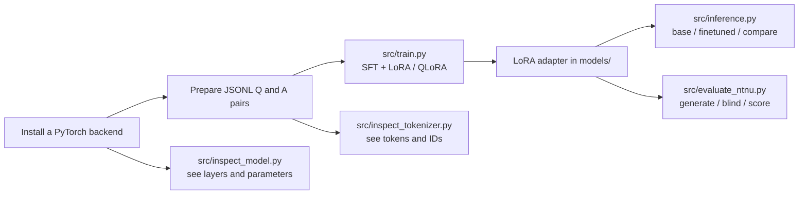

程式碼所做的核心選擇：

- **QLoRA**（4-bit NormalFloat 搭配雙重量化）是 NVIDIA CUDA 上的預設設定。它降低了基礎模型所需的記憶體，使其能放進 RTX 3060 / 4060 / 4070 等消費級 GPU。
- **`trl.SFTTrainer`** 負責監督式微調、聊天範本渲染、評測、檢查點儲存與最佳檢查點挑選。
- **全部七層線性投影層**（`q_proj`、`k_proj`、`v_proj`、`o_proj`、`gate_proj`、`up_proj`、`down_proj`）預設都是 LoRA 目標。
- 基礎模型是**凍結的**。訓練只更新小型 LoRA 矩陣；匯出的 adapter 只有幾十 MB，而不是動輒數 GB 的完整模型。

---

## 先從這裡開始：微調究竟如何運作

本節假設讀者沒有機器學習背景。後面的章節是參考手冊；本節則解釋*為什麼*指令長這樣。

### 30 秒建立心智模型

| 日常生活中的比喻 | 本儲存庫中的對應事物 |
|---|---|
| 一位已經讀完圖書館裡所有書的學生 | 預訓練好的 Qwen 模型（`Qwen/Qwen3.5-4B` 等） |
| 一本寫滿範例問題與理想答案的練習簿 | 你的 JSONL 檔案（`messages` / `instruction` / `text`） |
| 寫在書頁邊緣的便利貼，書本身完全沒動 | LoRA adapter（`adapter_model.safetensors`） |
| 縮印成小字的影印書，但仍然可以閱讀 | 4-bit NF4 基礎權重（QLoRA） |
| 老師標註「錯了，往這個方向稍微調整」 | 損失（loss）與梯度 |
| 練習老師沒看過的題目 | 保留的評測資料分割與臺師大題目集 |

微調**並不像**預訓練那樣，從頭教會模型各種事實。它是把一個已經具備能力的模型，輕輕推向你的範例所展示的風格、格式與領域行為。這就是為什麼幾百到幾千筆優質範例可能很有用，而雜訊多的範例一定會有害。

### 從一個句子到下一個字

語言模型從來不會直接看到中文字或英文字母。它看到的是整數，接著是向量，最後是機率。

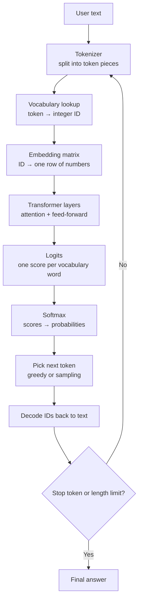

重點如下：

- **Token（詞元）** — 一小段文字。它可能是一個完整的中文詞、一個字，或英文單字的一部分。執行 `src/inspect_tokenizer.py` 就能看到你的句子被切成了哪些片段。
- **ID** — 該片段在固定詞彙表中的索引。嵌入表中每個 ID 都有一列；`src/inspect_tokenizer.py --token_id 120573` 會印出那一列。
- **Embedding（嵌入向量）** — 模型真正消耗的數值「意義座標」。
- **Logits → 機率** — 模型會為*每一個*可能的下一個 token 輸出一個分數。`--temperature` 與 `--top_p` 決定選擇時有多「大膽」。`temperature 0` 會讓生成變成貪婪且確定性的（評測腳本就是這樣做的）。
- **自迴歸迴圈** — 選到的 token 會被接到輸入後面，模型再跑一次。`--max_new_tokens` 限制這件事最多發生幾次。
- **上下文長度** — `--max_seq_length`（訓練）與模型的上下文視窗決定一次能考量多少個 token。序列越長用的記憶體越多；如果遇到 OOM，先降低長度，再動其他設定。

### 聊天範本在做什麼

模型無法從單純的字串拼接中判斷是誰在說話。Qwen 使用 ChatML 風格的範本，並搭配明確的控制 token：

```text
<|im_start|>system
You are a helpful assistant.<|im_end|>
<|im_start|>user
台灣師範大學的地址是什麼？<|im_end|>
<|im_start|>assistant
國立臺灣師範大學位於臺北市大安區和平東路一段 162 號。<|im_end|>
```

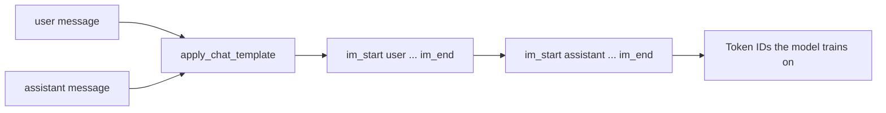

訓練時，`train.py` 會呼叫 `tokenizer.apply_chat_template(..., tokenize=False, add_generation_prompt=False)`，並把結果字串存到 `text` 欄位。因此模型學到的是那些分隔符號，而不只是文字。推論時，`inference.py` 使用 `add_generation_prompt=True`，讓提示詞以 `<|im_start|>assistant\n` 結尾，這樣下一個 token 就會開始回答。

這也是為什麼訓練與推論時的基礎模型 ID 必須一致：範本與詞彙表都屬於那個特定的分詞器。

### SFT 教導什麼，損失又隱藏了什麼

訓練會比較模型的機率分佈與每個位置上正確的下一個 token，並調整可訓練的權重以提高該機率。這就是交叉熵（cross-entropy，也稱為 NLL）損失。

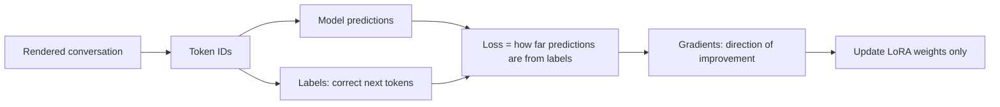

本專案預設會監督**整體渲染後的 `text`**。如果你傳入 `--assistant_only_loss`，TRL 會改為接收 `messages` 欄位，並遮蔽系統／使用者部分，因此損失只來自 assistant 回合及其回合結束 token。腳本會驗證每一列，並拒絕被截斷的 assistant 目標。此旗標需要搭配 `--dataset_format chat`。

### 為什麼 LoRA 與 QLoRA 能放進消費級 GPU

一個 4B 模型在 BF16 下，光權重就大約 8 GB，還沒算上活化值、梯度與優化器狀態。完整微調需要的記憶體是這個的好幾倍。LoRA 會保持基礎權重凍結，並在每個目標線性層旁邊學習兩個小矩陣：

```text
original:   y = W x                 W: big, frozen
LoRA:       y = W x + (alpha / r) * B A x
            A: r x in_features      B: out_features x r      (both trainable)
```

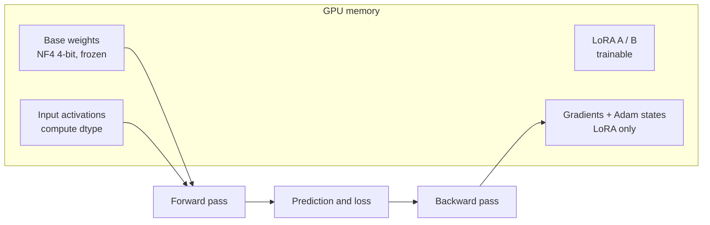

- `r`（`--lora_r`）是秩（rank），也就是那個小瓶頸的寬度。較大的 `r` 能表達更複雜的變化，但會用掉較多記憶體。
- `alpha`（`--lora_alpha`）用來縮放 LoRA 更新。本 README 中的指令都使用 `alpha = 2 * r`。
- `target_modules` 決定 adapter 要放在*哪裡*。預設涵蓋注意力與前饋投影層。當記憶體很緊時，首先可以試試只針對注意力（`q_proj,k_proj,v_proj,o_proj`）。
- QLoRA 另外會把凍結的基礎模型以 4-bit NF4 搭配雙重量化儲存，並在 `bfloat16`/`float16` 中進行運算。梯度與優化器狀態只存在於 LoRA 參數上，這就是節省記憶體的關鍵。
- `--gradient_checkpointing`（預設開啟）會在反向傳播時重新計算中間活化值，用一些速度換取較低的峰值記憶體。

### Epoch、批次、學習率與其他相關概念

| 術語 | 白話意義 | 本儲存庫中的旗標 |
|---|---|---|
| 範例 | 你 JSONL 中的一筆問答記錄 | `dataset_path` |
| Token | 分詞後的一段文字 | `max_seq_length` |
| 批次（Batch） | 一次前向傳播中一起處理的範例 | `per_device_batch_size` |
| 累積（Accumulation） | 在一次權重更新前累積多個小批次 | `gradient_accum_steps` |
| 有效批次 | `per_device_batch_size × gradient_accum_steps × GPU 數量` | 推導而得 |
| Epoch | 對訓練分割完整跑過一輪 | `num_epochs` / `--epochs` |
| 學習率 | 每次權重更新的幅度 | `learning_rate` / `--lr` |
| Warmup | 一開始學習率逐步攀升的小階段 | `warmup_ratio` |
| 種子（Seed） | 讓分割與初始化可以重現 | `seed` |
| 評測分割 | 不參與訓練、用來挑選最佳檢查點的範例 | `test_split` |

```mermaid
sequenceDiagram
    participant Data as Dataset
    participant T as SFTTrainer
    participant Opt as Optimizer
    Data->>T: 1,252 records, 5% held out
    Note over Data: ~1,189 training examples
    loop Each micro-batch
        Data->>T: 2 examples (per_device_batch_size 2)
        T->>T: forward + loss
    end
    Note over T: 8 micro-batches accumulated
    T->>Opt: one optimizer.step() (effective batch 16)
    Opt-->>T: weights updated
    Note over T: ~75 steps per epoch × 3 epochs ≈ 225 steps
```

以下是使用內附臺師大資料與後述 12 GB / 4B 設定的實際計算：

- 1,252 筆記錄，保留 5% → 約 1,189 筆訓練範例。
- `per_device_batch_size 2 × gradient_accum_steps 8` → 有效批次 16。
- 每個 epoch 約 75 次優化器步驟；三個 epoch → 約 **225 步驟**，這就是為什麼你會在範例輸出目錄中看到 `checkpoint-225/`。
- 因此 `--save_steps 200` 會在執行過程中寫入中間檢查點。

> **實作注意：** 在這個版本的 `train.py` 中，`--warmup_ratio` 會以數值形式作為 `warmup_steps` 參數傳給 `SFTConfig`（預設 `0.03`）。請把它當成一個固定的小幅 warmup 值，不要依賴它代表「所有步驟的 3%」。

### 推論時會發生什麼事

推論永遠不會修改權重。它載入同一個基礎模型，接上儲存的 adapter，然後不斷重複前面展示的 token 迴圈。

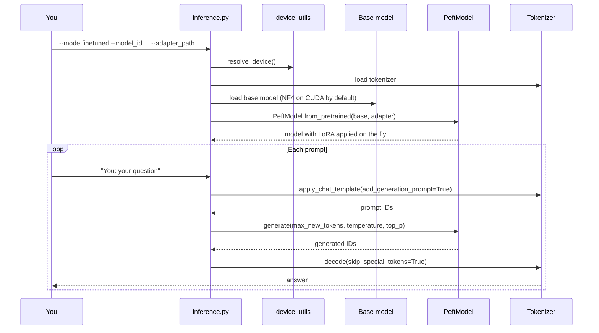

`--mode compare` 只載入一次基礎模型，再把 adapter 疊上去，然後對每個提示詞印出兩個回答。這讓「微調有沒有幫助？」變得一目了然，不必再開第二個程序。

如果 `--adapter_path` 是一個沒有 `adapter_config.json` 的目錄，腳本會尋找 `checkpoint-*` 子目錄，並挑選編號最大且含有 adapter 的那一個。

### 臺師大評測如何運作

訓練損失告訴你模型對訓練範例的擬合程度；它**不會**告訴你答案在事實上是否正確。為此，[`src/evaluate_ntnu.py`](src/evaluate_ntnu.py) 實作了一個小型的離線、人工評分基準測試。

`evaluation/ntnu_qa.jsonl` 包含剛好 **60** 題固定的問題：

| 類別 | 數量 | 測試內容 |
|---|---|---|
| `fact` | 40 | 事實性答案；每題都有臺師大官方來源網址與明確評分條件 |
| `uncertain` | 10 | 描述不足的問題，模型應該要求提供更多細節，並拒絕憑空編造 |
| `general` | 10 | 格式與遵循指示的限制 |

請不要把這些提示詞放進訓練。重複使用它們會讓保留的測試變成背誦檢查。

流程是 `generate` → `blind` → 人工審查 → `score`；步驟 8 會用圖表展示。

- `generate` 使用貪婪解碼（`do_sample=False`）、批次處理，以及可續寫的輸出：若輸出檔案中已有相符的內容，就會從既有答案繼續。它需要 LoRA adapter；沒有僅限基礎模型的模式。
- 一次執行會綁定模型、adapter 權重雜湊、題目雜湊、生成設定、後端、dtype 與量化旗標。變更其中任何一項都需要換一個新的輸出路徑。
- `blind` 使用固定種子，為每一題獨立打亂答案順序，並把對照表寫到**獨立的金鑰檔案**，讓審查者無法辨識是哪個模型。
- 只有當候選者至少通過 `max(34, 兩個基準)` 題 fact、至少 8 題 uncertain、至少 `max(基準)` - 1 題 general，且沒有重大捏造時，`score` 才會標記它的 `passes_quality`。基準本身不設關卡。

### 選擇運算後端

所有模型指令都接受 `--device auto|gpu|cuda|rocm|mps|xpu|cpu`。

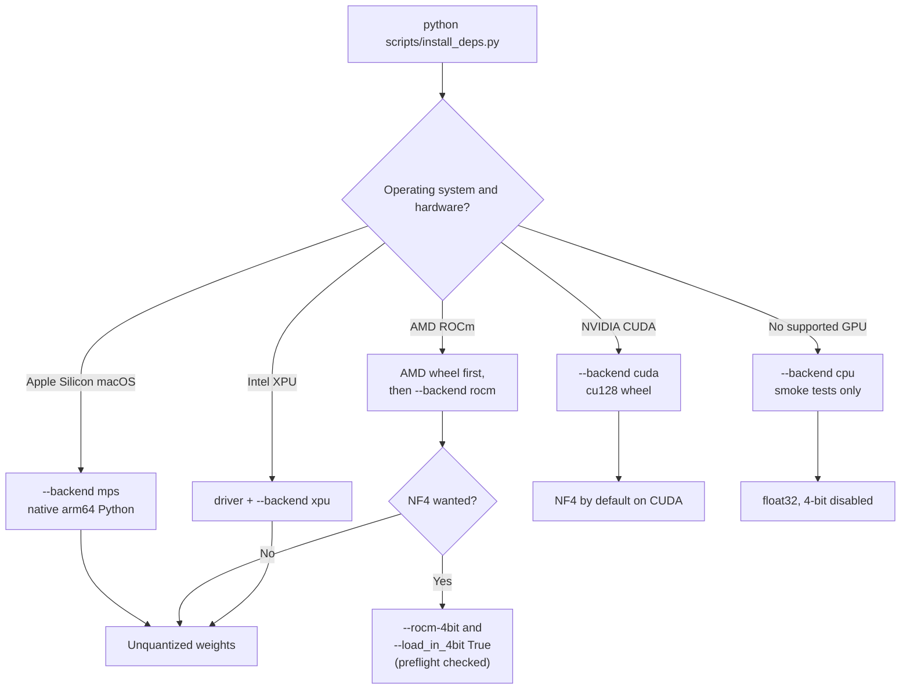

- `auto` 會依序嘗試 CUDA、ROCm、MPS、XPU，最後是 CPU。`gpu` 使用相同的搜尋順序，但若沒有加速器就會失敗。明確指定的後端必須可用。
- MPS 與 XPU 會拒絕 `--load_in_4bit True`；CPU 會印出提示，並靜默使用未量化的 `float32`。
- ROCm 的 NF4 是選擇性啟用，並會在載入大型模型前先執行一次小型的前向／反向預檢。失敗時會給出可採取的替代方案：`--load_in_4bit False`。
- 安裝程式**沒有 ROCm wheel 索引**：若是 AMD GPU，你必須先從 AMD 安裝正確的 PyTorch wheel，再執行 `--backend rocm` 安裝其餘相依套件並驗證裝置。

### 為什麼需要 Conda、PyTorch 與 GPU 後端

有三層很容易搞混：

| 層級 | 它是什麼 | 本專案為什麼需要它 |
|---|---|---|
| Conda 環境 | 一個隔離的資料夾，裡面放著一個 Python 直譯器與其套件 | 防止系統 Python 或其他專案弄壞這個專案；也讓 CUDA 與 ROCm 機器能保留各自的 wheel |
| PyTorch wheel | 針對特定加速器（cu128、ROCm/HIP、XPU、MPS 或 CPU）編譯好的 `torch` 套件 | 若沒有相符的 wheel，即使硬體上確實有 GPU，`torch.cuda.is_available()` 仍會是 false |
| CUDA / ROCm / Metal | 讓 PyTorch 能啟動 GPU kernel 的供應商執行環境 | 它是 Python 程式碼與 GPU 之間的橋樑；光有驅動程式還不夠 |

這就是為什麼實作指南會在安裝任何東西**之前**先建立一個名為 `ai` 的環境，並在執行安裝程式時傳入明確的 `--backend`。

---

## 零基礎到跑起來：完整實作指南

請依序執行以下步驟。每個步驟都會先說明概念，再給出可以直接貼上的指令。

### 步驟 0 — 先讀這邊：硬體與術語

閱讀本專案不需要 GPU，但要進行有意義的訓練就需要。最低限度可用的配置是：

- **8 GB VRAM**：用於 4B 模型、短序列長度的 QLoRA。
- **12 GB VRAM**：用於步驟 7 中舒適的 4B 指令。
- **Apple Silicon**：具統一記憶體，可使用 MPS；請從 `Qwen/Qwen3.5-0.8B` 開始。
- **僅 CPU**：支援煙霧測試。速度會很慢，不適合正式訓練。

從步驟 1 開始會用到的關鍵術語：

- **SFT** — 監督式微調：給模型看問答對，讓它模仿風格與行為。
- **LoRA** — 訓練小型附加矩陣，而不是整個模型。
- **QLoRA** — 在訓練那些小矩陣時，把基礎模型保持在 4-bit NF4。
- **Adapter（轉接器）** — 訓練後產生的小檔案；若沒有同一個基礎模型 ID，它就無法使用。
- **後端（Backend）** — 用於張量運算的執行環境：CUDA、ROCm、MPS、XPU 或 CPU。
- **環境（Environment）** — 這些套件所在的隔離 Python 安裝。

### 步驟 1 — 從零開始安裝 Conda

Conda 會建立隔離的 Python 環境。**請不要**把這些套件裝到你的系統 Python 中：其他專案的 PyTorch wheel、CUDA 版本與 Transformers 版本可能互相衝突。Miniconda 就夠了，不需要 Anaconda。

**Windows**

1. 從 https://docs.conda.io/en/latest/miniconda.html 下載 `Miniconda3-latest-Windows-x86_64.exe`。
2. 執行安裝程式。可以勾選「Add Miniconda3 to PATH」，或是從開始功能表使用「Anaconda Prompt」。
3. 開啟新的終端機並驗證：

```powershell
conda --version
```

**Linux / macOS**

```bash
# Linux x86_64
wget https://repo.anaconda.com/miniconda/Miniconda3-latest-Linux-x86_64.sh
bash Miniconda3-latest-Linux-x86_64.sh -b -p "$HOME/miniconda3"
"$HOME/miniconda3/bin/conda" init bash
exec bash

# macOS Apple Silicon (arm64)
curl -L -o ~/miniconda3.sh \
  https://repo.anaconda.com/miniconda/Miniconda3-latest-MacOSX-arm64.sh
bash ~/miniconda3.sh -b -p "$HOME/miniconda3"
"$HOME/miniconda3/bin/conda" init zsh
exec zsh
```

`conda init` 會把 Conda 加入你的 shell 啟動檔，讓 `conda activate` 在新的終端機中可用。用以下指令驗證：

```bash
conda --version
```

### 步驟 2 — 理解 CUDA、ROCm、MPS、XPU 與 CPU

這些是**後端**，不是 Python 的替代品：

| 後端 | 它是什麼 | 為什麼會選它 | 重要限制 |
|---|---|---|---|
| **CUDA** | NVIDIA 的平行運算平台與執行環境 | PyTorch 支援最完整；NF4/bitsandbytes 開箱即用 | 需要 NVIDIA 驅動程式與相符的 cu128 PyTorch wheel |
| **ROCm** | AMD 開源的 GPU 運算堆疊（HIP 是其類似 CUDA 的 API） | 使用 AMD GPU | wheel 必須與 ROCm 版本、GPU 型號及作業系統相符。本安裝程式**不會**幫你下載它 |
| **MPS** | Apple Metal Performance Shaders | Apple Silicon Mac | 需要原生 arm64 Python；不支援 4-bit 載入 |
| **XPU** | PyTorch 中的 Intel GPU 支援 | Intel Arc / Data Center GPU | 需要 Intel 驅動程式與 XPU wheel；不支援 4-bit 載入 |
| **CPU** | 純處理器執行 | 煙霧測試與除錯 | 對 4B 以上模型很慢；4-bit 會停用並改用 `float32` |

檢查你的機器實際上有什麼：

```bash
# NVIDIA only
nvidia-smi

# Inside the conda environment, after installing PyTorch
python -c "import torch; print(torch.__version__, torch.version.cuda, torch.version.hip)"
```

驅動程式與 PyTorch wheel 是兩回事。即使 `nvidia-smi` 顯示 GPU 正常運作，若 PyTorch 是從錯誤的索引安裝的，`torch.cuda.is_available()` 仍會是 `False`。一個環境只能放一個 PyTorch wheel，所以請把 CUDA 與 ROCm 環境分開。

### 步驟 3 — 建立 `ai` Conda 環境

```bash
conda create -n ai python=3.11 -y
conda activate ai
python --version
```

Python 3.11 對目前的 PyTorch、Transformers、TRL 與 PEFT 版本來說是安全的選擇。每個新終端機都會從 `base` 環境開始，所以每次都要再執行一次 `conda activate ai`。若你之前用過名為 `finetune` 的環境，可以用 `conda rename -n finetune ai` 重新命名（如果你的 conda 支援），或直接建立 `ai` 並啟用它。

### 步驟 4 — 安裝相依套件並驗證 PyTorch

`scripts/install_deps.py` 會做四件事：

1. 根據 `--backend` 選擇 PyTorch wheel 索引（CUDA → cu128、XPU → xpu、CPU → cpu；MPS 與 macOS CPU 使用 PyPI；ROCm 不安裝 wheel，並預期 AMD 的 wheel 已事先裝好）。
2. 在選定的裝置上執行真正的張量運算，並讀回實際安裝的 torch 版本。
3. 在 CUDA 上安裝 `requirements.txt`，其他後端則安裝 `requirements-common.txt`，然後重新鎖定 `torch==<verified version>`，避免 pip 悄悄換掉供應商的 wheel。
4. 只有在 `--rocm-4bit` 時才加入 `bitsandbytes>=0.50.0`。

在 wheel 安裝期間使用的 `-c requirements-common.txt` 是**約束條件**（它限制 `torch>=2.4.0,<2.12`），不是要把每個套件都裝兩次。

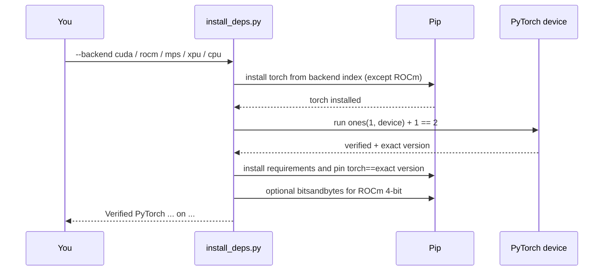

貼上對應你平台的指令：

```bash
# NVIDIA CUDA (Linux / Windows Git Bash)
python scripts/install_deps.py --backend cuda

# AMD ROCm: install the AMD PyTorch wheel FIRST, then:
python scripts/install_deps.py --backend rocm
python scripts/install_deps.py --backend rocm --rocm-4bit   # optional NF4 support

# Apple Silicon (native arm64 Python)
bash scripts/install_deps.sh --backend mps

# Intel XPU
python scripts/install_deps.py --backend xpu

# CPU only
python scripts/install_deps.py --backend cpu

# Windows PowerShell
powershell -File scripts/install_deps.ps1 -Backend cuda
powershell -File scripts/install_deps.ps1 -Backend rocm -Rocm4Bit
```

> **ROCm 警告：** `install_deps.py` 刻意略過 ROCm 的 wheel 下載，因為 AMD 的 wheel 與 GPU／OS／ROCm 版本有關。如果你在還沒安裝正確 wheel 前就執行 `--backend rocm`，驗證會失敗。請先依照 AMD 官方的 ROCm PyTorch 安裝指南，針對你的確切配置完成安裝。

驗證安裝結果：

```bash
python -c "import torch; print(torch.__version__, torch.cuda.is_available())"
python src/inspect_model.py --model_id Qwen/Qwen3.5-0.8B --device cpu --no_load
python -m unittest discover -s tests -v
```

最後一個指令會執行九項後端選擇測試，應該以 `OK` 結束。

### 步驟 5 — 選擇模型（以及原因）

**模型 ID** 是 Hugging Face 的儲存庫名稱。它在訓練與推論時必須完全相同，因為分詞器、聊天範本與詞彙表都屬於該模型。程式碼中的預設值是 `Qwen/Qwen3.5-0.8B`，讓煙霧測試保持輕量；實際的 GPU 工作通常會用 `Qwen/Qwen3.5-4B`。

| 如果你有 | 從這裡開始 | 原因 |
|---|---|---|
| 只有 CPU | `Qwen/Qwen3.5-0.8B`、`--device cpu`、`--load_in_4bit False` | 小到足以跑完煙霧測試 |
| 8 GB NVIDIA VRAM | `Qwen/Qwen3.5-4B`、NF4、短序列 | 4-bit 基礎權重放得下 |
| 12–16 GB NVIDIA VRAM | `Qwen/Qwen3.5-4B`、NF4、batch 2 | 品質與記憶體的最佳平衡 |
| 12 GB 以上且想要更大容量 | `Qwen/Qwen3.5-9B`、NF4、batch 1 | 需要謹慎設定序列長度 |
| Apple Silicon | `Qwen/Qwen3.5-0.8B` 或 `2B`、MPS、未量化 | MPS 不支援 4-bit 載入 |

完整規格與官方連結請見[模型選型](#模型選型qwen35-與-qwen3)。

### 步驟 6 — 用 ChatGPT 建立 SFT 資料集

SFT 需要**成對的範例**：一個真實的使用者問題，以及理想的 assistant 回答。這裡的原生格式是 ChatML，每行一個 JSON 物件：

```json
{"messages":[{"role":"user","content":"問題"},{"role":"assistant","content":"回答"}]}
```

你可以用 ChatGPT 或其他 LLM 產生初稿，但必須驗證它。語言模型能寫出流暢且看似合理的捏造內容；如果你拿捏造的地址或期限來訓練，adapter 就會把它當成事實學起來。

#### 提示詞 1：產生中文問答對

把下面這段貼到 ChatGPT，並替換最後一行的主題：

```text
你是一位資料標註員，正在為「監督式微調（SFT）」製作訓練資料。
請針對下面指定主題，產生 20 筆繁體中文問答對。

硬性規則：
1. 問題要像真實使用者會問的話；答案要簡潔、完整、可查證。
2. 絕對不要捏造地址、電話、期限、金額、人名、法規或制度。不確定就跳過該筆，不要猜。
3. 只輸出純 JSONL：每一行一個 JSON 物件，不要輸出任何說明文字，不要加 markdown 程式碼區塊。
4. 每行格式固定為：
{"messages":[{"role":"user","content":"問題"},{"role":"assistant","content":"回答"}]}
5. messages 陣列必須恰好 2 個元素，role 依序為 user、assistant，content 皆為非空白字串。
6. 20 筆的主題要彼此不重複。

主題：〈在這裡填入主題，例如：國立臺灣師範大學的入學申請流程〉
```

#### 提示詞 2：驗證與除錯 JSONL

在模型回傳初稿後貼上這段：

```text
你是 JSONL 驗證器。我會貼上一段 JSONL，請逐行檢查，
只輸出一個 JSON 陣列，元素格式：{"line":<行號>,"ok":true/false,"reason":"..."}
不要修改我的內容，只回報問題。

檢查規則：
1. 每行必須是合法 JSON 物件。
2. 必須有 messages 欄位，且為陣列、長度恰好 2。
3. messages[0].role == "user"，messages[1].role == "assistant"。
4. 兩個 content 都是非空白字串。
5. 若某行有額外欄位（例如 source），標記 ok=true 但於 reason 註明「額外欄位會被訓練器忽略」。

以下是待檢查的 JSONL：
〈貼上 JSONL〉
```


#### 儲存並驗證 JSONL

1. 把清理後的輸出貼到 `data/my_dataset.jsonl`。如果 ChatGPT 用 JSON 程式碼區塊包住了它，請把第一行與最後一行刪掉。
2. 在本機驗證，不要只在聊天視窗中檢查：

```bash
python - <<'PY'
import json
import sys
from pathlib import Path

path = Path('data/my_dataset.jsonl')
bad = []
for line_no, line in enumerate(path.read_text(encoding='utf-8').splitlines(), 1):
    if not line.strip():
        continue
    try:
        record = json.loads(line)
    except json.JSONDecodeError as exc:
        bad.append((line_no, f'JSON error: {exc}'))
        continue
    messages = record.get('messages')
    if not isinstance(messages, list) or len(messages) != 2:
        bad.append((line_no, 'messages must be a list of length 2'))
        continue
    if [m.get('role') for m in messages] != ['user', 'assistant']:
        bad.append((line_no, 'roles must be user then assistant'))
        continue
    if any(not isinstance(m.get('content'), str) or not m['content'].strip() for m in messages):
        bad.append((line_no, 'content must be a non-empty string'))

if bad:
    for item in bad[:20]:
        print(item)
    sys.exit(1)
print(f'OK: {path}')
PY
```

3. 對內附檔案執行同一個驗證器，看看什麼是已知正常的範例：`data/ntnu_dataset.jsonl` 有 1,252 筆有效記錄。

#### 幻覺與事實查核

**格式正確不代表事實正確。** 提示詞能減少編造的細節，但無法完全消除。訓練前請：

- 逐一以官方網站核對每個地址、電話號碼、期限、金額、人名、規則與法規。
- 把來源網址放在另一個檔案中，例如 `data/my_dataset.sources.json`；訓練器會忽略額外的鍵，但這個檔案能給你稽核軌跡。
- 優先選擇範圍狹窄、可查證的主題。「某所大學的入學常見問題」比「所有關於台灣的事」安全。
- 不要把 `evaluation/ntnu_qa.jsonl` 放進訓練。那 60 題是保留來評測的。

若是講求事實的任務，請搭配 ChatML 資料加入 `--assistant_only_loss`，這樣模型就不會被訓練成把問題文字當成答案來重複。

資料量建議：

| 範例數 | 建議做法 | 要調整的旗標 |
|---|---|---|
| < 500 | 短程煙霧測試，檢查是否過擬合 | `--num_epochs 1`、`--learning_rate 1e-4` |
| 500–5,000 | 一般 LoRA 訓練 | 預設值就合理 |
| 5,000–30,000 | 訓練久一點、epoch 少一點 | `--num_epochs 2`、`--learning_rate 1.5e-4` |
| 30,000+ | 更大容量與檢查點 | `--lora_r 32`、`--lora_alpha 64`、`--save_steps 300` |

### 步驟 7 — 使用 `src/train.py` 進行訓練

腳本路徑是 `src/train.py`；儲存庫根目錄沒有 `train.py`。`--load_in_4bit` 只接受 `True` 或 `False`。`--device` 接受 `auto|gpu|cuda|rocm|mps|xpu|cpu`。

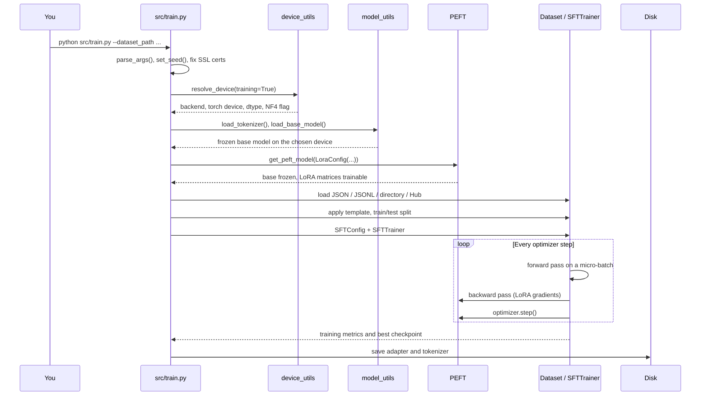

#### 依 VRAM 可直接複製的指令

**12 GB NVIDIA、4B 模型** — 建議作為第一次正式訓練：

```bash
python src/train.py \
  --model_id Qwen/Qwen3.5-4B \
  --dataset_path ./data/ntnu_dataset.jsonl \
  --dataset_format chat \
  --device gpu --load_in_4bit True --torch_dtype bfloat16 \
  --max_seq_length 2048 --num_epochs 3 \
  --per_device_batch_size 2 --gradient_accum_steps 8 \
  --learning_rate 2e-4 --lora_r 16 --lora_alpha 32 --lora_dropout 0.05 \
  --warmup_ratio 0.03 --test_split 0.05 --logging_steps 10 --save_steps 200 \
  --output_dir ./models/ntnu/gpu-12gb-4b
```

**4B 單一 epoch 煙霧測試** — 在長時間訓練前驗證流程：

```bash
python src/train.py \
  --model_id Qwen/Qwen3.5-4B \
  --dataset_path ./data/ntnu_dataset.jsonl \
  --dataset_format chat \
  --device gpu --load_in_4bit True --torch_dtype bfloat16 \
  --max_seq_length 2048 --num_epochs 1 \
  --per_device_batch_size 1 --gradient_accum_steps 8 \
  --learning_rate 2e-4 --lora_r 16 --lora_alpha 32 --lora_dropout 0.05 \
  --test_split 0.05 --logging_steps 10 --save_steps 200 \
  --output_dir ./models/ntnu/smoke-4b
```

**CPU 煙霧測試** — 沒有 GPU 也能跑：

```bash
python src/train.py \
  --model_id Qwen/Qwen3.5-0.8B \
  --dataset_path ./data/ntnu_dataset.jsonl \
  --dataset_format chat \
  --device cpu --load_in_4bit False --torch_dtype float32 \
  --max_seq_length 512 --num_epochs 1 \
  --per_device_batch_size 1 --gradient_accum_steps 4 \
  --learning_rate 2e-4 --lora_r 8 --lora_alpha 16 --lora_dropout 0.05 \
  --test_split 0.05 --logging_steps 5 --save_steps 50 \
  --output_dir ./models/ntnu/cpu-smoke
```

其他 VRAM 情況使用與 12 GB / 4B 指令相同的旗標，只改這些地方：

| 情況 | `--model_id` | `--max_seq_length` | batch | accum | `lora_r/alpha` | `--save_steps` | `--output_dir` |
|---|---|---|---|---|---|---|---|
| 8 GB NVIDIA | `Qwen/Qwen3.5-4B` | 2048 | 1 | 16 | 16/32 | 200 | `./models/ntnu/gpu-8gb-4b` |
| 12 GB NVIDIA、9B | `Qwen/Qwen3.5-9B` | 1536 | 1 | 16 | 16/32 | 250 | `./models/ntnu/gpu-12gb-9b` |
| 12 GB NVIDIA、9B 較長 | `Qwen/Qwen3.5-9B` | 2048 | 1 | 16 | 16/32，加上 `--target_modules q_proj,k_proj,v_proj,o_proj` | 250 | `./models/ntnu/gpu-12gb-9b-long` |
| 16 GB NVIDIA、9B | `Qwen/Qwen3.5-9B` | 2048 | 1 | 16 | 32/64 | 300 | `./models/ntnu/gpu-16gb-9b` |
| 24 GB NVIDIA、4B | `Qwen/Qwen3.5-4B` | 4096 | 2 | 8 | 32/64 | 300 | `./models/ntnu/gpu-24gb-4b` |
| 24 GB NVIDIA、9B | `Qwen/Qwen3.5-9B` | 2048 | 2 | 8 | 32/64 | 300 | `./models/ntnu/gpu-24gb-9b` |
| 9B 煙霧測試 | `Qwen/Qwen3.5-9B` | 1536 | 1 | 8 | 16/32、`--num_epochs 1` | 200 | `./models/ntnu/smoke-9b` |

#### 超參數說明

- `--max_seq_length` 是 OOM 時第一個要降低的設定。文字越長，注意力所需的記憶體越多，也會有更多範例被截斷。
- `--per_device_batch_size × --gradient_accum_steps × GPU 數量` 是有效批次。目標是 16–32。不必用到兩張 GPU；一張 GPU 用 `2 × 8 = 16` 就很好。
- `--learning_rate 2e-4` 是穩健的 LoRA 預設值。較小的資料集適合 `1e-4`。
- `--num_epochs 3` 是起步設定。注意驗證損失；若評測損失上升，代表過擬合或學習率太高。
- `--test_split 0.05` 會隱藏 5% 的資料，並在最後還原最佳檢查點。只有純吞吐量基準測試才把它設為 `0`。
- `--assistant_only_loss` 需要搭配 `--dataset_format chat`，且只監督 assistant 回合。
- `--gradient_checkpointing` 預設開啟，用速度換取較低的峰值記憶體。
- `--run_metrics path.json` 會記錄耗時、模型 revision、套件版本、資料集雜湊與 token 統計。

在 Windows 上，若 CUDA 記憶體配置零散：

```powershell
$env:PYTORCH_CUDA_ALLOC_CONF = "expandable_segments:True"
```

若仍然 OOM，先降低 `--max_seq_length`，再限制 `--target_modules q_proj,k_proj,v_proj,o_proj`，然後降低 micro-batch 並提高 `--gradient_accum_steps`，讓有效批次保持不變。

#### 遷移：已移除的捷徑 → 直接指令

具名的捷徑腳本已經移除。請使用上面的直接指令。下表把每個舊捷徑對應到替代方案；本 README 只印出前三個完整指令，其餘請依照「其他 VRAM 情況」表格。

| 已移除的捷徑 | 替代方案 | 主要差異 |
|---|---|---|
| `smoke-4b` | 4B 單一 epoch 煙霧指令 | 旗標相同，只有一個 epoch |
| `smoke-9b` | VRAM 表格中的 9B 列，`--num_epochs 1` | 1536 tokens、batch 1 |
| `cpu-smoke` | CPU 煙霧指令 | 0.8B、float32、無 4-bit |
| `gpu-8gb-4b` | 8 GB 列 | batch 1、累積 16 |
| `gpu-12gb-4b` | 12 GB / 4B 指令 | 完整三個 epoch |
| `gpu-12gb-9b` | 12 GB / 9B 列 | 1536 tokens |
| `gpu-12gb-9b-long` | 12 GB / 9B 較長列 | 僅注意力的 LoRA |
| `gpu-16gb-9b` | 16 GB / 9B 列 | rank 32 |
| `gpu-24gb-4b` | 24 GB / 4B 列 | 4096 tokens、rank 32 |
| `gpu-24gb-9b` | 24 GB / 9B 列 | batch 2、rank 32 |
| `ntnu-win-baseline` | 請見[重現性](#重現性原生-windows-臺師大基準測試) | 4B NF4、batch 2、3 epochs、2048 tokens |
| `ntnu-win-qwen35-4b` | 請見[重現性](#重現性原生-windows-臺師大基準測試) | 4B NF4、batch 4、2 epochs、512 tokens |
| `ntnu-win-qwen3-4b` | 請見[重現性](#重現性原生-windows-臺師大基準測試) | Qwen3-4B-Instruct-2507、batch 4 |
| `ntnu-win-qwen35-2b` | 請見[重現性](#重現性原生-windows-臺師大基準測試) | 2B 未量化、batch 8 |

如果你用過名為 `finetune` 的環境，從現在開始請執行 `conda activate ai`。

### 步驟 8 — 推論與評測

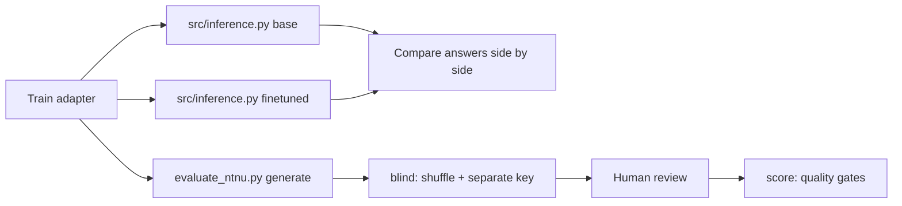

單次推論在使用 `--no_interactive` 時需要非空的 `--prompt`；沒有內建的測試提示詞。

```bash
# Base model before training
python src/inference.py --mode base --model_id Qwen/Qwen3.5-4B \
  --prompt "台灣師範大學的地址是什麼" --no_interactive

# Fine-tuned adapter
python src/inference.py --mode finetuned --model_id Qwen/Qwen3.5-4B \
  --adapter_path ./models/ntnu/gpu-12gb-4b \
  --prompt "台灣師範大學的地址是什麼" --no_interactive

# Side-by-side comparison
python src/inference.py --mode compare --model_id Qwen/Qwen3.5-4B \
  --adapter_path ./models/ntnu/gpu-12gb-4b \
  --load_in_4bit True \
  --prompt "請簡單介紹國立臺灣師範大學。" --no_interactive
```

若沒有 `--no_interactive`，腳本會在回答完選用的 `--prompt` 後開啟互動迴圈。輸入 `quit`、`exit`、`q`，或按 Ctrl+C 離開。

若為 Qwen3.5 思考模式，請加上 `--use_thinking True`。Qwen3.5 不支援 Qwen3 的 `/think` 與 `/nothink` 軟開關；這個 CLI 旗標會把 `chat_template_kwargs={"enable_thinking": true}` 傳給分詞器。

執行離線臺師大評測：

```bash
python src/evaluate_ntnu.py generate \
  --model_id Qwen/Qwen3.5-4B \
  --adapter_path ./models/ntnu/gpu-12gb-4b \
  --output ./models/ntnu/candidate.json

python src/evaluate_ntnu.py blind \
  baseline=./models/ntnu/baseline.json candidate=./models/ntnu/candidate.json \
  --output ./models/ntnu/review.json \
  --key ./models/ntnu/key.json

python src/evaluate_ntnu.py score \
  --review ./models/ntnu/review.json \
  --key ./models/ntnu/key.json \
  --baselines baseline1 baseline2 \
  --output ./models/ntnu/score.json
```

`--baselines` 的名稱必須與 `blind` 步驟中使用的名稱相符。`generate` 需要 adapter，並會強制使用 BF16 權重；若你需要控制權重格式，請明確使用 `--bf16_weights` 或 `--load_in_4bit`。

---

## 安裝方式

這是前面已經逐步說明過的內容的精簡版參考。

### 從零開始安裝 Miniconda

請見[步驟 1](#步驟-1--從零開始安裝-conda) 以取得各平台的安裝程式。Miniconda 就夠了；用 `conda --version` 驗證。

### 建立 `ai` 環境

```bash
conda create -n ai python=3.11 -y
conda activate ai
python --version
```

### 安裝並驗證後端

`install_deps.py` 使用目前作用的 Python，所以請先啟用 `ai`。Bash 包裝程式會原樣轉送每個旗標；PowerShell 包裝程式則使用 `-Backend` 與 `-Rocm4Bit`。

| 後端 | 指令 | 安裝程式使用的 wheel 索引 |
|---|---|---|
| NVIDIA CUDA | `python scripts/install_deps.py --backend cuda` | `https://download.pytorch.org/whl/cu128` |
| AMD ROCm | 先安裝 AMD wheel，再執行 `python scripts/install_deps.py --backend rocm` | 無；預期已事先安裝 wheel |
| Apple Silicon | `bash scripts/install_deps.sh --backend mps` | PyPI，僅限原生 arm64 |
| Intel XPU | `python scripts/install_deps.py --backend xpu` | `https://download.pytorch.org/whl/xpu` |
| CPU | `python scripts/install_deps.py --backend cpu` | `https://download.pytorch.org/whl/cpu`，或在 macOS 上使用 PyPI |
| Windows PowerShell | `powershell -File scripts/install_deps.ps1 -Backend cuda` | 與 `cuda` 相同 |

安裝程式會驗證真正的張量運算，然後在 CUDA 上安裝 `requirements.txt`、其他環境安裝 `requirements-common.txt`，並重新鎖定它剛剛驗證過的確切 torch 版本。ROCm NF4 需要 `--rocm-4bit`，並會加入 `bitsandbytes>=0.50.0`。

`requirements-common.txt` 中的核心套件：

| 套件 | 最低版本 | 用途 |
|---|---|---|
| `torch` | `>=2.4.0,<2.12` | 張量運算與 GPU kernel；依後端而異的 wheel |
| `transformers` | `>=5.12.1` | Qwen 模型、分詞器、聊天範本 |
| `peft` | `>=0.13.0` | LoRA / QLoRA adapter |
| `trl` | `>=1.6.0` | `SFTTrainer` |
| `accelerate` | `>=1.13.0` | 裝置配置與分散式輔助程式 |
| `datasets` | `>=3.0.0` | 載入 JSON / JSONL / Hub 資料集 |
| `packaging` | `>=21.0` | PyTorch 版本能力檢查 |
| `certifi` | `>=2023.7.22` | `model_utils.py` 中 SSL 修復使用的 CA bundle |

`requirements.txt` 另外會設定 cu128 索引，並為 NVIDIA NF4 安裝 `bitsandbytes>=0.46.1`。

官方後端參考資料：

- NVIDIA CUDA: https://developer.nvidia.com/cuda-downloads
- PyTorch wheels: https://pytorch.org/get-started/locally/
- AMD ROCm: https://rocm.docs.amd.com/
- Apple Metal / MPS: https://developer.apple.com/metal/pytorch/
- Intel XPU: https://pytorch.org/docs/stable/xpu.html

---

## 模型選型：Qwen3.5 與 Qwen3

以下官方規格來自連結的 Hugging Face 模型卡（查核日期 2026-11-26）。HF 中繼資料欄記錄的是 Hugging Face 頁面另行揭露的資訊，與模型卡文字不同；這兩種計算方式**不可互換**。專案中的 revision 來自 `models/ntnu/windows-comparison/observations.json`，是本地測試紀錄，不是官方規格。

| 模型 ID | 官方參數量 | HF 中繼資料 | 上下文長度 | 架構 | 預設思考模式 | 專案 revision |
|---|---|---|---|---|---|---|
| `Qwen/Qwen3.5-4B` | 4B | 5B | 262,144; extensible to 1,010,000 | 具視覺編碼器的因果 LM；Gated DeltaNet + 稀疏 MoE | 思考模式（`<think>…</think>`） | `851bf6e806efd8d0a36b00ddf55e13ccb7b8cd0a` |
| `Qwen/Qwen3.5-2B` | 2B | — | 262,144 | 具視覺編碼器的混合稀疏 MoE | 非思考模式；可啟用思考 | `15852e8c16360a2fea060d615a32b45270f8a8fc` |
| `Qwen/Qwen3.5-0.8B` | 0.8B | 0.9B | 262,144 | 具視覺編碼器的混合稀疏 MoE | 非思考模式；官方模型卡警告可能出現思考迴圈 | — (code default) |
| `Qwen/Qwen3.5-9B` | 9B | 10B | 262,144; extensible to 1,010,000 | 具視覺編碼器的混合稀疏 MoE | 思考模式 | — |
| `Qwen/Qwen3-4B-Instruct-2507` | 4.0B (3.6B non-embedding) | — | 262,144 | 因果 LM；36 層；GQA 32 Q / 8 KV heads | 僅非思考模式 | `cdbee75f17c01a7cc42f958dc650907174af0554` |

官方模型卡：

- [Qwen3.5-4B](https://huggingface.co/Qwen/Qwen3.5-4B)
- [Qwen3.5-2B](https://huggingface.co/Qwen/Qwen3.5-2B)
- [Qwen3.5-0.8B](https://huggingface.co/Qwen/Qwen3.5-0.8B)
- [Qwen3.5-9B](https://huggingface.co/Qwen/Qwen3.5-9B)
- [Qwen3-4B-Instruct-2507](https://huggingface.co/Qwen/Qwen3-4B-Instruct-2507)

注意事項：

1. 五個模型都採用 `apache-2.0` 授權。文中不主張特定的發布日期；模型卡引用的是 2026 年 2 月，但那不是明確的發布日期。
2. Qwen3.5 模型**不**正式支援 Qwen3 的 `/think` 與 `/nothink` 軟開關。請透過 `chat_template_kwargs={"enable_thinking": ...}` 控制思考模式，這裡將其暴露為 `--use_thinking True|False`。
3. Qwen3-4B-Instruct-2507 僅支援非思考模式；傳入 `--use_thinking False` 沒有害處，但沒有必要。
4. `Qwen/Qwen3.5-0.8B` 是預設值，因為它小到足以跑 CPU 煙霧測試。它並不是用來產生正式結果的建議模型。
5. 傳給推論的基礎模型 ID 必須與訓練時使用的相同。不會匯出合併後的完整模型。

---

## 功能特色

- **QLoRA / LoRA 支援** — NVIDIA CUDA 與相容的 AMD ROCm 環境可使用 4-bit NF4，任何支援的後端也可使用未量化的權重。
- **多種資料格式** — ChatML（原生）、Alpaca（`instruction` / `input` / `output`）與純文字。所有格式在內部都會轉換成聊天訊息。
- **Hugging Face Hub 整合** — 直接從 Hub 載入資料集，並把訓練好的 adapter 推回去。
- **思考模式** — 在訓練與推論時，透過聊天範本啟用 Qwen3.5 的 `<think>` 推理。
- **CLI 優先的設計** — 每個超參數都是命令列旗標；不需要 YAML。
- **多種運算後端** — NVIDIA CUDA、AMD ROCm、Apple Metal（MPS）、Intel XPU，以及 float32 CPU 備援。
- **單檔訓練腳本** — `src/train.py` 依序執行完整的 SFT 流程，適合教學與逐行閱讀。
- **模型檢視** — `src/inspect_model.py` 可在不需要資料集的情況下回報參數量、詞彙表大小、嵌入維度與層級配置。
- **分詞器檢視** — `src/inspect_tokenizer.py` 會顯示 token 片段、ID 與對應的嵌入向量列。
- **微調前後比較** — 先測試基礎模型，再與微調後的模型並排比較。
- **互動式推論** — 模型會保持在記憶體中，並在迴圈中讀取提示詞（預設）；`--no_interactive` 則執行一次提示詞後結束。
- **評測分割** — 自動切割訓練／測試資料，並依評測損失挑選最佳模型。
- **梯度檢查點** — 預設啟用，以降低峰值記憶體。
- **離線品質基準測試** — 針對內附的臺師大題目集提供確定性生成、盲審與明確的品質關卡。

---

## 硬體需求

| 配置 | 最低 VRAM | 典型 GPU |
|---|---|---|
| QLoRA 4B (4-bit, batch size 1–2) | ~6–8 GB | RTX 3060 / 4060 / 4070, T4 |
| QLoRA 9B (4-bit, batch size 1) | ~10–12 GB | RTX 4070 Ti / 5070 Ti (laptop), 3080 12 GB |
| QLoRA 9B (4-bit, batch size 2) | ~20–24 GB | RTX 4090 / 3090 24 GB, A5000 |
| LoRA 4B (unquantized, batch size 1) | ~12 GB | RTX 3080 / 4070 Ti / 4080, A10 |
| CPU (unquantized, float32) | — | Any CPU, very slow; smoke tests only |

這些 VRAM 數字是 NVIDIA 的例子。在 Apple Silicon 上，權重、活化值與作業系統共用統一記憶體。檢查新機器時請從 `Qwen3.5-0.8B` 開始。若記憶體不足，先降低 `--max_seq_length`，再動其他設定。

訓練、推論、兩個檢視工具與臺師大評測都接受 `--device auto|gpu|cuda|rocm|mps|xpu|cpu`。自動偵測會依序嘗試 CUDA、ROCm、MPS、XPU，最後是 CPU；`gpu` 需要有可用的 GPU，並使用相同順序。明確指定的後端必須可用。

訓練與推論在 NVIDIA CUDA 上預設使用 NF4。ROCm 預設使用未量化的權重，且只有在其核心預檢通過後才接受 `--load_in_4bit True`。MPS 與 XPU 使用未量化的權重。CPU 使用未量化的 `float32`。兩個檢視工具在所有後端上都預設使用未量化的權重。

---

## 專案結構

```text
fine-tuning-playground/
├── requirements.txt                    # NVIDIA cu128 installation entry point
├── requirements-common.txt             # Shared Python dependencies
├── src/
│   ├── train.py                        # Full SFT pipeline (single file, top-to-bottom)
│   ├── inference.py                    # base / finetuned / compare + interactive loop
│   ├── evaluate_ntnu.py                # Greedy generation, blinding, quality scoring
│   ├── device_utils.py                 # Backend selection, dtype, ROCm NF4 validation
│   ├── model_utils.py                  # Shared tokenizer and model loading helpers
│   ├── inspect_model.py                # Model internals report
│   └── inspect_tokenizer.py            # Token pieces, IDs, and embedding vectors
├── data/
│   ├── ntnu_dataset.jsonl              # Bundled NTNU ChatML dataset (1,252 records)
│   ├── full_dataset.jsonl              # Aggregated extended dataset (1,746 records)
│   ├── ntnu/                           # Curated NTNU JSONL files
│   └── taiwan/                         # Curated Taiwan JSONL files
├── evaluation/ntnu_qa.jsonl            # 60 held-out prompts, criteria, and sources
├── models/                             # Adapters and benchmark data (gitignored)
├── scripts/
│   ├── install_deps.py                 # Backend-aware installer and device probe
│   ├── install_deps.sh                 # Bash wrapper for the installer
│   └── install_deps.ps1                # PowerShell wrapper for the installer
├── tests/test_device_utils.py          # Backend selection and quantization tests
├── README.md                           # This file (English)
└── README.zh-Hant.md                   # Traditional Chinese documentation
```

### 檔案說明

**`src/train.py`** — 單一檔案中的完整 SFT 流程：SSL 修復 → 解析 CLI 參數 → 選擇裝置 → 載入分詞器 → 載入基礎模型（可選 4-bit）→ 套用 LoRA → 載入並格式化資料 → 設定 `SFTTrainer` → 訓練 → 儲存 adapter。所有超參數都是 CLI 旗標。

**`src/inference.py`** — 以 `base`、`finetuned` 或 `compare` 模式進行獨立推論。若沒有 `--prompt`，它會直接進入互動迴圈（`You:`；輸入 `quit`、`exit` 或 `q`，或按 Ctrl+C 停止）。若有 `--prompt`，它會回答一次，然後除非給了 `--no_interactive`，否則繼續進入同一個迴圈。

**`src/evaluate_ntnu.py`** — 三個子命令。`generate` 為單一模型與 adapter 寫入確定性的答案；`blind` 會打亂具名執行結果的答案，並把對照表分開儲存；`score` 對完成的審查結果套用品質關卡。

**`src/device_utils.py`** — 解析後端、裝置、dtype 與 NF4 策略，並執行 ROCm NF4 預檢。**`src/model_utils.py`** 則存放共用的分詞器／模型載入程式碼、預設模型 ID（`Qwen/Qwen3.5-0.8B`）與 SSL 憑證修復。

**`src/inspect_model.py`** — 印出標準化報告：模型設定（詞彙表、hidden size、層數、heads、KV heads、head dimension、FFN size、context、activation、RoPE theta、tied embeddings）、分詞器中繼資料，以及——除非設定 `--no_load`——參數量、嵌入形狀與記憶體估算、dtype 與配置位置。

**`src/inspect_tokenizer.py`** — 顯示句子如何被切成 token、每個 token 的 ID，以及它在輸入嵌入層中的向量。至少需要 `--sentence`、`--token` 或 `--token_id` 其中之一。

**`scripts/install_deps.py` / `.sh` / `.ps1`** — 安裝依後端而異的 PyTorch wheel，用真正的張量運算驗證它，然後安裝其餘的 Python 相依套件。

**`tests/test_device_utils.py`** — 模擬硬體以驗證後端選擇與量化規則；用 `python -m unittest discover -s tests -v` 執行。

---

## 設定參數

### 訓練（`src/train.py`）

| 類別 | 參數 | 預設值 | 說明 |
|---|---|---|---|
| **模型** | `--model_id` | `Qwen/Qwen3.5-0.8B` | Hugging Face 模型 ID；正式 GPU 訓練請使用 `Qwen/Qwen3.5-4B` 或其他 4B / 9B 模型 |
| | `--load_in_4bit` | CUDA 上開啟 | `True` / `False`；NF4 QLoRA。在相容的 ROCm 上需選擇性啟用；MPS/XPU 會拒絕；CPU 上忽略 |
| | `--torch_dtype` | `bfloat16` | `bfloat16`、`float16` 或 `float32`；能力檢查可能會選擇不同的有效 dtype |
| **LoRA** | `--lora_r` | `16` | LoRA 秩 |
| | `--lora_alpha` | `32` | LoRA 縮放係數，通常為 `2 × r` |
| | `--lora_dropout` | `0.05` | LoRA 層內的 dropout |
| | `--target_modules` | `q_proj,k_proj,v_proj,o_proj,gate_proj,up_proj,down_proj` | 以逗號分隔的模組名稱 |
| **資料** | `--dataset_path` | _(必填)_ | 本機 JSON/JSONL 檔案、會遞迴掃描 `*.jsonl` 的目錄，或 Hub 資料集名稱。本機不存在的路徑會被傳給 `load_dataset()` |
| | `--dataset_format` | `chat` | `chat`、`alpaca` 或 `text` |
| | `--test_split` | `0.05` | 驗證資料比例，範圍 `[0, 1)`；`0` 會停用評測 |
| | `--seed` | `42` | 分割、初始化與取樣的種子 |
| | `--max_seq_length` | `4096` | 每筆範例的最大 token 長度 |
| | `--use_thinking` | `False` | 把 `enable_thinking` 傳給聊天範本；請見上方 Qwen3.5 注意事項 |
| **優化** | `--learning_rate`, `--lr` | `2e-4` | 峰值學習率 |
| | `--num_epochs`, `--epochs` | `3` | 訓練 epoch 數 |
| | `--per_device_batch_size`, `--batch_size` | `2` | 每個裝置的 micro-batch |
| | `--gradient_accum_steps` | `8` | 每次優化器步驟的 micro-batch 數 |
| | `--gradient_checkpointing` | `True` | 重新計算活化值以節省記憶體 |
| | `--group_by_length` | off | 把長度相近的範例分組 |
| | `--assistant_only_loss` | off | 監督 assistant 回合及其回合結束 token；需要 `--dataset_format chat` |
| | `--loss_type` | TRL 預設值 | `nll` 或 `chunked_nll`（降低詞彙投影所需的記憶體） |
| | `--warmup_ratio` | `0.03` | 此版本中以數值形式傳給 `SFTConfig(warmup_steps=...)` |
| | `--logging_steps` | `10` | 每 N 步驟記錄一次指標 |
| | `--save_steps` | `200` | 當 `save_strategy="steps"` 時，每 N 步驟存一次檢查點 |
| | `--output_dir` | `./models/qwen3-4b-finetuned` | adapter 輸出目錄 |
| **評測** | `--eval_each_epoch` | off | 每個 epoch 都評測並儲存，而不是每 `save_steps` 一次 |
| | `--eval_batch_size` | `8` | 每個裝置的評測 micro-batch |
| **基準測試** | `--benchmark_steps` | `0` | 計時的優化器步驟；正值會跳過評測與 adapter 匯出 |
| | `--benchmark_warmup_steps` | `3` | 不計入計時的步驟 |
| | `--run_metrics` | — | 記錄耗時、後端、dtype、NF4 狀態、長度、revision 與版本的 JSON 路徑 |
| **硬體** | `--device` | `auto` | `auto`、`gpu`、`cuda`、`rocm`、`mps`、`xpu`、`cpu` |
| **Hub** | `--push_to_hub` | `False` | 訓練後推送 adapter 與分詞器；與基準測試模式不相容 |
| | `--hub_model_id` | `""` | 目標 Hub 儲存庫；推送時必填 |

`parse_args()` 中的驗證規則：步驟數必須非負、`0 <= test_split < 1`、`0 <= warmup_ratio <= 1`、batch size／累積／長度必須為正、`--assistant_only_loss` 需要 chat 格式、`--eval_each_epoch` 需要正的評測分割，且基準測試不能與 Hub 推送合併。

### 推論（`src/inference.py`）

| 類別 | 參數 | 預設值 | 說明 |
|---|---|---|---|
| **模型** | `--model_id` | `Qwen/Qwen3.5-0.8B` | 基礎模型；必須與訓練時使用的模型相同 |
| | `--mode` | `base` | `base`、`finetuned` 或 `compare` |
| | `--adapter_path` | — | `finetuned` 與 `compare` 必填；必要時會自動選擇最新的 `checkpoint-*` |
| | `--load_in_4bit` | CUDA 上開啟 | `True` / `False`；NF4 規則與訓練相同 |
| | `--torch_dtype` | `bfloat16` | 計算 dtype |
| | `--device` | `auto` | `auto`、`gpu`、`cuda`、`rocm`、`mps`、`xpu`、`cpu` |
| **生成** | `--prompt` | — | 在進入互動迴圈前要回答的一個提示詞 |
| | `--max_new_tokens` | `2048` | 最多生成的 token 數 |
| | `--temperature` | `0.7` | 取樣溫度；`0` 會選擇貪婪解碼 |
| | `--top_p` | `0.9` | 核取樣（nucleus sampling）閾值 |
| | `--use_thinking` | `False` | 在聊天範本中啟用思考模式 |
| **流程** | `--no_interactive` | off | 執行一次提示詞後結束。**必須提供非空的 `--prompt`** |

### 模型檢視（`src/inspect_model.py`）

| 參數 | 預設值 | 說明 |
|---|---|---|
| `--model_id` | `Qwen/Qwen3.5-0.8B` | 要檢視的模型 |
| `--load_in_4bit` | `False` | 載入量化權重以檢視量化後的參數量 |
| `--torch_dtype` | `float32` | 載入權重時的計算 dtype |
| `--device` | `auto` | `auto`、`gpu`、`cuda`、`rocm`、`mps`、`xpu`、`cpu` |
| `--no_load` | off | 只印出設定與分詞器資訊 |

### 分詞器檢視（`src/inspect_tokenizer.py`）

| 參數 | 預設值 | 說明 |
|---|---|---|
| `--model_id` | `Qwen/Qwen3.5-0.8B` | 要檢視其分詞器（與選擇性嵌入向量）的模型 |
| `--sentence` | — | 要切成 token 片段、ID 與向量的句子 |
| `--token` | — | 查詢一個 token 字串：其索引與向量 |
| `--token_id` | — | 查詢一個 token ID：其字串與向量 |
| `--vector_limit` | `8` | 要印出的向量元素數；`0` 會印出整個向量 |
| `--load_in_4bit` | `False` | 以 4-bit 載入模型 |
| `--torch_dtype` | `float32` | 載入權重時的計算 dtype |
| `--device` | `auto` | `auto`、`gpu`、`cuda`、`rocm`、`mps`、`xpu`、`cpu` |
| `--no_model` | off | 只做分詞與 ID；不計算向量 |

至少需要 `--sentence`、`--token` 或 `--token_id` 其中之一，且 `--vector_limit` 必須非負。

### 臺師大評測（`src/evaluate_ntnu.py`）

頂層選項：`--cases`（預設 `evaluation/ntnu_qa.jsonl`）必須放在子命令**之前**。

| 子命令 | 參數 | 預設值 | 說明 |
|---|---|---|---|
| `generate` | `--model_id` | _(必填)_ | 基礎模型 ID |
| | `--adapter_path` | _(必填)_ | 要評測的 adapter |
| | `--device` | `gpu` | `auto`、`gpu`、`cuda`、`rocm`、`mps`、`xpu`、`cpu` |
| | `--load_in_4bit` | CUDA 上開啟 | 與 `--bf16_weights` 互斥 |
| | `--bf16_weights` | off | 未量化的 BF16 權重；與 `--load_in_4bit` 互斥 |
| | `--batch_size` | `4` | 一起生成的提示詞數量 |
| | `--max_new_tokens` | `192` | 生成內容上限 |
| | `--output` | _(必填)_ | 可續寫的 JSON，包含 `run` 中繼資料與 `answers` |
| `blind` | `NAME=PATH ...` | _(必填)_ | 每個候選者或基準各一個具名的回答檔案 |
| | `--output` | _(必填)_ | 打亂後的審查檔案 |
| | `--key` | _(必填)_ | 從題目 ID 對應到執行名稱的獨立對照表 |
| `score` | `--review` | _(必填)_ | 由 `blind` 產生的已審查檔案 |
| | `--key` | _(必填)_ | 由 `blind` 產生的金鑰檔案 |
| | `--baselines` | _(必填)_ | 審查檔案中剛好兩個基準名稱 |
| | `--output` | _(必填)_ | 每個執行的總計與 `passes_quality` 旗標 |

`generate` 會在內部強制使用 `torch_dtype=bfloat16`。只有當記錄的執行設定相符時才會重用既有的輸出檔案；否則腳本會拋出錯誤，要求換一個新的路徑。

> **注意：** `src/train.py` 與 `src/inference.py` 預設為 `Qwen/Qwen3.5-0.8B`，讓 CPU 煙霧測試保持輕量。若是 GPU 工作，請對訓練與推論**兩者**都傳入 `--model_id Qwen/Qwen3.5-4B`（或其他 4B / 9B 模型）。

---

## 資料格式

三種格式在訓練前都會正規化為聊天訊息。若要用 ChatGPT 產生其中任何一種，請從[步驟 6](#步驟-6--用-chatgpt-建立-sft-資料集) 開始。

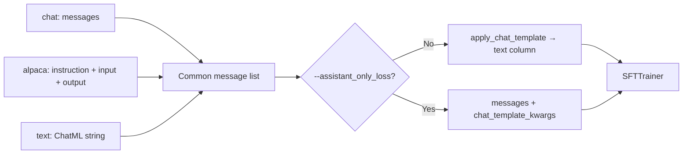

### ChatML 格式

Qwen 的原生格式。每個 JSONL 行（或 JSON 清單項目）都有一個 `messages` 鍵：

```json
{
  "messages": [
    {"role": "system", "content": "You are a helpful assistant."},
    {"role": "user", "content": "What is the capital of France?"},
    {"role": "assistant", "content": "The capital of France is Paris."}
  ]
}
```

系統訊息是選用的。需要 `--dataset_format chat`（預設）。這是 `--assistant_only_loss` 唯一接受的格式。

### Alpaca 格式

三個欄位：`instruction`、`input` 與 `output`。當 `input` 非空時，它會被接到 instruction 後面，中間空一行。

```json
{
  "instruction": "Translate the following to French.",
  "input": "Hello, how are you?",
  "output": "Bonjour, comment allez-vous ?"
}
```

需要 `--dataset_format alpaca`。如果你偏好這個結構，就請 ChatGPT 產生這三個鍵，而不是 `messages`。

### Text 格式

一個 `text` 欄位，內容是完整的 ChatML 對話。載入器會以 `<|im_end|>\n<|im_start|>` 分割，並從 user 開始交替 user / assistant 角色：

```json
{
  "text": "<|im_start|>user\nWhat is machine learning?<|im_end|>\n<|im_start|>assistant\nMachine learning is a subset of AI...<|im_end|>"
}
```

需要 `--dataset_format text`。

---

## 使用方式

### 基本訓練

在本機 JSONL 檔案上訓練，其中每一行都是一段 ChatML 對話：

```bash
python src/train.py \
  --model_id Qwen/Qwen3.5-4B \
  --dataset_path ./data/my_dataset.jsonl \
  --output_dir ./my-finetuned-model
```

`--dataset_path` 也接受目錄：其下所有 `*.jsonl` 檔案都會被遞迴找到、排序並合併。請注意，整個目錄樹可能會把重複的同一筆記錄合併進來，因此建議使用明確的訓練檔案或整理過的子目錄：

```bash
python src/train.py \
  --model_id Qwen/Qwen3.5-4B \
  --dataset_path ./data/ntnu \
  --output_dir ./models/ntnu
```

任何本機不存在的路徑都會被當成 Hugging Face 資料集名稱。

### 使用 Alpaca 資料集訓練

```bash
python src/train.py \
  --dataset_path ./data/alpaca_data.json \
  --dataset_format alpaca \
  --lr 2e-4 --epochs 5 \
  --output_dir ./alpaca-finetuned
```

### 從 Hugging Face Hub 訓練

```bash
python src/train.py \
  --dataset_path databricks/databricks-dolly-15k \
  --dataset_format alpaca \
  --max_seq_length 2048 \
  --output_dir ./dolly-finetuned
```

### 推論 — 互動模式（預設）

模型會保持在記憶體中，並在迴圈中讀取提示詞。在 `You:` 處輸入問題；用 `quit`、`exit`、`q` 或 Ctrl+C 停止。

```bash
# Fine-tuned model — interactive chat
python src/inference.py --mode finetuned --model_id Qwen/Qwen3.5-4B \
  --adapter_path ./models/ntnu/gpu-12gb-4b

# Base model — one prompt, then continue interactively
python src/inference.py --mode base --model_id Qwen/Qwen3.5-4B \
  --prompt "台灣師範大學的地址是什麼"

# Compare mode — each input shows base vs fine-tuned answers
python src/inference.py --mode compare --model_id Qwen/Qwen3.5-4B \
  --adapter_path ./models/ntnu/gpu-12gb-4b
```

### 推論 — 單次模式（`--no_interactive`）

這適合腳本與比較使用。使用這個旗標時**必須提供 `--prompt`**；`inference.py` 沒有內建的測試提示詞。

```bash
python src/inference.py --mode base --model_id Qwen/Qwen3.5-4B \
  --prompt "台灣師範大學的地址是什麼" --no_interactive

python src/inference.py --mode finetuned --model_id Qwen/Qwen3.5-4B \
  --adapter_path ./my-finetuned-model \
  --prompt "台灣師範大學的地址是什麼" --no_interactive
```

### 使用思考模式的推論

傳入 `--use_thinking True` 以啟用 Qwen3.5 的 `<think>` 標籤。除非設定了 `--no_interactive`，否則腳本之後會繼續進入互動迴圈。

```bash
python src/inference.py --mode finetuned --model_id Qwen/Qwen3.5-4B \
  --adapter_path ./my-finetuned-model \
  --use_thinking True \
  --prompt "台灣師範大學的地址是什麼"
```

### 檢視模型

```bash
# Configuration + tokenizer + weights (default)
python src/inspect_model.py --model_id Qwen/Qwen3.5-4B

# Configuration + tokenizer only (fast; skips the weight download)
python src/inspect_model.py --model_id Qwen/Qwen3.5-4B --no_load

# Quantized parameter counts
python src/inspect_model.py --model_id Qwen/Qwen3.5-4B --load_in_4bit True
```

### 檢視分詞器

```bash
# Split a Traditional Chinese sentence
python src/inspect_tokenizer.py --model_id Qwen/Qwen3.5-0.8B \
  --sentence "請告訴我國立台灣師範大學的具體位置在哪裡？"

# Look up a token string and an ID
python src/inspect_tokenizer.py --model_id Qwen/Qwen3.5-0.8B --token "台"
python src/inspect_tokenizer.py --model_id Qwen/Qwen3.5-0.8B --token_id 120573

# Tokenization only, no model download
python src/inspect_tokenizer.py --model_id Qwen/Qwen3.5-0.8B \
  --sentence "Hello world" --no_model
```

---

## 進階用法

### 自訂 LoRA 目標模組

把 LoRA 限制在注意力投影層以節省記憶體：

```bash
python src/train.py \
  --dataset_path ./data/train.jsonl \
  --model_id Qwen/Qwen3.5-4B \
  --target_modules q_proj,k_proj,v_proj,o_proj \
  --output_dir ./attention-only-lora
```

### 推送到 Hugging Face Hub

先登入，然後傳入兩個旗標：

```bash
huggingface-cli login

python src/train.py \
  --dataset_path ./data/train.jsonl \
  --output_dir ./my-adapter \
  --push_to_hub True \
  --hub_model_id your-username/qwen3-4b-finetuned
```

推送時 `--hub_model_id` 必填，而基準測試執行無法推送，因為它們不會匯出 adapter。

### 全精度 LoRA 與 QLoRA 的比較

QLoRA（4-bit）是 NVIDIA 的預設值。使用未量化的 LoRA：

```bash
python src/train.py \
  --dataset_path ./data/train.jsonl \
  --load_in_4bit False \
  --per_device_batch_size 1 \
  --output_dir ./fp-lora-finetuned
```

對 4B 模型而言，這大約需要 12 GB VRAM。若記憶體不足，請降低 micro-batch 或 `--max_seq_length`。

### 在訓練時啟用思考模式

如果你的資料集含有推理軌跡（`<think>...</think>`），請啟用支援思考的聊天範本。訓練仍然需要 ChatML 資料；這個旗標控制的是範本如何渲染目標。

```bash
python src/train.py \
  --dataset_path ./data/reasoning_dataset.jsonl \
  --use_thinking True \
  --output_dir ./thinking-finetuned
```

### 測量速度與記憶體用量

`--benchmark_steps` 會在 warmup 之後，對固定範圍的優化器步驟計時，且不會寫出 adapter。它很適合搭配 `--run_metrics` 進行可重現的比較：

```bash
python src/train.py \
  --model_id Qwen/Qwen3.5-4B \
  --dataset_path ./data/ntnu_dataset.jsonl \
  --device cuda --load_in_4bit True \
  --benchmark_steps 10 --benchmark_warmup_steps 3 \
  --run_metrics ./models/benchmarks/nf4-run.json \
  --output_dir ./models/benchmarks/nf4
```

指標 JSON 會記錄所有 CLI 參數、模型 revision 與注意力實作、資料集 SHA-256（單一檔案）、後端、裝置名稱、dtype、NF4 狀態、已安裝的套件版本、token 長度統計、各階段耗時、訓練器指標、最佳檢查點與驗證損失，以及基準測試範圍的結果。

---

## 重現性：原生 Windows 臺師大基準測試

四次 Windows 比較執行現在都以單純的 `src/train.py` 指令表示。旗標 `--gradient_checkpointing`、`--loss_type`、`--run_metrics`、`--group_by_length`、`--eval_each_epoch`、`--eval_batch_size`、`--assistant_only_loss`、`--benchmark_steps` 與 `--benchmark_warmup_steps` 都存在於 `train.py` 中。以下版本使用有效批次 16，並指定明確的指標路徑。

記錄的 revision 與指標位於 `models/ntnu/windows-comparison/observations.json`。那邊記錄的套件版本是過去的環境，**不是**安裝需求；請使用 `requirements-common.txt` 中的版本。

```bash
# Baseline: Qwen3.5-4B, NF4, batch 2 x accum 8, 3 epochs, 2048 tokens
python src/train.py \
  --model_id Qwen/Qwen3.5-4B --load_in_4bit True \
  --dataset_path ./data/ntnu_dataset.jsonl --device gpu \
  --num_epochs 3 --learning_rate 2e-4 --max_seq_length 2048 \
  --per_device_batch_size 2 --gradient_accum_steps 8 \
  --gradient_checkpointing True \
  --output_dir ./models/ntnu/windows-comparison/ntnu-win-baseline \
  --loss_type nll \
  --run_metrics ./models/ntnu/windows-comparison/ntnu-win-baseline/metrics.json

# Qwen3.5-4B short: batch 4 x accum 4, 2 epochs, 512 tokens
python src/train.py \
  --model_id Qwen/Qwen3.5-4B --load_in_4bit True \
  --dataset_path ./data/ntnu_dataset.jsonl --device gpu \
  --num_epochs 2 --learning_rate 2e-4 --max_seq_length 512 \
  --per_device_batch_size 4 --gradient_accum_steps 4 \
  --gradient_checkpointing True \
  --output_dir ./models/ntnu/windows-comparison/ntnu-win-qwen35-4b \
  --loss_type nll --group_by_length --eval_each_epoch --eval_batch_size 4 \
  --run_metrics ./models/ntnu/windows-comparison/ntnu-win-qwen35-4b/metrics.json

# Qwen3-4B-Instruct-2507 short: non-thinking model, same short settings
python src/train.py \
  --model_id Qwen/Qwen3-4B-Instruct-2507 --load_in_4bit True \
  --dataset_path ./data/ntnu_dataset.jsonl --device gpu \
  --num_epochs 2 --learning_rate 2e-4 --max_seq_length 512 \
  --per_device_batch_size 4 --gradient_accum_steps 4 \
  --gradient_checkpointing True \
  --output_dir ./models/ntnu/windows-comparison/ntnu-win-qwen3-4b \
  --loss_type nll --group_by_length --eval_each_epoch --eval_batch_size 4 \
  --run_metrics ./models/ntnu/windows-comparison/ntnu-win-qwen3-4b/metrics.json

# Qwen3.5-2B short: unquantized BF16, batch 8 x accum 2
python src/train.py \
  --model_id Qwen/Qwen3.5-2B --load_in_4bit False \
  --dataset_path ./data/ntnu_dataset.jsonl --device gpu \
  --num_epochs 2 --learning_rate 2e-4 --max_seq_length 512 \
  --per_device_batch_size 8 --gradient_accum_steps 2 \
  --gradient_checkpointing True \
  --output_dir ./models/ntnu/windows-comparison/ntnu-win-qwen35-2b \
  --loss_type nll --group_by_length --eval_each_epoch --eval_batch_size 8 \
  --run_metrics ./models/ntnu/windows-comparison/ntnu-win-qwen35-2b/metrics.json
```

只有在搭配 `--dataset_format chat`（預設）時才加入 `--assistant_only_loss`。若只要計時，請加上 `--benchmark_steps 10 --benchmark_warmup_steps 3`；在該模式下不會匯出 adapter。

---

## 輸出產物

一般訓練執行後，`output_dir` 包含：

```text
my-finetuned-model/
├── adapter_config.json          # LoRA rank, alpha, target modules, base model
├── adapter_model.safetensors    # Trained LoRA weights (tens of MB)
├── tokenizer.json               # Tokenizer vocabulary
├── tokenizer_config.json        # Tokenizer settings
├── chat_template.jinja          # Saved chat template (when the tokenizer has one)
├── training_args.bin            # Serialized trainer arguments
└── checkpoint-*/                 # Intermediate checkpoints if save_steps was reached
```

不會另外寫出**合併後的完整模型**。推論總是載入基礎模型並接上 adapter，這就是為什麼 `--model_id` 必須與訓練時使用的相同。檢查點目錄含有相同的 adapter 檔案，外加優化器／排程器狀態與訓練器狀態；`--adapter_path` 可以直接指向其中一個。

---

## 建議與最佳實踐

1. **從小開始。** 在完整訓練前，先執行 4B 煙霧指令或 CPU 煙霧指令。
2. **有效批次大小**是 `per_device_batch_size × gradient_accum_steps × num_gpus`。目標是 16–32。在單張 GPU 上，`2 × 8 = 16`。
3. **學習率** — `2e-4` 是穩健的 LoRA 預設值。少於 500 筆範例時，`1e-4` 能降低過擬合風險。
4. **注意評測損失。** 評測損失上升代表過擬合或學習率太高。啟用評測時，最佳檢查點會自動還原。
5. **序列長度**受 `SFTConfig.max_length` 限制。目前的訓練器設定沒有序列打包（sequence packing）。
6. **混合精度** — 啟動日誌會印出有效的 dtype。不支援的 BF16 會在可能的情況下退回 FP16；CPU 使用 FP32。MPS 訓練需要 PyTorch 2.5+ 才支援 FP16、2.6+ 才支援 BF16。
7. **資料品質勝過數量。** 500–1000 筆乾淨的範例，通常勝過 10,000 筆雜訊多的範例。
8. **推論時的 `model_id` 要與微調時使用的模型相符。**
9. **審慎選擇推論流程** — 探索時用互動迴圈，腳本則用 `--no_interactive` 搭配明確的 `--prompt`。
10. **在準備評分候選者之前，不要把評測提示詞放進訓練。**
11. **若是講求事實的任務，優先使用 `--assistant_only_loss`** 搭配 ChatML 資料，這樣模型就不會被訓練成把問題文字當成答案。
12. **生成的訓練資料要驗證兩次** — 用 JSONL 驗證器檢查結構，用官方來源查核事實。

---

## 疑難排解

| 問題 | 可能原因 | 解決方案 |
|---|---|---|
| `conda: command not found` | Conda 未在此 shell 中初始化 | 執行 `conda init bash` / `zsh`、重新開啟終端機，或在 Windows 上使用 Anaconda Prompt |
| `python -m pip: No module named pip` | Python 直譯器選錯了 | 執行 `conda activate ai` 並檢查 `python --version` |
| 明明有 GPU，訓練卻使用 CPU | PyTorch wheel 或驅動程式無法存取 GPU | 請依照[後端說明](#安裝並驗證後端)重新安裝，並傳入明確的 `--device` |
| `torch.cuda.is_available()` 在 ROCm 設定後仍為 `False` | 未安裝 AMD wheel 或 ROCm 版本不符 | 先安裝正確的 AMD wheel；`--backend rocm` 只會安裝其餘相依套件 |
| `--device gpu` 或明確指定的 GPU 不可用 | 要求的加速器對 PyTorch 不可見 | 確認 wheel 與驅動程式，或使用 `--device cpu` |
| `OutOfMemoryError` | micro-batch、序列長度或 LoRA 涵蓋範圍太大 | 先降低 `--max_seq_length`，再降低 `--per_device_batch_size`，然後改用僅注意力的 `--target_modules` |
| `KeyError: 'qwen3'` | Transformers 版本太舊 | 升級到 `transformers>=5.12.1` |
| NF4 在 CUDA 或 ROCm 上失敗 | bitsandbytes kernel 缺失或版本不符 | 讓 bitsandbytes 與 GPU 及 CUDA/ROCm 版本相符；使用 `--load_in_4bit False` |
| MPS 運算子不受支援 | PyTorch 缺少對應的 MPS kernel | 在啟動 Python 前設定 `PYTORCH_ENABLE_MPS_FALLBACK=1` |
| 在 MPS 或 XPU 上使用 `--load_in_4bit True` | 那些後端不支援 4-bit 載入 | 使用 `--load_in_4bit False` |
| Hub 下載／SSL 錯誤 | `SSL_CERT_FILE` / `REQUESTS_CA_BUNDLE` 設定損壞 | `train.py` 與 `inference.py` 會在啟動時修復這些問題；`certifi` 已宣告在 `requirements-common.txt` 中 |
| 訓練損失為 NaN | 學習率太高或 dtype 有問題 | 降低 `--learning_rate` 或使用 `--torch_dtype bfloat16` |
| 模型一直重複同一句話 | 過擬合或溫度太低 | 減少 `--num_epochs` 或提高 `--temperature` |
| JSONL 驗證器回報錯誤列 | ChatGPT 加了說明文字、程式碼圍欄或錯誤的角色 | 移除 markdown 圍欄，並用提示詞 2 重新產生 |
| 本機檔案卻從 Hub 載入 | `dataset_path` 在本機不存在 | 請使用 `./data/train.jsonl`，不要用到拼錯的路徑 |
| `A valid --prompt is required when using --no_interactive` | `--no_interactive` 一律需要提示詞 | 傳入 `--prompt "..."` 或移除 `--no_interactive` |
| `--assistant_only_loss requires --dataset_format chat` | 旗標組合無效 | 使用 ChatML 資料或移除該旗標 |
| `Row N has no complete assistant target` | assistant 回答被長度上限截斷 | 提高 `--max_seq_length` 或縮短該筆範例 |
| `--eval_each_epoch requires a positive --test_split` | 未設定評測資料 | 設定 `--test_split 0.05` 或移除 `--eval_each_epoch` |
| `LoRA adapter not found` | `--adapter_path` 不正確 | 指向輸出目錄，或含有 `adapter_config.json` 的 `checkpoint-*` 資料夾 |
| `The output belongs to a different evaluation run` | 重用了不同設定的結果檔案 | 使用新的 `--output` 路徑，或沿用原本的模型／adapter／後端設定 |
| 從目錄訓練時找不到 `.jsonl` 檔案 | 目錄掃描只比對 `*.jsonl`，不比對 `*.json` | 轉換檔案，或直接把檔案路徑傳給 `--dataset_path` |

---

## 授權條款

本專案採用 [MIT License](LICENSE) 授權。Qwen3 / Qwen3.5 模型依其在 Hugging Face 上的各自授權條款發布（上方列出的模型使用 Apache 2.0）。

繁體中文文件：[README.zh-Hant.md](README.zh-Hant.md)
